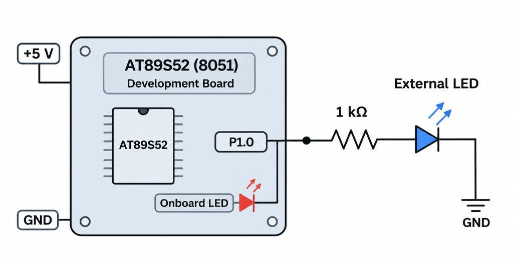

# Continuous Assessment Test 2 (CAT2)

- **Date:** 20/07/2026 (Week 2)
- **Experiment:** Bare-Metal LED Blinking Using AT89S52 Microcontroller
- **Task Documentation:** [TASK2B Documentation](TASK2B/README.md)

