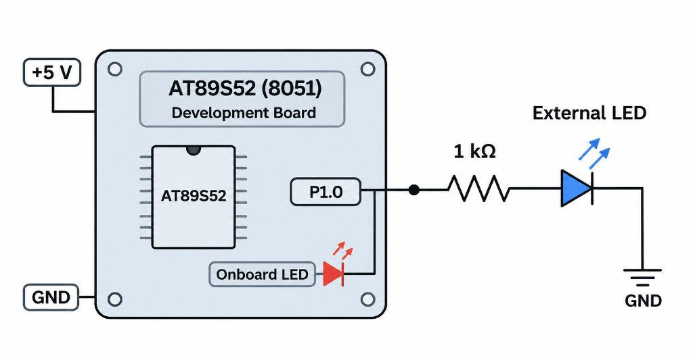

# Continuous Assessment Test 2 (CAT2) — TASK2B

### EXP
Continuous Assessment Test 2 (CAT2) / Continuous Lab Evaluation-2

### DATE
20/07/2026 (Week 2)

### NAME OF EXP
Bare-Metal LED Blinking Using AT89S52 Microcontroller  
*(Official Course Topic: 8051 Tool Chain setup – Development Board – AT89S52: Bare-Metal LED Blink)*

---

### HARDWARE SETUP / PLATFORM

#### Confirmed Platform Details
- **Microcontroller**: Atmel / Microchip AT89S52 (8051 architecture)
- **Board**: AT89S52 Development Board (exact board manufacturer/model unconfirmed)
- **Clock Frequency**: 11.0592 MHz crystal oscillator reported (note: software delay loop comment mentions 12 MHz calculation)
- **Reported User LED Pin**: P1.0 (reported by student)
- **Software Toolchain**: Keil µVision IDE / C51 Compiler and Programiz (online C programming editor)
- **Physical Programming Device**: Not confirmed (hardware ISP programmer model to be confirmed)
- **LED Electrical Configuration**: Active-low configuration assumed by firmware logic

> [!NOTE]
> **Toolchain Roles vs Hardware Programmers:** Keil µVision is an integrated development environment (IDE) and compiler toolchain, and Programiz is an online code editor/compiler. Neither is a hardware device programmer. Firmware flashing requires a dedicated physical hardware programmer (such as an ISP programmer or USB-to-UART/SPI bootloader), which remains unconfirmed.

> [!IMPORTANT]
> **Byte-Wide Port Operation:** The firmware implementation in `main.c` assigns values directly to the full 8-bit Port 1 register (`P1 = 0x00;` and `P1 = 0xFF;`). This drives all eight pins of Port 1 (P1.0 through P1.7) simultaneously, rather than selectively masking or bit-addressing only P1.0 (`P1^0`).

#### Hardware Bring-Up Sheet (Question Paper Deliverables)

| Parameter | Specification / Student Entry Status |
| :--- | :--- |
| **MCU** | AT89S52 |
| **CPU Core** | 8-bit 8051 (MCS-51 Architecture) |
| **Operating Voltage** | Not confirmed (Standard AT89S52 nominal VCC is 5.0 V; board power rails unverified with DMM) |
| **Debug Interface** | Not confirmed (AT89S52 supports In-System Programming [ISP]; no on-chip JTAG debug interface) |
| **LED GPIO Port** | Port 1 (`P1`, SFR Address `0x90`) |
| **LED GPIO Pin** | P1.0 reported by student (firmware drives entire Port 1: P1.0–P1.7) |
| **LED Active State** | Active-Low (`0` = LED ON, `1` = LED OFF) |
| **LED Frequency (Hz)** | Intended ~1 Hz (nominal 500 ms ON / 500 ms OFF; physical output unverified) |

---

### TASK NO
TASK2B

#### Task Description (According to CAT2 Question Paper)
As specified in the official Continuous Lab Evaluation-2 question paper:
- **Core Activity**: Compile a minimal bare-metal Embedded C program, program the AT89S52 microcontroller, and control an LED by directly accessing the microcontroller's memory-mapped GPIO registers.
- **Mandatory Constraint**: Strictly NO to using Arduino APIs, HAL libraries, or RTOS services.
- **Required Steps**:
  1. **Hardware Board Bring-Up**:
     - Identify the microcontroller, programmer interface, power source, user LED, and relevant GPIO pin.
     - Verify the development board power rails using a digital multimeter.
     - Identify the LED GPIO port and pin from the schematic/datasheet.
     - Establish communication between the host computer and target MCU.
  2. **Bare-Metal LED Blink**:
     - Configure the LED GPIO as an output using direct register access.
     - Implement a delay mechanism using a simple software loop.
     - Blink the LED at approximately 1 Hz (50% duty cycle).
  3. **Custom Library Function**: Develop a custom function for delay functionality (`delay(unsigned int msec)`).

---

### Circuit Diagram

*Circuit diagram placeholder. Hardware schematic and breadboard/development board wiring diagram to be confirmed and added.*



---

### Core Logic / Pseudocode / Code Base

#### 1. Main Objective
Implement a bare-metal 8051 control routine in C to blink an LED connected to Port 1 by directly writing to the memory-mapped Special Function Register (SFR) `P1` without HAL abstractions, operating system services, or external drivers.

#### 2. GPIO Operation
In the 8051 architecture, I/O ports are memory-mapped registers located in the Special Function Register (SFR) space. Port 1 is mapped to byte address `0x90`, accessible via the `#include <reg51.h>` header.
- Writing `0x00` sets all pins of Port 1 (P1.0–P1.7) to logic LOW (0 V).
- Writing `0xFF` sets all pins of Port 1 (P1.0–P1.7) to logic HIGH (~5 V).
Because the existing firmware writes byte-wide to `P1`, all 8 pins transition together.

#### 3. Custom Software Delay
The software delay is implemented using nested `for` loops in `delay(unsigned int msec)`:
- The outer loop iterates `msec` times.
- The inner loop executes 127 empty iterations (`for (j = 0; j < 127; j++)`), intended to consume CPU machine cycles to produce roughly a 1-millisecond delay at a 12 MHz clock frequency.

#### 4. Main Algorithm
1. Enter an infinite superloop (`while(1)`).
2. Drive Port 1 LOW (`P1 = 0x00`), sinking current and turning the active-low LED ON.
3. Call `delay(500)` to hold the ON state for roughly 500 ms.
4. Drive Port 1 HIGH (`P1 = 0xFF`), cutting current flow and turning the active-low LED OFF.
5. Call `delay(500)` to hold the OFF state for roughly 500 ms.
6. Repeat indefinitely, producing an intended period of 1000 ms (~1 Hz blink rate).

#### 5. Pseudocode
```text
FUNCTION delay(msec):
    FOR i FROM 0 TO msec - 1 DO
        FOR j FROM 0 TO 126 DO
            // Waste instruction machine cycles (approx. 1 ms per outer iteration at 12 MHz)
        ENDFOR
    ENDFOR
ENDFUNCTION

FUNCTION main():
    WHILE TRUE DO
        P1 = 0x00        // Drive all Port 1 pins LOW -> Active-low LEDs ON
        CALL delay(500)  // Wait approximately 500 ms
        P1 = 0xFF        // Drive all Port 1 pins HIGH -> Active-low LEDs OFF
        CALL delay(500)  // Wait approximately 500 ms
    ENDWHILE
ENDFUNCTION
```

#### 6. Code Implementation (`main.c`)
```c
#include <reg51.h>

// A simple software delay function
void delay(unsigned int msec) 
{
    unsigned int i, j;
    for (i = 0; i < msec; i++) {
        for (j = 0; j < 127; j++) {
            // This inner loop takes roughly 1 millisecond at 12 MHz
        }
    }
}

void main() 
{
    while(1) 
    {
        P1 = 0x00;      // Turn all Port 1 LEDs ON (Active-low)
        delay(500);     // Wait for roughly 500 milliseconds (half a second)
        
        P1 = 0xFF;      // Turn all Port 1 LEDs OFF
        delay(500);     // Wait for roughly 500 milliseconds
    }
}
```

#### 7. Active-Low LED Operation
- **Circuit Behavior**: In an active-low LED circuit, the LED anode is tied to the positive supply rail (VCC, 5 V) through a current-limiting resistor, while the cathode connects to the microcontroller GPIO pin.
- **Logic LOW (`P1 = 0x00`)**: When the pin outputs 0 V, a potential difference exists across the LED, allowing current to flow from VCC into the pin (current sinking). This forward-biases the diode, turning the LED **ON**.
- **Logic HIGH (`P1 = 0xFF`)**: When the pin outputs logic 1 (~5 V), both terminals of the LED circuit are at approximately equal potential. No forward current can flow, turning the LED **OFF**.

---

### INFERENCE

1. **Direct GPIO Register Access**:
   The experiment illustrates fundamental bare-metal embedded programming on the 8051 (MCS-51) architecture. Writing directly to the memory-mapped Special Function Register `P1` (SFR `0x90`) provides immediate, low-overhead hardware control without the latency or memory footprint of HAL libraries, Arduino abstractions, or RTOS drivers.

2. **Bare-Metal Embedded C Workflow**:
   The program executes directly from the reset vector (`0x0000`) configured by `STARTUP.A51` into `main()`, highlighting the minimal runtime required by 8-bit microcontrollers in IoT edge nodes.

3. **Alternating Output State Control**:
   By toggling Port 1 between `0x00` and `0xFF`, the microcontroller switches between current-sinking and high-state conditions, achieving continuous LED blinking through alternating output states.

4. **Nominal 1 Hz Blinking**:
   The firmware establishes an intended 500 ms ON time and 500 ms OFF time, targeting a total period of 1000 ms (1 Hz frequency, 50% duty cycle).

5. **Software Delay Limitations**:
   Software delay loops execute blocking CPU cycles, preventing the processor from performing other computations or entering low-power sleep modes. Furthermore, software loop timing is sensitive to clock frequency discrepancies (e.g., 11.0592 MHz actual crystal vs. 12 MHz assumed in the loop calculation, causing an approximate ~8% timing deviation) and Keil C51 compiler optimization levels. For deterministic timing in production IoT systems, hardware timer peripherals (Timer 0 / Timer 1) should be utilized.

6. **Hardware Verification Status**:
   - **Intended Behavior**: Verified through static code analysis, logic inspection, and Keil project compilation to Intel HEX format (`Objects/led_test.hex`).
   - **Physical Hardware Observations**: The actual physical blink frequency, multi-meter voltage rail measurements, and physical development board bring-up have **not yet been confirmed** on live laboratory hardware.
