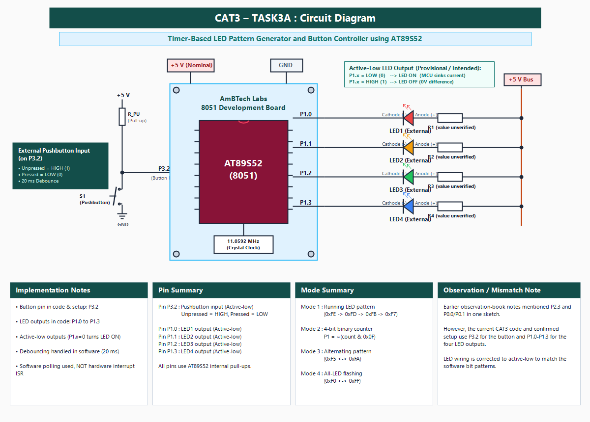

### EXP
CAT3

### DATE
27/07/2026

### NAME OF EXP
Timer-Based LED Pattern Generator and Button Interrupt Controller

### HARDWARE SETUP / PLATFORM
- **Microcontroller:** AT89S52 (8051 architecture)
- **Board:** AmBTech Labs 8051 Development Board (11.0592 MHz clock, nominal 5 V)
- **GPIO & Peripherals:** Pushbutton on P3.2 (`sbit BTN = P3^2`); four external active-low LEDs on P1.0–P1.3 with series resistors.
- **Port Characteristics:** Port 1 and Port 3 feature internal pull-ups.
- **Software:** Keil µVision (IDE/compiler) and ProgISP v1.72 (flasher).

### TASK NO
TASK3A — Four LED operating modes controlled by one pushbutton using software polling and debouncing.

### Circuit Diagram


Four external active-low LEDs connect to P1.0–P1.3, and the pushbutton on P3.2 switches to GND with active-low press detection.

### Core Logic / Pseudocode / Code Base
1. Wait for initial press (`mode = 0 → 1`).
2. Run active mode; `delay_check()` polls button every 10 ms.
3. Advance `mode = (*mode % 4) + 1` with 20 ms debouncing.
4. **Mode 1:** Running LED (`0xFE`, `0xFD`, `0xFB`, `0xF7`).
5. **Mode 2:** 4-bit counter `P1 = ~(count & 0x0F)`.
6. **Mode 3:** Alternate `0xF5` and `0xFA`.
7. **Mode 4:** All-LED flash (`0xF0` and `0xFF`).

*Note: Execution uses software polling, not a hardware interrupt ISR or timer. Pins P3.2 and P1.0–P1.3 supersede earlier sketch notes.*

```c
#include <reg51.h>

sbit BTN = P3^2;

void delay_ms(unsigned int ms) {
    unsigned int i, j;
    for (i = 0; i < ms; i++)
        for (j = 0; j < 120; j++);
}

unsigned char check_button(void) {
    if (BTN == 0) {
        delay_ms(20);
        if (BTN == 0) {
            while (BTN == 0);
            delay_ms(20);
            return 1;
        }
    }
    return 0;
}

void delay_check(unsigned int ms, unsigned char *mode) {
    unsigned int i;
    for (i = 0; i < ms / 10; i++) {
        if (check_button()) {
            *mode = (*mode % 4) + 1;
            return;
        }
        delay_ms(10);
    }
}
```

### INFERENCE
1. The pushbutton on P3.2 reliably switches among all four LED modes using software polling and 20 ms debouncing without hardware interrupts.
2. Active-low Port 1 register manipulation produces running, counter, alternating, and flashing visual sequences.
3. Polling inside `delay_check()` maintains responsiveness during pattern execution while preserving software timing.
