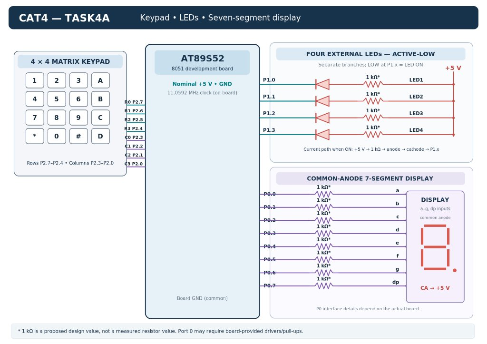

### EXP
CAT4

### DATE
03/08/2026 (Week 4)

### NAME OF EXP
Matrix Keypad, 7-Segment Display, and Multi-LED Controller

### HARDWARE SETUP / PLATFORM
- **Microcontroller:** AT89S52 (8051 architecture)
- **Board:** AmBTech Labs 8051 Development Board (11.0592 MHz clock, nominal 5 V)
- **Keypad:** 4×4 matrix keypad on Port 2 (rows R0–R3 on P2.7–P2.4, columns C0–C3 on P2.3–P2.0).
- **Outputs:** Common-anode 7-segment display on P0.0–P0.7; four active-low LEDs on P1.0–P1.3 with proposed 1 kΩ resistors (board circuitry unverified).
- **Software:** Keil µVision (IDE/compiler) and ProgISP v1.72 (flasher).

### TASK NO
TASK4A — Scan a 4×4 matrix keypad to display pressed digits on a 7-segment display and trigger corresponding LED operating modes.

### Circuit Diagram


A 4×4 keypad interfaces to Port 2, driving a 7-segment display on Port 0 and four active-low LEDs on P1.0–P1.3.

### Core Logic / Pseudocode / Code Base
1. Initialize ports (`P0 = P1 = P2 = 0xFF`) and display digit `'0'`.
2. Scan keypad by grounding rows (P2.7–P2.4) and reading columns (P2.3–P2.0).
3. Display detected numeric keys ('0'–'9') on the 7-segment display via `P0`.
4. Trigger LED commands via `led_control(key)`:
   - **Keys 1–4:** Individual LEDs (`0xFE`, `0xFD`, `0xFB`, `0xF7`).
   - **Key 5:** Running LED sequence.
   - **Key 6:** Alternating pattern (`0xF5` <-> `0xFA`).
   - **Key 7:** 4-bit binary counter (`P1 = ~(count & 0x0F)`).
   - **Key 8:** All-LED flash (`0xF0` <-> `0xFF`).
   - **Key 9:** All LEDs OFF (`0xFF`).
   - **Key 0:** Reset display to `'0'` and LEDs OFF.

```c
#include <reg51.h>

int keypad_scan(void) {
    static const int keypad[4][4] = {
        {'1', '2', '3', 'A'}, {'4', '5', '6', 'B'},
        {'7', '8', '9', 'C'}, {'*', '0', '#', 'D'}
    };
    static const unsigned char rowPin[4] = {7, 6, 5, 4};
    static const unsigned char colPin[4] = {3, 2, 1, 0};
    int row, col;
    for (row = 0; row < 4; row++) {
        P2 |= 0xF0;
        P2 &= ~(1 << rowPin[row]);
        for (col = 0; col < 4; col++) {
            if ((P2 & (1 << colPin[col])) == 0)
                return keypad[row][col];
        }
    }
    return -1;
}

void display_digit(unsigned char value) {
    static const unsigned char seg_code[] = {
        0xC0, 0xF9, 0xA4, 0xB0, 0x99, 0x92, 0x82, 0xF8, 0x80, 0x90
    };
    if (value >= '0' && value <= '9')
        P0 = seg_code[value - '0'];
}
```

#### Alternative Implementation — joshi.c
- **LED Polarity:** `main.c` uses active-low logic (`0xFE`, `0xFD`, `0xF5`), whereas `joshi.c` uses active-high drive (`1 << (key - 1)`).
- **Seven-Segment Encoding:** `main.c` targets common-anode displays (`0xC0` for 0), while `joshi.c` implements common-cathode codes (`0x3F` for 0).
- **Keypad Mapping:** `main.c` returns ASCII characters (`'1'`, `'A'`), whereas `joshi.c` returns direct integer modes (`1`, `2`, `3`).
- **Key Capture (`keypad_wait`):** `joshi.c` introduces `keypad_wait(n)`, polling `keypad_scan()` in 10 ms increments for responsive mode switching during running patterns.
- *Status:* Provided for reference only; `main.c` remains the official laboratory implementation.

<details>
<summary>View Alternative joshi.c Code</summary>

```c
#include <reg51.h>


/*-----------------------------------------
    Function Prototypes
-----------------------------------------*/

void delayms(unsigned int duration);

int keypad_scan(void);
int keypad_wait(unsigned int n);

void display_digit(int value);

void led_control(unsigned char key);

void running_led(void);
void alternate_led(void);
void binary_counter(void);
void blink_all(void);

void led_pattern(unsigned char pattern);

/*-----------------------------------------
    Global Variables
-----------------------------------------*/

int mode = -1;


/*-----------------------------------------
    Main Program
-----------------------------------------*/

void main(void)
{
    int key;

    // Initial blank state
    P0 = 0x00;      // 7 segment OFF
    P1 = 0xFF;      // LEDs ON

    while(1)
    {
        display_digit(mode);

        switch(mode)
        {
            case 1:
            case 2:
            case 3:
            case 4:
                led_control(mode);
                break;

            case 5:
                running_led();
                break;

            case 6:
                alternate_led();
                break;

            case 7:
                binary_counter();
                break;

            case 8:
                blink_all();
                break;
	case 9:
 		   led_pattern(0x00);
    		   break;

	case 0:
    		led_pattern(0x0F);
    		break;
            default:

                key = keypad_scan();

                if(key != -1)
                    mode = key;

                break;
        }
    }
}


/*-----------------------------------------
    Delay Function
-----------------------------------------*/

void delayms(unsigned int duration)
{
    unsigned int i, j;

    for(i = 0; i < duration; i++)
    {
        for(j = 0; j < 350; j++);
    }
}


/*-----------------------------------------
    Keypad Scan Function
-----------------------------------------*/

int keypad_scan(void)
{
    static const int keypad[4][4] =
    {
        {1, 2, 3, 4},
        {5, 6, 7, 8},
        {9, 0, -1, -1},
        {-1, -1, -1, -1}
    };

    static const unsigned char rowPin[4] = {7, 6, 5, 4};
    static const unsigned char colPin[4] = {3, 2, 1, 0};

    int row, col;


    for(row = 0; row < 4; row++)
    {
        // Set all rows HIGH
        P2 |= 0xF0;

        // Set current row LOW
        P2 &= ~(1 << rowPin[row]);

        // Check columns
        for(col = 0; col < 4; col++)
        {
            if((P2 & (1 << colPin[col])) == 0)
            {
                return keypad[row][col];
            }
        }
    }

    return -1;
}


/*-----------------------------------------
    Keypad Wait Function
-----------------------------------------*/

int keypad_wait(unsigned int n)
{
    unsigned int i;
    int key;

    for(i = 0; i < n; i++)
    {
        key = keypad_scan();

        if(key != -1)
        {
            return key;
        }

        delayms(10);
    }

    return -1;
}


/*-----------------------------------------
    Seven Segment Display Function
-----------------------------------------*/

void display_digit(int value)
{
    static const unsigned char digit[10] =
    {
        0x3F,   // 0
        0x06,   // 1
        0x5B,   // 2
        0x4F,   // 3
        0x66,   // 4
        0x6D,   // 5
        0x7D,   // 6
        0x07,   // 7
        0x7F,   // 8
        0x6F    // 9
    };

    if(value >= 0 && value <= 9)
    {
        P0 = digit[value];
    }
    else
    {
        P0 = 0x00;
    }
}


/*-----------------------------------------
    LED Mode Functions
-----------------------------------------*/

void led_control(unsigned char key)
{
    int new_key;

    P1 = (1 << (key - 1));

    while(1)
    {
        new_key = keypad_wait(1);

        if(new_key != -1)
        {
            mode = new_key;
            return;
        }
    }
}


void running_led(void)
{
    int i;
    int key;

    while(1)
    {
        for(i = 1; i <= 4; i++)
        {
            P1 = (1 << (i - 1));

            key = keypad_wait(50);

            if(key != -1)
            {
                mode = key;
                return;
            }
        }
    }
}


void alternate_led(void)
{
    static const unsigned char pattern[2] = {0x05, 0x0A};

    int i;
    int key;

    while(1)
    {
        for(i = 0; i < 2; i++)
        {
            P1 = pattern[i];

            key = keypad_wait(50);

            if(key != -1)
            {
                mode = key;
                return;
            }
        }
    }
}


void binary_counter(void)
{
    int i;
    int key;

    while(1)
    {
        for(i = 0; i <= 15; i++)
        {
            P1 = i;

            key = keypad_wait(50);

            if(key != -1)
            {
                mode = key;
                return;
            }
        }
    }
}


void blink_all(void)
{
    static const unsigned char pattern[2] = {0x0F, 0x00};

    int i;
    int key;

    while(1)
    {
        for(i = 0; i < 2; i++)
        {
            P1 = pattern[i];

            key = keypad_wait(50);

            if(key != -1)
            {
                mode = key;
                return;
            }
        }
    }
}

void led_pattern(unsigned char pattern)
{
    int key;

    P1 = pattern;

    while(1)
    {
        key = keypad_wait(1);

        if(key != -1)
        {
            mode = key;
            return;
        }
    }
}
```

</details>

### INFERENCE
1. Matrix keypad scanning using row-grounding and column-polling efficiently reads 16 keys using 8 GPIO pins on Port 2.
2. Port 0 directly decodes common-anode 7-segment numerals while Port 1 drives active-low multi-mode LED patterns.
3. Embedded polling inside active pattern routines maintains keypad responsiveness during pattern execution.
