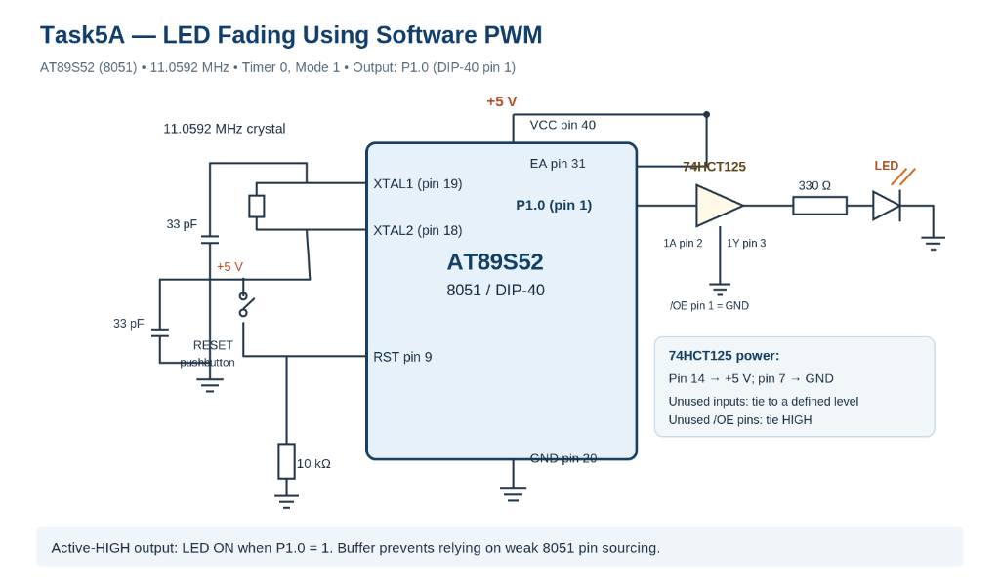

# Task5A — LED Fading Using Software PWM

## Aim
To generate a software PWM signal using Timer 0 interrupts on the AT89S52 microcontroller and vary an external LED's brightness by gradually increasing and decreasing the duty cycle.

---

## Circuit Diagram



### Laboratory Setup & Connection Details
In the actual laboratory environment:
- An **AT89S52 development board** was used, which incorporates an onboard crystal oscillator and onboard power-on/manual reset circuitry.
- **No separate external crystal connections** were wired on the breadboard during the experiment.
- The external LED interface forms an active-HIGH configuration:
  $$\text{P1.0 (Physical Pin 1)} \longrightarrow 330\,\Omega\text{ resistor} \longrightarrow \text{LED Anode} \longrightarrow \text{LED Cathode} \longrightarrow \text{Common GND}$$
- The **$330\,\Omega$ resistor** is the standard proposed schematic current-limiting value for active-HIGH operation; it was not experimentally measured.
- The microcontroller's ground and the external LED return path share a common GND reference on the development board.

---

## Components Required

- **AT89S52 Microcontroller Development Board** (with integrated crystal oscillator and reset circuit)
- **External Light Emitting Diode (LED)**
- **Current-Limiting Resistor** ($330\,\Omega$ schematic nominal)
- **Breadboard & Jumper Wires**
- **Regulated DC Power Supply** (for the development board)
- **Keil µVision IDE** (for Embedded C compiling and firmware generation)

---

## Pin Configuration

| Pin / Peripheral | Physical Location | Function / Purpose |
|---|---|---|
| **P1.0** | Pin 1 (DIP-40) | Active-HIGH Software PWM Output to external LED |
| **GND** | Pin 20 (DIP-40) | Common ground reference |
| **Timer 0** | Internal Peripheral | Generates periodic hardware interrupts for PWM base timing |

In the Embedded C source code, the pin mapping is defined as:
```c
sbit LED = P1^0;
```

---

## Timer Configuration

Timer 0 is configured in 16-bit Timer Mode with interrupts enabled using the following hardware registers:

```c
TMOD = 0x01;
TH0 = 0xFF;
TL0 = 0xF7;

ET0 = 1;
EA = 1;
TR0 = 1;
```

### Register Functions:
- **`TMOD = 0x01`**: Configures Timer 0 as a 16-bit timer (Mode 1), gated by software (`GATE = 0`, internal clock source `C/T = 0`).
- **`TH0 = 0xFF` & `TL0 = 0xF7`**: Preload the 16-bit counter register with `0xFFF7` (65,527 decimal) to establish a short tick period before overflow.
- **`ET0 = 1`**: Enables the Timer 0 overflow interrupt (`IE.1`).
- **`EA = 1`**: Enables global interrupts (`IE.7`).
- **`TR0 = 1`**: Sets the Timer 0 run control bit (`TCON.4`) to start counting.

---

## Timer Calculations

Assuming the standard 11.0592 MHz crystal frequency referenced in laboratory observation notes:

1. **Machine-Cycle Period:**
   $$T_{\text{machine}} = \frac{12}{11.0592\text{ MHz}} \approx 1.085\,\mu\text{s}$$

2. **Timer Preload Value:**
   $$\text{Preload} = 0\text{xFFF7}_{16} = 65527_{10}$$

3. **Counts to Overflow:**
   $$65536 - 65527 = 9\text{ machine cycles}$$

4. **Nominal Timer Tick Interval:**
   $$T_{\text{tick}} = 9 \times 1.085\,\mu\text{s} \approx 9.766\,\mu\text{s}$$

5. **Ideal PWM Base Period (100 Counts per PWM cycle):**
   $$T_{\text{PWM}} = 100 \times 9.766\,\mu\text{s} \approx 0.977\text{ ms}$$

6. **Ideal PWM Frequency:**
   $$f_{\text{PWM}} = \frac{1}{0.977\text{ ms}} \approx 1.024\text{ kHz}$$

> [!NOTE]
> **Important:** The calculated $1.024\text{ kHz}$ is an ideal theoretical estimate. Real-world frequency is subject to interrupt-entry latency, register reloading execution cycles inside the ISR (`TH0 = 0xFF; TL0 = 0xF7;`), context saving, and C compiler ISR overhead. This value is a theoretical derivation and was not experimentally measured.

---

## PWM Working Principle

Pulse Width Modulation (PWM) regulates average delivered power to the LED by modulating the ratio of ON time ($T_{\text{ON}}$) relative to total period ($T_{\text{period}} = T_{\text{ON}} + T_{\text{OFF}}$) at a repetition rate faster than the human eye's persistence of vision:

$$\text{Duty Cycle (\%)} = \left(\frac{T_{\text{ON}}}{T_{\text{ON}} + T_{\text{OFF}}}\right) \times 100$$

### Intended Duty Cycle vs. LED Brightness

| Duty Cycle | Intended Perceived Brightness |
|:---:|:---:|
| **0%** | OFF |
| **25%** | Dim |
| **50%** | Medium |
| **75%** | Bright |
| **100%** | Fully ON |

*Note: In the actual implementation code, duty cycle transitions in discrete increments of 10% (from 0% up to 100%) rather than 25% steps.*

---

## Global Variables in Source Code

The firmware maintains four tracking variables:

```c
unsigned char pwm_count = 0;
unsigned char duty = 0;
unsigned char fade_count = 0;
unsigned char direction = 1;
```

- **`pwm_count`**: Sub-period accumulator running from 0 to 99, representing the current tick within a 100-step PWM cycle.
- **`duty`**: Specifies the threshold count (0 to 100) determining how many counts during the PWM cycle the LED output remains HIGH.
- **`fade_count`**: Tracks the number of completed 100-count PWM periods to pace the visual fading transition.
- **`direction`**: Fading direction flag; `1` denotes increasing brightness (fading in), while `0` denotes decreasing brightness (fading out).

---

## Core Program Logic

### 1. Software PWM Output Generation
On every Timer 0 interrupt, the pin state is updated based on whether the current count is within the active duty window:

```c
if(pwm_count < duty)
{
    LED = 1;
}
else
{
    LED = 0;
}
```

### 2. PWM Period Tracking & Timing Control
The PWM counter advances on every tick. Upon completing 100 counts, it resets and flags a completed cycle:

```c
pwm_count++;

if(pwm_count >= 100)
{
    pwm_count = 0;
    fade_count++;
}
```

### 3. Fading Rate and Direction Switching
After 10 full PWM cycles (`fade_count >= 10`), the duty cycle is adjusted by 10%. The direction inverts upon hitting boundaries:

```c
if(direction == 1)
{
    duty += 10;

    if(duty >= 100)
    {
        direction = 0;
    }
}
else
{
    duty -= 10;

    if(duty == 0)
    {
        direction = 1;
    }
}
```

The duty cycle smoothly cycles through:
$$0\% \longrightarrow 10\% \longrightarrow 20\% \longrightarrow \dots \longrightarrow 100\% \longrightarrow 90\% \longrightarrow \dots \longrightarrow 0\%$$

---

## Algorithm & Pseudocode

### Algorithm
1. **Initialize** global variables: `pwm_count = 0`, `duty = 0`, `fade_count = 0`, `direction = 1`.
2. **Configure Timer 0** in 16-bit Mode 1 with preload `0xFFF7`.
3. **Enable Interrupts** globally (`EA = 1`) and for Timer 0 (`ET0 = 1`), then start the timer (`TR0 = 1`).
4. **Enter an infinite idle loop** in `main()`, leaving all operations to the interrupt service routine.
5. **Inside Timer 0 ISR (`timer0_ISR`)**:
   - Reload preload values `TH0 = 0xFF` and `TL0 = 0xF7`.
   - If `pwm_count < duty`, set `LED = 1`; otherwise set `LED = 0`.
   - Increment `pwm_count`.
   - When `pwm_count` reaches 100:
     - Reset `pwm_count = 0`.
     - Increment `fade_count`.
     - When `fade_count` reaches 10:
       - Reset `fade_count = 0`.
       - If `direction == 1`, add 10 to `duty`; if `duty >= 100`, switch `direction = 0`.
       - If `direction == 0`, subtract 10 from `duty`; if `duty == 0`, switch `direction = 1`.
6. **Repeat** continuously on hardware timer events.

### Pseudocode
```text
BEGIN PROGRAM
    SET pwm_count = 0
    SET duty = 0
    SET fade_count = 0
    SET direction = 1
    
    FUNCTION main():
        CONFIGURE TMOD = 0x01         // Timer 0, 16-bit Mode 1
        LOAD TH0 = 0xFF, TL0 = 0xF7   // Preload for 9 machine cycles
        ENABLE Timer0_Interrupt (ET0 = 1)
        ENABLE Global_Interrupts (EA = 1)
        START Timer0 (TR0 = 1)
        
        WHILE TRUE:
            // Non-blocking idle loop
        END WHILE
    END FUNCTION

    INTERRUPT ROUTINE timer0_ISR():
        RELOAD TH0 = 0xFF
        RELOAD TL0 = 0xF7
        
        // PWM output comparison
        IF pwm_count < duty THEN
            SET LED = HIGH
        ELSE
            SET LED = LOW
        END IF
        
        INCREMENT pwm_count
        
        IF pwm_count >= 100 THEN
            SET pwm_count = 0
            INCREMENT fade_count
            
            IF fade_count >= 10 THEN
                SET fade_count = 0
                
                IF direction == 1 THEN
                    duty = duty + 10
                    IF duty >= 100 THEN
                        direction = 0
                    END IF
                ELSE
                    duty = duty - 10
                    IF duty == 0 THEN
                        direction = 1
                    END IF
                END IF
            END IF
        END IF
    END INTERRUPT ROUTINE
END PROGRAM
```

---

## Expected Output

When loaded into the AT89S52 microcontroller, the firmware is intended to produce a visible fading effect on the external LED connected to P1.0. As the duty cycle increments from 0% to 100% in 10% steps, perceived brightness steadily increases. Upon reaching 100%, the duty cycle decrements back to 0%, gradually dimming the LED until it turns fully off, repeating cyclically.

---

## Important Observations

- **16-bit Mode 1 Operation**: Timer 0 is configured in 16-bit manual reload mode.
- **Periodic Interrupt Execution**: Timer overflow automatically invokes `timer0_ISR` (interrupt vector 1).
- **Software-Synthesized PWM**: Pulse width modulation is entirely synthesized in software through counter comparisons inside the ISR.
- **Dedicated Port Output**: Pin P1.0 is driven active-HIGH to control the external LED.
- **100-Step Resolution**: The PWM sub-counter divides each PWM cycle into 100 discrete resolution steps (0% to 100%).
- **10% Step Graduations**: The duty cycle transitions in increments of 10% per fade update.
- **Secondary Cycle Pacer**: `fade_count` ensures that each brightness level persists for 10 full PWM cycles before stepping.
- **Directional Reversal**: The `direction` state variable reverses the increment/decrement sequence at 0% and 100% boundaries.
- **Zero-CPU Idle Loop**: The `main()` routine contains a non-blocking `while(1);` loop, conserving CPU capacity exclusively for ISR execution.
- **Absence of Blocking Delays**: No `delay()` loops are employed, preventing CPU blocking.
- **Latency & Execution Overhead**: The actual operating frequency deviates slightly from ideal theoretical estimates due to interrupt latency, C context save/restore cycles, and register reloading.
- **Self-Contained Clocking**: The development board provides an integrated clock crystal and reset circuit.

---

## Result

An Embedded C program was developed and deployed for the AT89S52 microcontroller to demonstrate interrupt-driven software PWM using Timer 0. The program dynamically modulates the duty cycle between 0% and 100% in 10% increments to smoothly fade an external LED connected to P1.0 without blocking delays. Real hardware performance requires physical verification on the laboratory development board.

---

## File Descriptions

| File | Description |
|---|---|
| `led_fading_software_pwm.c` | Embedded C source implementation using Timer 0 interrupt |
| `led_fading_software_pwm.uvproj` | Keil µVision 4 project file |
| `led_fading_software_pwm.uvopt` | Keil µVision project configuration & debug options |
| `STARTUP.A51` | Standard 8051 startup assembly initialization |
| `Objects/led_fading_software_pwm.hex` | Existing compiled Intel HEX firmware binary |
| `circuit.png` | Task5A circuit diagram |
| `README.md` | Technical documentation and analysis |
