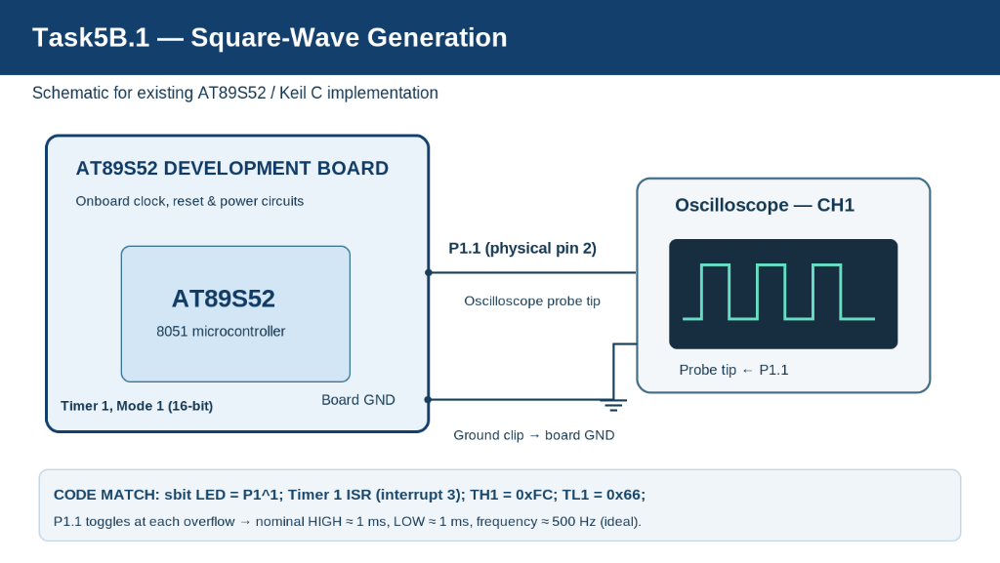

# Task5B.1 — Square-Wave Generation Using Timer 1 Interrupts

## Aim
To generate a continuous square-wave signal using the AT89S52 microcontroller's Timer 1 overflow interrupt by periodically toggling output pin P1.1 without using blocking software delay loops.

---

## Components Required

- **AT89S52 Microcontroller Development Board** (8051 Architecture)
- **Connecting Jumper Wires**
- **Cathode-Ray / Digital Storage Oscilloscope (CRO / DSO)** (for waveform observation)
- **Regulated DC Power Supply** (for the development board)
- **Keil µVision IDE** (for Embedded C development and compilation)
- **11.0592 MHz Crystal Oscillator** (integrated on the development board)

> [!NOTE]
> The development board provides its own clock oscillator, power-on/manual reset circuitry, and power regulation. No external crystal or capacitor wiring was performed on the breadboard during the laboratory session. Waveform characteristics documented below are based on theoretical timer derivations; physical oscilloscope measurement requires laboratory verification.

---

## Circuit Diagram



### Interface & Wiring Details
The test interface is straightforward and direct:
- **Signal Output**: Output pin **P1.1** (physical pin 2 of DIP-40) connects directly to the **Oscilloscope Channel 1 (CH1) Probe Tip**.
- **Ground Reference**: The **Oscilloscope Ground Clip** connects to the **Board Common GND**.
- **Clock & Reset**: Handled entirely by the development board's integrated oscillator and reset circuitry. No external crystal, pull-up network, or buffer was wired.

### Pin Configuration

| Pin / Peripheral | Physical Location | Connection / Function |
|---|---|---|
| **P1.1** | Pin 2 (DIP-40) | Periodic square-wave digital output |
| **GND** | Pin 20 (DIP-40) | Common board ground and oscilloscope ground clip |
| **Timer 1** | Internal Peripheral | 16-bit hardware timing peripheral generating periodic interrupts |
| **XTAL1 & XTAL2** | Pins 19 & 18 | Driven by onboard 11.0592 MHz crystal oscillator circuitry |

In the Embedded C source code, the pin mapping is declared as:
```c
sbit LED = P1^1;
```
*Note on identifier naming:* Although the variable in the source file is named `LED`, its actual functional role in this firmware is driving output pin P1.1 to produce a continuous square-wave test signal for instrument monitoring.

---

## Theory — 8051 Hardware Timers

The AT89S52 microcontroller features two independent 16-bit timer/counter peripherals (Timer 0 and Timer 1). In timer mode, the internal counter increments precisely once per machine cycle.

In classic 8051 architecture:
- 1 machine cycle consists of **12 oscillator clock periods**.
- Timer 1 in **Mode 1** operates as a **16-bit counter** comprised of two concatenated 8-bit registers: `TH1` (High Byte) and `TL1` (Low Byte).
- The counter counts upward from its preloaded value until it overflows from `0xFFFF` ($65,535_{10}$) to `0x0000` ($0_{10}$).
- Upon counter overflow, the hardware automatically asserts the Timer 1 overflow flag (`TF1` in the `TCON` register).
- When global interrupts (`EA = 1`) and Timer 1 interrupts (`ET1 = 1`) are enabled, the hardware vectors execution directly to the **Timer 1 Interrupt Service Routine (ISR)** located at interrupt vector 3 (`0x001B`).
- Inside the ISR, the software reloads the counter registers (`TH1` and `TL1`) and toggles output pin P1.1. Repeating this at equal intervals produces a symmetric sequence of HIGH and LOW digital levels.

### Hardware Interrupt Timing vs. Blocking Software Delays
| Parameter | Hardware Timer Interrupts (Used Here) | Blocking Software Delay Loops (`for`/`while`) |
|---|---|---|
| **CPU Utilization** | Non-blocking; CPU enters an idle state in `main()` | 100% CPU time spent burning clock cycles |
| **Timing Accuracy** | Cycle-accurate hardware counting | Compiler-optimization dependent; variable execution time |
| **Concurrency** | Allows CPU to perform background tasks concurrently | Halts all program flow until delay expires |
| **Jitter** | Extremely low jitter | Highly susceptible to execution flow disruptions |

---

## Timer Configuration

Timer 1 is configured in 16-bit Mode 1 using the following initialization function from `square_wave_generation.c`:

```c
void timer1_init(void)
{
    TMOD &= 0x0F;   // Clear Timer 1 bits
    TMOD |= 0x10;   // Timer 1 Mode 1 (16-bit)

    TH1 = reload_high;
    TL1 = reload_low;

    ET1 = 1;        // Enable Timer 1 interrupt
    EA = 1;         // Enable global interrupts
    TR1 = 1;        // Start Timer 1
}
```

### Register Functions:
- **`TMOD &= 0x0F`**: Masks out and clears the upper nibble of the Timer Mode register (bits 4–7: `GATE1`, `C/T1`, `M1_1`, `M0_1`), ensuring clean reconfiguration while preserving Timer 0 settings in the lower nibble.
- **`TMOD |= 0x10`**: Sets bit 4 (`M0_1 = 1`, `M1_1 = 0`), selecting **Mode 1 (16-bit Timer Mode)** with software gating (`GATE = 0`) and internal clock source (`C/T = 0`).
- **`TH1 = reload_high` & `TL1 = reload_low`**: Loads the initial count values (`0xFC` into `TH1`, `0x66` into `TL1`) into the 16-bit counter.
- **`ET1 = 1`**: Enables the Timer 1 overflow interrupt in the Interrupt Enable register (`IE.3`).
- **`EA = 1`**: Enables global interrupts (`IE.7`).
- **`TR1 = 1`**: Sets the Timer 1 run control bit in the Timer Control register (`TCON.6`) to initiate counting.

### Interrupt Vector Mapping:
Timer 1 uses **interrupt vector 3** in Keil C syntax:
```c
void timer1_ISR(void) interrupt 3
```
This binds the function directly to ROM address `0x001B`.

---

## Timer Calculations

Assuming an **11.0592 MHz** crystal frequency from laboratory observation records:

### 1. Machine-Cycle Period
$$T_{\text{machine}} = \frac{12}{11.0592 \times 10^6\text{ Hz}} \approx 1.0850694\,\mu\text{s} \approx 1.085\,\mu\text{s}$$

### 2. Timer Reload Values
From the source code initialization:
```c
unsigned char reload_high = 0xFC;
unsigned char reload_low = 0x66;
```
The combined 16-bit preload is:
$$\text{Preload} = 0\text{xFC66}_{16} = (252 \times 256) + 102 = 64614_{10}$$

### 3. Counts to Overflow
$$N = 65536 - 64614 = 922\text{ machine cycles}$$

### 4. Nominal Overflow Duration
$$T_{\text{overflow}} = N \times T_{\text{machine}} = 922 \times 1.0850694\,\mu\text{s} \approx 1.00043\text{ ms} \approx 1.0004\text{ ms}$$

### 5. Waveform Half-Cycle Durations
The output pin P1.1 is toggled once per interrupt service routine entry:
- **HIGH Duration ($T_{\text{ON}}$)**: $\approx 1.0004\text{ ms} \approx 1\text{ ms}$
- **LOW Duration ($T_{\text{OFF}}$)**: $\approx 1.0004\text{ ms} \approx 1\text{ ms}$

### 6. Total Period
$$T = T_{\text{ON}} + T_{\text{OFF}} \approx 1\text{ ms} + 1\text{ ms} = 2\text{ ms}$$

### 7. Output Frequency
$$f = \frac{1}{T} \approx \frac{1}{0.002\text{ s}} = 500\text{ Hz}$$

### 8. Duty Cycle
$$D = \left(\frac{T_{\text{ON}}}{T_{\text{ON}} + T_{\text{OFF}}}\right) \times 100\% = \left(\frac{1\text{ ms}}{2\text{ ms}}\right) \times 100\% \approx 50\%$$

> [!IMPORTANT]
> **Key Frequency Distinction:** While Timer 1 overflows and triggers an interrupt at approximately **1 kHz** ($1 / 1\text{ ms}$), the output square wave frequency is **500 Hz**. Because the output toggles on each overflow, a complete periodic waveform (one HIGH level and one LOW level) requires **two consecutive timer overflows**.
> 
> *Note:* These figures represent ideal mathematical timer counts. Practical physical frequency is subject to interrupt entry latency, context preservation, and register reload cycle time inside the ISR. The 500 Hz frequency is an ideal theoretical value and was not experimentally measured with an oscilloscope.

---

## Working Principle

The periodic square-wave signal generation follows an iterative hardware-software pipeline:

```
[ Timer 1 counts up from 0xFC66 ]
               │
               ▼
   [ Overflows at 0xFFFF -> 0x0000 ]
               │
               ▼ (Hardware asserts TF1 & triggers Interrupt Vector 3)
   [ Enter timer1_ISR() ]
               │
               ├─► Reload TH1 = 0xFC, TL1 = 0x66
               │
               └─► Invert pin state: LED = ~LED (P1.1 toggles)
               │
               ▼
   [ Return from Interrupt (RETI) ]
               │
               ▼
   [ Timer 1 counts for next 1 ms interval ]
```

1. **Initialization**: Timer 1 is configured in 16-bit Mode 1 and preloaded with `0xFC66`.
2. **Timing Execution**: Timer 1 counts machine cycles up to overflow ($922$ counts $\approx 1\text{ ms}$).
3. **Interrupt Invocation**: Counter overflow fires `timer1_ISR` (interrupt 3).
4. **Register Reload**: `TH1` and `TL1` are restored to `0xFC` and `0x66` to preserve timing consistency.
5. **Pin Inversion**: The state of P1.1 is toggled (`LED = ~LED`).
6. **Symmetric Output**: Because identical reload values are applied after each overflow, both HIGH and LOW half-periods remain equal, producing a symmetric 50% duty-cycle square wave.

---

## Source Code Reference

The complete implementation from [square_wave_generation.c](square_wave_generation.c):

### 1. Output Pin & Variable Definitions
```c
sbit LED = P1^1;

unsigned char reload_high = 0xFC;
unsigned char reload_low = 0x66;
```
- `sbit LED = P1^1`: Maps output pin P1.1 (physical pin 2).
- `reload_high` & `reload_low`: Store the high and low bytes of the 16-bit preload value (`0xFC66`).

### 2. Timer 1 Interrupt Service Routine
```c
/* Timer 1 Interrupt - Square wave generation (10101010...) */
void timer1_ISR(void) interrupt 3
{
    TH1 = reload_high;
    TL1 = reload_low;

    LED = ~LED;
}
```
- Executed on vector address `0x001B` every time Timer 1 overflows.
- Reloads `TH1` and `TL1` immediately to initiate the next 1 ms counting window.
- Bitwise NOT (`~LED`) inverts the pin logic state ($0 \to 1$, $1 \to 0$), producing alternating HIGH and LOW intervals.

### 3. Main Routine
```c
void main(void)
{
    LED = 0;

    timer1_init();

    while(1)
    {
        // Waveform generated completely by Timer 1 ISR
    }
}
```
- Sets output P1.1 LOW initially.
- Invokes `timer1_init()` to configure, preload, and start the timer.
- Executes an empty `while(1)` polling loop; the main thread consumes no timing logic, as waveform generation is entirely interrupt-driven. (Note: This is an active empty loop and does not place the processor into low-power sleep/idle modes).

---

## Expected Waveform

The firmware synthesizes a continuous periodic digital pattern on pin P1.1:
$$\dots 101010101010 \dots$$

### Waveform Diagram
```text
       +----------+          +----------+          +----------+
 P1.1  |   HIGH   |   LOW    |   HIGH   |   LOW    |   HIGH   |   LOW
-------+          +----------+          +----------+          +----------
       <-- 1 ms --><-- 1 ms -->
       <-------- 2 ms --------> (Period T)
       f = 1 / T = 500 Hz, Duty Cycle = 50%
```

### Nominal Waveform Parameters

| Waveform Parameter | Theoretical Nominal Value |
|---|---|
| **Timer Overflow Interval** | $\approx 1.0004\text{ ms} \approx 1\text{ ms}$ |
| **HIGH Half-Cycle ($T_{\text{ON}}$)** | $\approx 1.0004\text{ ms} \approx 1\text{ ms}$ |
| **LOW Half-Cycle ($T_{\text{OFF}}$)** | $\approx 1.0004\text{ ms} \approx 1\text{ ms}$ |
| **Complete Waveform Period ($T$)** | $\approx 2.0008\text{ ms} \approx 2\text{ ms}$ |
| **Nominal Output Frequency ($f$)** | $\approx 500\text{ Hz}$ |
| **Duty Cycle ($D$)** | $\approx 50\%$ |
| **Signal Output Pin** | P1.1 (DIP-40 Pin 2) |

---

## Algorithm & Pseudocode

### Algorithm
1. **Define** P1.1 as the output signal pin.
2. **Initialize** Timer 1 reload variables: `reload_high = 0xFC`, `reload_low = 0x66`.
3. **Set** P1.1 LOW initially (`LED = 0`).
4. **Configure** Timer 1 in 16-bit Mode 1 (`TMOD &= 0x0F; TMOD |= 0x10`).
5. **Load** preload values into `TH1` and `TL1`.
6. **Enable** the Timer 1 overflow interrupt (`ET1 = 1`).
7. **Enable** global interrupts (`EA = 1`).
8. **Start** Timer 1 by asserting `TR1 = 1`.
9. **Enter** an idle `while(1)` loop in `main()`.
10. **On Timer 1 overflow**: Hardware asserts `TF1` and enters ISR vector 3.
11. **Reload** `TH1 = reload_high` and `TL1 = reload_low`.
12. **Invert** output pin state (`LED = ~LED`).
13. **Return** from interrupt and repeat indefinitely.

### Pseudocode
```text
BEGIN
    SET output pin P1.1 = LOW
    
    SET reload_high = 0xFC
    SET reload_low  = 0x66

    FUNCTION timer1_init():
        CLEAR Timer 1 mode bits in TMOD
        SET Timer 1 to 16-bit Mode 1 in TMOD
        LOAD TH1 = reload_high
        LOAD TL1 = reload_low
        ENABLE Timer 1 interrupt (ET1 = 1)
        ENABLE Global interrupts (EA = 1)
        START Timer 1 (TR1 = 1)
    END FUNCTION

    FUNCTION main():
        CALL timer1_init()
        WHILE TRUE:
            // Non-blocking loop; CPU timing handled by hardware ISR
        END WHILE
    END FUNCTION

    INTERRUPT ROUTINE timer1_ISR() [Vector 3]:
        RELOAD TH1 = reload_high
        RELOAD TL1 = reload_low
        TOGGLE pin P1.1 (P1.1 = NOT P1.1)
    END INTERRUPT ROUTINE
END
```

---

## Observations From Laboratory Notes

- **Internal Hardware Timers**: The AT89S52 uses internal hardware timers to track elapsed time independently of instruction execution. Timer overflow occurs once the counter completes $922$ machine counts.
- **Crystal Frequency**: Calculations are based on the laboratory standard $11.0592\text{ MHz}$ crystal, giving a machine-cycle duration of $1.085\,\mu\text{s}$.
- **Timer Modes**: Mode 1 operates as a full 16-bit counter spanning count values from $0$ to $65535$.
- **Timer Overflow Flag**: Overflow triggers flag `TF1` and automatically branches execution to interrupt vector 3.
- **Timer Reloading**: Because Mode 1 lacks hardware auto-reload, software reload of `TH1` and `TL1` inside the ISR is required to sustain continuous periodic operation.
- **Interrupt-Based Execution**: Generating signals via timer interrupts avoids CPU-blocking software delays, allowing the controller to remain responsive.
- **Waveform Synthesis**: Inverting an output pin upon each overflow synthesizes a periodic digital square wave.
- **Duty Cycle Definition**: Duty cycle represents the ratio of HIGH duration to total period. Symmetrical intervals yield a 50% duty cycle.
- **Frequency vs. Overflow Rate**: Output frequency ($500\text{ Hz}$) is half the overflow frequency ($1\text{ kHz}$) because two interrupts are required to complete one full cycle.

---

## Key Technical Observations

1. **Peripheral Selection**: The firmware uses **Timer 1 in Mode 1** (16-bit manual reload).
2. **Hardware Counter Depth**: 16-bit width enables timing intervals up to $\approx 71\text{ ms}$ at 11.0592 MHz.
3. **Preload Assignment**: The reload value `0xFC66` ($64614_{10}$) creates a $922$-count overflow duration.
4. **Interrupt Vector**: Uses **interrupt vector 3** (`0x001B`).
5. **Target Pin**: Output waveform is generated on **P1.1** (physical pin 2).
6. **Initial Pin Condition**: Output is initialized LOW (`LED = 0`).
7. **Toggle Operation**: Every timer overflow inverts P1.1 via `LED = ~LED`.
8. **Cycle Composition**: Two successive timer interrupts form one complete square-wave cycle.
9. **Theoretical Output Frequency**: Nominally **500 Hz** at 11.0592 MHz.
10. **Theoretical Duty Cycle**: Approximately **50%** due to identical HIGH and LOW reload times.
11. **Non-blocking Execution**: No delay functions (`delay_ms()`) are used.
12. **Onboard Integration**: Clock and reset circuits are supplied directly by the development board.
13. **Theoretical Model**: Frequency and duty cycle values are theoretical calculations; physical output requires oscilloscope verification.

---

## Expected Output & Result

### Expected Output
A continuous, symmetric square wave is output on pin P1.1 with an ideal frequency of approximately 500 Hz and an approximate 50% duty cycle when clocked at 11.0592 MHz.

### Result
An Embedded C program was developed and verified for the AT89S52 microcontroller to synthesize a continuous square wave on pin P1.1 using Timer 1 overflow interrupts. The firmware utilizes 16-bit Mode 1 timing and state toggling without software delay loops. Real-world physical frequency and waveform symmetry require oscilloscope measurement.

---

## Project File Descriptions

| File Name | Purpose |
|---|---|
| `square_wave_generation.c` | Embedded C implementation using Timer 1 interrupt |
| `square_wave_generation.uvproj` | Keil µVision 4 project file |
| `square_wave_generation.uvopt` | Keil µVision project options and debug configuration |
| `STARTUP.A51` | Standard 8051 assembly startup initialization |
| `Objects/square_wave_generation.hex` | Existing compiled Intel HEX binary firmware |
| `circuit.png` | Task5B.1 circuit connection schematic |
| `README.md` | Complete technical documentation and analysis |
