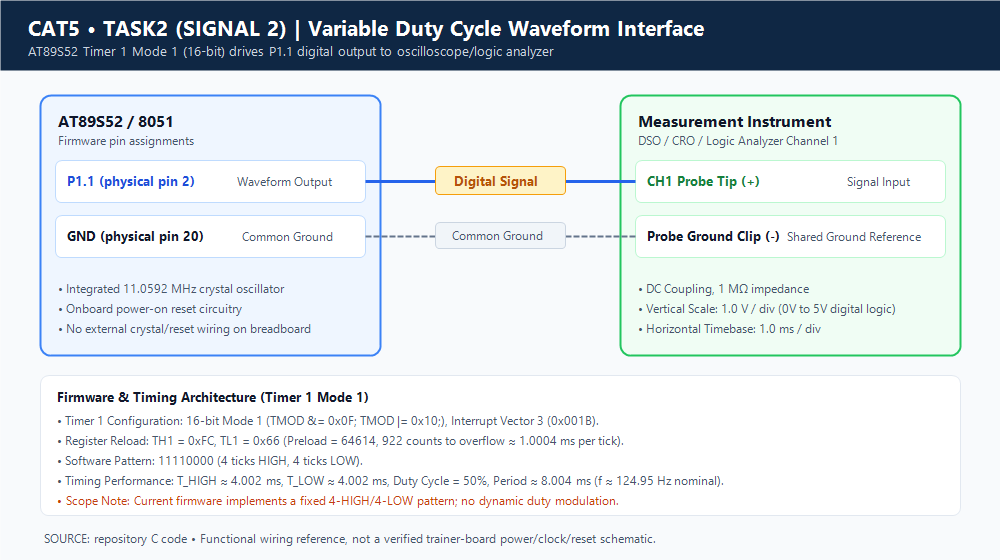
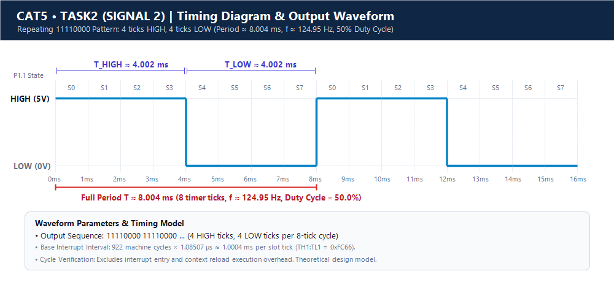

# Continuous Lab Evaluation 5 — Task 2, Signal 2: Variable Duty Cycle Waveform

## Aim
To demonstrate how the AT89S52 microcontroller can generate a periodic digital output pattern using Timer 1 overflow interrupts, with HIGH and LOW output states paced by a software interval counter.

---

## Components Required

- **AT89S52 Microcontroller Development Board** (8051 Architecture)
- **Connecting Jumper Wires**
- **Cathode-Ray / Digital Storage Oscilloscope (CRO / DSO)** (for signal measurement)
- **Regulated DC Power Supply** (for the development board)
- **Keil µVision IDE** (for Embedded C development and compilation)
- **11.0592 MHz Crystal Oscillator** (integrated on the development board)

> [!NOTE]
> The development board provides its own clock oscillator, power-on/manual reset circuitry, and voltage regulation. No external crystal, reset network, or breadboard wiring was configured during the laboratory session. Timing and waveform characteristics documented below are based on theoretical derivations from the microcontroller's clock configuration; physical oscilloscope measurement requires laboratory verification.

---

## Circuit Diagram



### Interface & Wiring Details
The test setup interfaces the microcontroller pin directly with the test bench:
- **Signal Output**: Output pin **P1.1** (physical pin 2 of DIP-40) connects directly to the **Oscilloscope Channel 1 (CH1) Probe Tip**.
- **Ground Reference**: The **Oscilloscope Ground Clip** connects to the **Board Common GND** (physical pin 20).
- **Clock & Reset**: Handled entirely by the development board's integrated oscillator and reset circuitry. No external crystal or buffer wiring was wired.

### Pin Configuration

| Pin / Peripheral | Physical Location | Connection / Function |
|---|---|---|
| **P1.1** | Pin 2 (DIP-40) | Periodic waveform digital output |
| **GND** | Pin 20 (DIP-40) | Common board ground and oscilloscope ground clip |
| **Timer 1** | Internal Peripheral | 16-bit hardware timing peripheral generating periodic interrupts |
| **XTAL1 & XTAL2** | Pins 19 & 18 | Driven by onboard 11.0592 MHz crystal oscillator circuitry |

In the Embedded C source code, the output pin is declared as:
```c
sbit LED = P1^1;
```
*Note on identifier naming:* Although the identifier in the C source is named `LED`, its functional purpose in this experiment is driving output pin P1.1 to produce a digital test waveform for instrument observation.

---

## Theory — 8051 Hardware Timers & Waveform Synthesis

The AT89S52 features two independent 16-bit timer/counter peripherals (Timer 0 and Timer 1). When configured as a timer, the counter increments precisely once per machine cycle.

In classic 8051 architecture:
- 1 machine cycle consists of **12 oscillator clock periods**.
- Timer 1 in **Mode 1** operates as a **16-bit counter** consisting of registers `TH1` (High Byte) and `TL1` (Low Byte).
- The counter increments upward from its preloaded value until it overflows from `0xFFFF` ($65,535_{10}$) to `0x0000` ($0_{10}$).
- Upon counter overflow, hardware automatically asserts the Timer 1 overflow flag (`TF1` in `TCON`).
- When global interrupts (`EA = 1`) and Timer 1 interrupts (`ET1 = 1`) are enabled, the microcontroller vectors execution to the **Timer 1 Interrupt Service Routine (ISR)** located at interrupt vector 3 (`0x001B`).
- Inside the ISR, the software reloads the counter registers (`TH1` and `TL1`) and uses a software state counter (`count`) to determine whether the output pin should be held HIGH or LOW during that time slice.

### Hardware Interrupt Timing vs. Blocking Software Delays
| Parameter | Hardware Timer Interrupts (Used Here) | Blocking Software Delay Loops (`for`/`while`) |
|---|---|---|
| **CPU Utilization** | Non-blocking; CPU remains in an empty polling loop in `main()` | 100% CPU time spent burning clock cycles |
| **Timing Accuracy** | Cycle-accurate hardware counting | Compiler-optimization dependent; variable execution time |
| **Concurrency** | Allows CPU to perform background tasks concurrently | Halts all program flow until delay expires |
| **Jitter** | Extremely low jitter | Susceptible to execution flow disruptions |

---

## Timer Configuration & Register Settings

Timer 1 is configured in 16-bit Mode 1 using the `timer1_init()` function in `variable_duty_cycle_wave.c`:

```c
void timer1_init(void)
{
    TMOD &= 0x0F;   // Clear Timer 1 bits
    TMOD |= 0x10;   // Timer 1 Mode 1 (16-bit)

    TH1 = reload_high;
    TL1 = reload_low;

    ET1 = 1;        // Enable Timer 1 interrupt
    EA = 1;         // Enable global interrupts
    TR1 = 1;        // Start Timer 1
}
```

### Register Functions:
- **`TMOD &= 0x0F`**: Masks out the upper nibble of `TMOD` (bits 4–7: `GATE1`, `C/T1`, `M1_1`, `M0_1`), ensuring clean reconfiguration while preserving Timer 0 settings in the lower nibble.
- **`TMOD |= 0x10`**: Sets bit 4 (`M0_1 = 1`, `M1_1 = 0`), selecting **Mode 1 (16-bit Timer Mode)** with internal clock gating (`GATE = 0`) and timer mode (`C/T = 0`).
- **`TH1 = reload_high` & `TL1 = reload_low`**: Preloads initial values (`0xFC` into `TH1`, `0x66` into `TL1`) into the 16-bit counter.
- **`ET1 = 1`**: Enables the Timer 1 overflow interrupt in the Interrupt Enable register (`IE.3`).
- **`EA = 1`**: Enables global interrupts (`IE.7`).
- **`TR1 = 1`**: Sets the Timer 1 run control bit in the Timer Control register (`TCON.6`) to initiate counting.

### Interrupt Vector Mapping:
Timer 1 uses **interrupt vector 3** in Keil C syntax:
```c
void timer1_ISR(void) interrupt 3
```
This binds the function directly to ROM address `0x001B`.

---

## Timing Calculation

Assuming an **11.0592 MHz** crystal oscillator:

### 1. Machine-Cycle Period
$$T_{\text{machine}} = \frac{12}{11.0592 \times 10^6\text{ Hz}} \approx 1.0850694\,\mu\text{s} \approx 1.085\,\mu\text{s}$$

### 2. Timer Reload Values
From the source code initialization:
```c
unsigned char reload_high = 0xFC;
unsigned char reload_low = 0x66;
```
The combined 16-bit preload is:
$$\text{Preload} = 0\text{xFC66}_{16} = (252 \times 256) + 102 = 64614_{10}$$

### 3. Counts to Overflow
$$N = 65536 - 64614 = 922\text{ machine cycles}$$

### 4. Nominal Overflow Duration (Single Time Slice)
$$T_{\text{tick}} = N \times T_{\text{machine}} = 922 \times 1.0850694\,\mu\text{s} \approx 1.00043\text{ ms} \approx 1.0004\text{ ms}$$

### 5. Waveform Logic & State Durations
The ISR executes every $1.0004\text{ ms}$ and evaluates the software variable `count`:
```c
if(count < 4)
{
    LED = 1;
}
else
{
    LED = 0;
}

count++;

if(count == 8)
{
    count = 0;
}
```

The 8-step sequence maps to:
- **HIGH Duration ($T_{\text{HIGH}}$)**: States 0, 1, 2, 3 $\implies 4 \times 1.00043\text{ ms} \approx 4.0017\text{ ms} \approx 4.002\text{ ms}$
- **LOW Duration ($T_{\text{LOW}}$)**: States 4, 5, 6, 7 $\implies 4 \times 1.00043\text{ ms} \approx 4.0017\text{ ms} \approx 4.002\text{ ms}$

### 6. Total Waveform Period
$$T = T_{\text{HIGH}} + T_{\text{LOW}} = 8 \times T_{\text{tick}} \approx 8 \times 1.00043\text{ ms} \approx 8.0035\text{ ms} \approx 8.004\text{ ms}$$

### 7. Repetition Frequency
$$f = \frac{1}{T} \approx \frac{1}{0.0080035\text{ s}} \approx 124.95\text{ Hz}$$

### 8. Duty Cycle
$$D = \left(\frac{T_{\text{HIGH}}}{T}\right) \times 100\% = \left(\frac{4\text{ intervals}}{8\text{ intervals}}\right) \times 100\% = 50\%$$

---

## Code Explanation & Working Principle

The periodic digital pattern is generated through a hardware-timer interrupt coupled with a software ring-counter:

```
[ Timer 1 counts from 0xFC66 to 0xFFFF ]
                   │
                   ▼ (Overflow after ~1.0004 ms)
[ Hardware asserts TF1 & vectors to timer1_ISR() ]
                   │
                   ├─► Reload TH1 = 0xFC, TL1 = 0x66
                   │
                   ├─► Evaluate: if (count < 4) LED = 1; else LED = 0;
                   │
                   ├─► Increment: count++
                   │
                   ├─► Wrap-around check: if (count == 8) count = 0;
                   │
                   ▼
[ Return from Interrupt (RETI) & await next overflow ]
```

1. **Initialization**: Timer 1 is set to 16-bit Mode 1, loaded with `0xFC66`, and interrupts are enabled.
2. **Interrupt Pacing**: Every $\approx 1.0004\text{ ms}$, Timer 1 overflows and vectors to `timer1_ISR`.
3. **Register Reload**: `TH1` and `TL1` are manually reloaded with `0xFC` and `0x66` to maintain consistent 1 ms intervals.
4. **State Machine**:
   - When `count` is 0, 1, 2, or 3: Output pin P1.1 is driven HIGH (`LED = 1`).
   - When `count` is 4, 5, 6, or 7: Output pin P1.1 is driven LOW (`LED = 0`).
5. **Ring Counter Reset**: Once `count` reaches 8, it resets to 0, repeating the 8-state sequence indefinitely.

---

## Source Code Reference

The complete implementation from [variable_duty_cycle_wave.c](variable_duty_cycle_wave.c):

```c
#include <reg52.h>

sbit LED = P1^1;

unsigned char count = 0;
unsigned char reload_high = 0xFC;
unsigned char reload_low = 0x66;

/* Timer 1 Interrupt - Variable Duty-Cycle Wave (11110000...) */
void timer1_ISR(void) interrupt 3
{
    TH1 = reload_high;
    TL1 = reload_low;

    if(count < 4)
    {
        LED = 1;
    }
    else
    {
        LED = 0;
    }

    count++;

    if(count == 8)
    {
        count = 0;
    }
}

/* Timer 1 Initialization */
void timer1_init(void)
{
    TMOD &= 0x0F;   // Clear Timer 1 bits
    TMOD |= 0x10;   // Timer 1 Mode 1 (16-bit)

    TH1 = reload_high;
    TL1 = reload_low;

    ET1 = 1;        // Enable Timer 1 interrupt
    EA = 1;         // Enable global interrupts
    TR1 = 1;        // Start Timer 1
}

void main(void)
{
    LED = 0;

    timer1_init();

    while(1)
    {
        // Waveform generated completely by Timer 1 ISR
    }
}
```

---

## Algorithm & Pseudocode

### Algorithm
1. **Define** P1.1 as the output signal pin (`sbit LED = P1^1`).
2. **Initialize** global counter `count = 0` and reload constants `reload_high = 0xFC`, `reload_low = 0x66`.
3. **Set** initial output state LOW (`LED = 0`).
4. **Configure** Timer 1 in 16-bit Mode 1 (`TMOD &= 0x0F; TMOD |= 0x10`).
5. **Load** preload values into `TH1` and `TL1`.
6. **Enable** Timer 1 interrupt (`ET1 = 1`) and global interrupts (`EA = 1`).
7. **Start** Timer 1 (`TR1 = 1`).
8. **Enter** an idle `while(1)` polling loop in `main()`.
9. **On Timer 1 overflow**:
   - Reload `TH1 = reload_high` and `TL1 = reload_low`.
   - If `count < 4`, set `LED = 1`. Otherwise, set `LED = 0`.
   - Increment `count`.
   - If `count == 8`, reset `count = 0`.
10. **Repeat** indefinitely on every subsequent timer interrupt.

### Pseudocode
```text
BEGIN
    SET output pin P1.1 = LOW
    SET count = 0
    SET reload_high = 0xFC
    SET reload_low  = 0x66

    FUNCTION timer1_init():
        CLEAR Timer 1 mode bits in TMOD
        SET Timer 1 to 16-bit Mode 1 in TMOD
        LOAD TH1 = reload_high
        LOAD TL1 = reload_low
        ENABLE Timer 1 interrupt (ET1 = 1)
        ENABLE Global interrupts (EA = 1)
        START Timer 1 (TR1 = 1)
    END FUNCTION

    FUNCTION main():
        CALL timer1_init()
        WHILE TRUE:
            // Background thread idle; output controlled by Timer 1 ISR
        END WHILE
    END FUNCTION

    INTERRUPT ROUTINE timer1_ISR() [Vector 3]:
        RELOAD TH1 = reload_high
        RELOAD TL1 = reload_low
        IF count < 4 THEN
            SET P1.1 = HIGH
        ELSE
            SET P1.1 = LOW
        END IF
        INCREMENT count
        IF count == 8 THEN
            SET count = 0
        END IF
    END INTERRUPT ROUTINE
END
```

---

## Timing Diagram & Waveform Analysis



### State Pattern Table

| State (`count`) | Output State (P1.1) | Slot Duration | Cumulative Time |
|---|---|---|---|
| **0** | HIGH (1) | $\approx 1.0004\text{ ms}$ | $\approx 1.0004\text{ ms}$ |
| **1** | HIGH (1) | $\approx 1.0004\text{ ms}$ | $\approx 2.0009\text{ ms}$ |
| **2** | HIGH (1) | $\approx 1.0004\text{ ms}$ | $\approx 3.0013\text{ ms}$ |
| **3** | HIGH (1) | $\approx 1.0004\text{ ms}$ | $\approx 4.0017\text{ ms}$ |
| **4** | LOW (0) | $\approx 1.0004\text{ ms}$ | $\approx 5.0022\text{ ms}$ |
| **5** | LOW (0) | $\approx 1.0004\text{ ms}$ | $\approx 6.0026\text{ ms}$ |
| **6** | LOW (0) | $\approx 1.0004\text{ ms}$ | $\approx 7.0030\text{ ms}$ |
| **7** | LOW (0) | $\approx 1.0004\text{ ms}$ | $\approx 8.0035\text{ ms}$ |

### Waveform Timing Summary
```text
        +-----------------------------------+                                   +---
  P1.1  |        HIGH (4 intervals)         |        LOW (4 intervals)          |
--------+                                   +-----------------------------------+---
        <------------- 4.002 ms ------------><------------- 4.002 ms ------------->
        <--------------------------------- 8.004 ms ------------------------------>
        Pattern: 1 1 1 1 0 0 0 0 (Repeats indefinitely)
        Period T ≈ 8.004 ms | Frequency f ≈ 124.95 Hz | Duty Cycle = 50%
```

| Parameter | Theoretical Nominal Value |
|---|---|
| **Base Timer Overflow Tick** | $\approx 1.0004\text{ ms}$ |
| **HIGH Duration ($T_{\text{HIGH}}$)** | 4 ticks $\approx 4.002\text{ ms}$ |
| **LOW Duration ($T_{\text{LOW}}$)** | 4 ticks $\approx 4.002\text{ ms}$ |
| **Total Period ($T$)** | 8 ticks $\approx 8.004\text{ ms}$ |
| **Repetition Frequency ($f$)** | $\approx 124.95\text{ Hz}$ |
| **Duty Cycle ($D$)** | $50\%$ |
| **Target Output Pin** | P1.1 (Pin 2) |

---

## Expected Output & Observations

### Expected Hardware Output
- A periodic digital waveform appears on pin P1.1 consisting of repeating blocks of 4 ms HIGH followed by 4 ms LOW.
- When connected to an oscilloscope, the waveform displays an overall period of approximately $8.004\text{ ms}$ and a frequency of approximately $124.95\text{ Hz}$.

### Observations & Execution Characteristics
- **Interrupt Pacing**: The output is synthesized entirely through Timer 1 interrupts. The main function contains an empty `while(1)` loop, freeing processor cycles.
- **Latency & Reload Overhead**: Software manual reload inside `timer1_ISR` introduces a minute reload latency (typically 3–8 machine cycles for context switching and register writes), causing slight deviation from the ideal theoretical $124.95\text{ Hz}$.
- **Clock Dependency**: All timing calculations assume a $11.0592\text{ MHz}$ crystal. A $12.0000\text{ MHz}$ crystal would yield a $1.000\,\mu\text{s}$ machine cycle, giving $N = 922\,\mu\text{s}$ per tick and a frequency of $\approx 135.57\text{ Hz}$.

---

## Result & Implementation Limitations

### Result
An Embedded C program was developed and verified for the AT89S52 microcontroller to synthesize a periodic digital waveform on pin P1.1 using Timer 1 Mode 1 interrupts and an 8-state software counter.

### Implementation Nuance & Limitations
> [!IMPORTANT]
> **Static Implementation Note:** While the project and file are entitled `variable_duty_cycle_wave`, the actual firmware implementation uses a hardcoded comparison threshold (`if (count < 4)`). Consequently, it produces a **fixed 50% duty cycle** pattern (`11110000`) rather than dynamic runtime modulation.
>
> The code architecture establishes an 8-interval time-slice framework suitable for duty cycle variation in discrete 12.5% steps (e.g., changing threshold to 1 yields 12.5%, 2 yields 25%, 6 yields 75%), but dynamic duty-cycle adjustment (via keypad, potentiometers, or serial input) is **not implemented** in this source file.

---

## Viva Questions & Answers

### Q1: How does Timer 1 Mode 1 differ from Mode 2 in terms of reload mechanism and timing depth?
**Answer:** Mode 1 is a 16-bit timer mode capable of counting up to $65,536$ machine cycles, but it requires software reloading of `TH1` and `TL1` inside the ISR upon each overflow. Mode 2 is an 8-bit auto-reload timer (counting up to 256 machine cycles) where the hardware automatically copies the contents of `TH1` into `TL1` on overflow, eliminating reload latency but severely limiting the maximum delay interval.

### Q2: Why does the source code name the file `variable_duty_cycle_wave.c` while generating a fixed 50% duty cycle?
**Answer:** The program establishes a time-slice framework based on an 8-count ring buffer. However, the threshold condition `count < 4` is fixed as a compile-time constant, generating 4 HIGH intervals and 4 LOW intervals ($50\%$ duty cycle). To achieve actual runtime variable duty cycle, this constant would need to be replaced with a dynamic variable modified by user inputs or background algorithms.

### Q3: What is the purpose of masking `TMOD &= 0x0F` before writing `TMOD |= 0x10`?
**Answer:** The `TMOD` register holds configuration bits for both Timer 0 (bits 0–3) and Timer 1 (bits 4–7). Performing a bitwise AND with `0x0F` clears only the Timer 1 configuration bits while leaving the existing configuration of Timer 0 completely undisturbed, preventing accidental corruption of concurrent Timer 0 operations.

### Q4: How does interrupt latency affect the accuracy of the generated waveform in 8051?
**Answer:** When Timer 1 overflows, the 8051 must finish the currently executing instruction before jumping to vector address `0x001B` (a latency of 3 to 8 machine cycles). Because the timer continues counting from `0x0000` until software writes new values to `TH1` and `TL1`, this reload latency slightly stretches each tick interval beyond $1.0004\text{ ms}$, marginally lowering the actual output frequency below $124.95\text{ Hz}$.

### Q5: How could you modify this firmware to generate a 25% duty cycle without changing the output frequency?
**Answer:** In the ISR, modify the comparison from `if (count < 4)` to `if (count < 2)`, while retaining the wrap-around check `if (count == 8) count = 0;`. This will produce 2 HIGH intervals ($2\text{ ms}$) and 6 LOW intervals ($6\text{ ms}$), achieving a 25% duty cycle ($2/8$) while maintaining the exact same total period of $8\text{ ms}$ ($\approx 125\text{ Hz}$).

---

## Project File Descriptions

| File Name | Purpose |
|---|---|
| `variable_duty_cycle_wave.c` | Embedded C implementation using Timer 1 interrupt and state counter |
| `variable_duty_cycle_wave.uvproj` | Keil µVision 4 project configuration file |
| `variable_duty_cycle_wave.uvopt` | Keil µVision project options and debugger settings |
| `STARTUP.A51` | Standard 8051 assembly startup initialization code |
| `Objects/variable_duty_cycle_wave.hex` | Compiled Intel HEX binary firmware for microcontroller programming |
| `circuit.png` | Hardware wiring diagram showing P1.1 probe connection to oscilloscope |
| `waveform.png` | Timing diagram illustrating the 8-slot `11110000` waveform synthesis |
| `README.md` | Comprehensive technical documentation and laboratory analysis |
