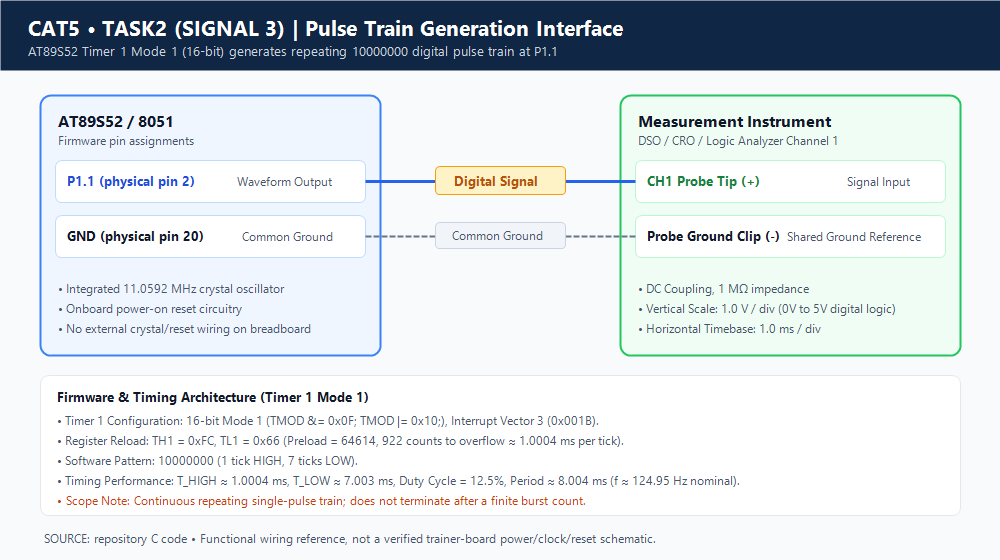
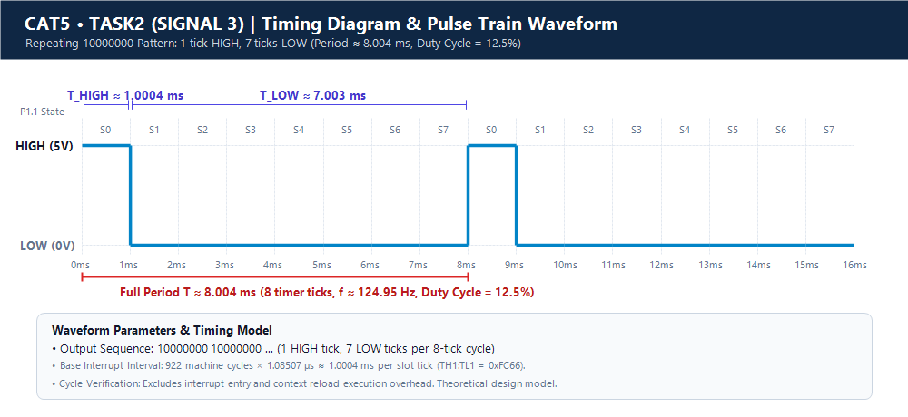

# Continuous Lab Evaluation 5 — Task 2, Signal 3: Pulse Train Generation

## Aim
To generate a repeating digital pulse train using Timer 1 overflow interrupts on the AT89S52 microcontroller, producing narrow active pulses spaced by controlled inactive intervals.

---

## Components Required

- **AT89S52 Microcontroller Development Board** (8051 Architecture)
- **Connecting Jumper Wires**
- **Cathode-Ray / Digital Storage Oscilloscope (CRO / DSO)** (for signal measurement)
- **Regulated DC Power Supply** (for the development board)
- **Keil µVision IDE** (for Embedded C development and compilation)
- **11.0592 MHz Crystal Oscillator** (integrated on the development board)

> [!NOTE]
> The development board provides its own clock oscillator, power-on/manual reset circuitry, and voltage regulation. No external crystal, reset network, or breadboard wiring was configured during the laboratory session. Timing and waveform characteristics documented below are based on theoretical derivations from the microcontroller's clock configuration; physical oscilloscope measurement requires laboratory verification.

---

## Circuit Diagram



### Interface & Wiring Details
The test setup interfaces the microcontroller pin directly with the test bench:
- **Signal Output**: Output pin **P1.1** (physical pin 2 of DIP-40) connects directly to the **Oscilloscope Channel 1 (CH1) Probe Tip**.
- **Ground Reference**: The **Oscilloscope Ground Clip** connects to the **Board Common GND** (physical pin 20).
- **Clock & Reset**: Handled entirely by the development board's integrated oscillator and reset circuitry. No external crystal or buffer wiring was wired.

### Pin Configuration

| Pin / Peripheral | Physical Location | Connection / Function |
|---|---|---|
| **P1.1** | Pin 2 (DIP-40) | Periodic pulse train digital output |
| **GND** | Pin 20 (DIP-40) | Common board ground and oscilloscope ground clip |
| **Timer 1** | Internal Peripheral | 16-bit hardware timing peripheral generating periodic interrupts |
| **XTAL1 & XTAL2** | Pins 19 & 18 | Driven by onboard 11.0592 MHz crystal oscillator circuitry |

In the Embedded C source code, the output pin is declared as:
```c
sbit LED = P1^1;
```
*Note on identifier naming:* Although the identifier in the C source is named `LED`, its functional purpose in this experiment is driving output pin P1.1 to generate a periodic pulse train test signal for instrument monitoring.

---

## Theory — Pulse Train Generation in Embedded Systems

A **pulse train** is a continuous, periodic sequence of rectangular pulses characterized by an active pulse width ($T_{\text{HIGH}}$), a repetition period ($T$), a repetition frequency ($f = 1/T$), and a duty cycle ($D = T_{\text{HIGH}} / T$).

Pulse trains are widely utilized in digital and embedded systems for:
- Trigger pulses to synchronize external instrumentation, sensors (e.g., ultrasonic ranging triggers), and ADCs.
- Clock strobes to latch data in shift registers and sequential circuits.
- Stepper motor step-pulse sequences and frequency-keyed signaling.

### Generating Pulses via Hardware Interrupts vs. Blocking Delays
Using hardware timer interrupts to synthesize pulse trains offers significant advantages over blocking delay routines (`delay_ms()`):
| Parameter | Hardware Timer Interrupts (Used Here) | Blocking Software Delay Loops (`for`/`while`) |
|---|---|---|
| **CPU Availability** | The CPU remains free in `main()` to handle other background operations | 100% of CPU time is consumed in delay loops |
| **Timing Accuracy** | Driven by hardware machine cycles; completely deterministic | Dependent on compiler optimization and CPU instruction pipelining |
| **Duty Cycle Precision** | Accurate down to discrete hardware time slices | Prone to drift caused by nested loop overheads |
| **Concurrency** | Fully asynchronous background signal generation | Blocks execution, preventing multitasking |

In the AT89S52:
- Timer 1 operates in **Mode 1** as a 16-bit counter register (`TH1` and `TL1`).
- The counter counts machine cycles up to overflow (`0xFFFF` $\to$ `0x0000`), automatically asserting `TF1` and branching to interrupt vector 3 (`0x001B`).
- By maintaining an internal cycle count (`count`), the microcontroller drives pin P1.1 HIGH for exactly one timer slice and LOW for the remaining seven slices.

---

## Timer Configuration & Register Settings

Timer 1 is initialized in 16-bit Mode 1 using the `timer1_init()` function in `pulse_train_generation.c`:

```c
void timer1_init(void)
{
    TMOD &= 0x0F;   // Clear Timer 1 bits
    TMOD |= 0x10;   // Timer 1 Mode 1 (16-bit)

    TH1 = 0xFC;
    TL1 = 0x66;

    ET1 = 1;        // Enable Timer 1 interrupt
    EA = 1;         // Enable global interrupts
    TR1 = 1;        // Start Timer 1
}
```

### Register Functions:
- **`TMOD &= 0x0F`**: Clears the upper nibble of `TMOD` (Timer 1 mode bits: `GATE1`, `C/T1`, `M1_1`, `M0_1`), preventing accidental disruption to Timer 0 settings in the lower nibble.
- **`TMOD |= 0x10`**: Sets bit 4 (`M0_1 = 1`, `M1_1 = 0`), selecting **Mode 1 (16-bit Timer Mode)** with software gating (`GATE = 0`) and internal clock source (`C/T = 0`).
- **`TH1 = 0xFC` & `TL1 = 0x66`**: Loads literal immediate constants (`0xFC` into `TH1`, `0x66` into `TL1`) establishing the 16-bit reload value `0xFC66`.
- **`ET1 = 1`**: Enables Timer 1 overflow interrupt in `IE.3`.
- **`EA = 1`**: Enables global interrupts in `IE.7`.
- **`TR1 = 1`**: Sets the run control bit in `TCON.6` to start the counter.

### Interrupt Vector Mapping:
Timer 1 uses **interrupt vector 3** in Keil C syntax:
```c
void timer1_ISR(void) interrupt 3
```
This binds the function directly to ROM address `0x001B`.

---

## Timer Calculations

Assuming an **11.0592 MHz** crystal oscillator:

### 1. Machine-Cycle Period
$$T_{\text{machine}} = \frac{12}{11.0592 \times 10^6\text{ Hz}} \approx 1.0850694\,\mu\text{s} \approx 1.085\,\mu\text{s}$$

### 2. Timer Reload Values
From the source code initialization:
```c
TH1 = 0xFC;
TL1 = 0x66;
```
The combined 16-bit preload is:
$$\text{Preload} = 0\text{xFC66}_{16} = (252 \times 256) + 102 = 64614_{10}$$

### 3. Counts to Overflow
$$N = 65536 - 64614 = 922\text{ machine cycles}$$

### 4. Nominal Overflow Duration (Single Time Slice)
$$T_{\text{tick}} = N \times T_{\text{machine}} = 922 \times 1.0850694\,\mu\text{s} \approx 1.00043\text{ ms} \approx 1.0004\text{ ms}$$

### 5. Pulse Duration & Inactive Duration
The ISR executes every $1.0004\text{ ms}$ and evaluates the software variable `count`:
```c
if(count == 0)
{
    LED = 1;
}
else
{
    LED = 0;
}

count++;

if(count == 8)
{
    count = 0;
}
```

The 8-step sequence maps to:
- **Active Pulse Width ($T_{\text{HIGH}}$)**: State 0 $\implies 1 \times 1.00043\text{ ms} \approx 1.0004\text{ ms} \approx 1\text{ ms}$
- **Inactive Duration ($T_{\text{LOW}}$)**: States 1, 2, 3, 4, 5, 6, 7 $\implies 7 \times 1.00043\text{ ms} \approx 7.0030\text{ ms} \approx 7\text{ ms}$

### 6. Pulse Repetition Period
$$T = T_{\text{HIGH}} + T_{\text{LOW}} = 8 \times T_{\text{tick}} \approx 8 \times 1.00043\text{ ms} \approx 8.0035\text{ ms} \approx 8.004\text{ ms}$$

### 7. Pulse Repetition Frequency
$$f = \frac{1}{T} \approx \frac{1}{0.0080035\text{ s}} \approx 124.95\text{ Hz}$$

### 8. Duty Cycle
$$D = \left(\frac{T_{\text{HIGH}}}{T}\right) \times 100\% = \left(\frac{1\text{ interval}}{8\text{ intervals}}\right) \times 100\% = 12.5\%$$

---

## Pulse Generation Logic & Working Principle

The pulse train generation operates via an interrupt-driven state generator:

```
[ Timer 1 counts from 0xFC66 to 0xFFFF ]
                   │
                   ▼ (Overflow after ~1.0004 ms)
[ Hardware asserts TF1 & vectors to timer1_ISR() ]
                   │
                   ├─► Reload TH1 = 0xFC, TL1 = 0x66
                   │
                   ├─► Evaluate: if (count == 0) LED = 1; else LED = 0;
                   │
                   ├─► Increment: count++
                   │
                   ├─► Wrap-around check: if (count == 8) count = 0;
                   │
                   ▼
[ Return from Interrupt (RETI) & await next overflow ]
```

1. **Initialization**: Timer 1 is configured in 16-bit Mode 1, loaded with `0xFC66`, and interrupts are enabled.
2. **Interrupt Pacing**: Every $\approx 1.0004\text{ ms}$, Timer 1 overflows and vectors execution to `timer1_ISR`.
3. **Hardware Reload**: Registers `TH1` and `TL1` are manually reloaded with literal constants `0xFC` and `0x66` to preserve consistent 1 ms intervals.
4. **State Machine**:
   - When `count == 0`: Output pin P1.1 is driven HIGH (`LED = 1`), emitting the leading active pulse.
   - When `count != 0` (states 1 through 7): Output pin P1.1 is driven LOW (`LED = 0`), creating the inter-pulse inactive window.
5. **Continuous Loop**: When `count` reaches 8, it resets to 0. The program emits a continuous, uninterrupted train of 1 ms pulses spaced 7 ms apart.

---

## Source Code Reference

The complete implementation from [pulse_train_generation.c](pulse_train_generation.c):

```c
#include <reg52.h>

sbit LED = P1^1;

unsigned char count = 0;

/* Timer 1 Interrupt */
void timer1_ISR(void) interrupt 3
{
    // Reload Timer 1 values
    TH1 = 0xFC;
    TL1 = 0x66;

    // Generate pulse train: 10000000
    if(count == 0)
    {
        LED = 1;
    }
    else
    {
        LED = 0;
    }

    count++;

    if(count == 8)
    {
        count = 0;
    }
}


/* Timer 1 Initialization */
void timer1_init(void)
{
    TMOD &= 0x0F;   // Clear Timer 1 bits
    TMOD |= 0x10;   // Timer 1 Mode 1 (16-bit)

    TH1 = 0xFC;
    TL1 = 0x66;

    ET1 = 1;        // Enable Timer 1 interrupt
    EA = 1;         // Enable global interrupts
    TR1 = 1;        // Start Timer 1
}


void main(void)
{
    LED = 0;

    timer1_init();

    while(1)
    {
        // Main loop remains empty
        // Waveform generated completely by ISR
    }
}
```

---

## Algorithm & Pseudocode

### Algorithm
1. **Define** P1.1 as the output signal pin (`sbit LED = P1^1`).
2. **Initialize** global counter `count = 0`.
3. **Set** initial output state LOW (`LED = 0`).
4. **Configure** Timer 1 in 16-bit Mode 1 (`TMOD &= 0x0F; TMOD |= 0x10`).
5. **Load** preload values `0xFC` into `TH1` and `0x66` into `TL1`.
6. **Enable** Timer 1 interrupt (`ET1 = 1`) and global interrupts (`EA = 1`).
7. **Start** Timer 1 (`TR1 = 1`).
8. **Enter** an idle `while(1)` polling loop in `main()`.
9. **On Timer 1 overflow**:
   - Reload `TH1 = 0xFC` and `TL1 = 0x66`.
   - If `count == 0`, set `LED = 1`. Otherwise, set `LED = 0`.
   - Increment `count`.
   - If `count == 8`, reset `count = 0`.
10. **Repeat** indefinitely on every subsequent timer interrupt.

### Pseudocode
```text
BEGIN
    SET output pin P1.1 = LOW
    SET count = 0

    FUNCTION timer1_init():
        CLEAR Timer 1 mode bits in TMOD
        SET Timer 1 to 16-bit Mode 1 in TMOD
        LOAD TH1 = 0xFC
        LOAD TL1 = 0x66
        ENABLE Timer 1 interrupt (ET1 = 1)
        ENABLE Global interrupts (EA = 1)
        START Timer 1 (TR1 = 1)
    END FUNCTION

    FUNCTION main():
        CALL timer1_init()
        WHILE TRUE:
            // Non-blocking loop; pulse generation managed by Timer 1 ISR
        END WHILE
    END FUNCTION

    INTERRUPT ROUTINE timer1_ISR() [Vector 3]:
        RELOAD TH1 = 0xFC
        RELOAD TL1 = 0x66
        IF count == 0 THEN
            SET P1.1 = HIGH
        ELSE
            SET P1.1 = LOW
        END IF
        INCREMENT count
        IF count == 8 THEN
            SET count = 0
        END IF
    END INTERRUPT ROUTINE
END
```

---

## Timing Diagram & Waveform Analysis



### State Pattern Table

| State (`count`) | Output State (P1.1) | Slot Duration | Cumulative Time | Description |
|---|---|---|---|---|
| **0** | HIGH (1) | $\approx 1.0004\text{ ms}$ | $\approx 1.0004\text{ ms}$ | Active Pulse |
| **1** | LOW (0) | $\approx 1.0004\text{ ms}$ | $\approx 2.0009\text{ ms}$ | Inactive Window |
| **2** | LOW (0) | $\approx 1.0004\text{ ms}$ | $\approx 3.0013\text{ ms}$ | Inactive Window |
| **3** | LOW (0) | $\approx 1.0004\text{ ms}$ | $\approx 4.0017\text{ ms}$ | Inactive Window |
| **4** | LOW (0) | $\approx 1.0004\text{ ms}$ | $\approx 5.0022\text{ ms}$ | Inactive Window |
| **5** | LOW (0) | $\approx 1.0004\text{ ms}$ | $\approx 6.0026\text{ ms}$ | Inactive Window |
| **6** | LOW (0) | $\approx 1.0004\text{ ms}$ | $\approx 7.0030\text{ ms}$ | Inactive Window |
| **7** | LOW (0) | $\approx 1.0004\text{ ms}$ | $\approx 8.0035\text{ ms}$ | Inactive Window |

### Waveform Timing Summary
```text
        +-------+                                                               +-------+
  P1.1  |  1 ms |                        7 ms LOW                               |  1 ms |
--------+       +---------------------------------------------------------------+       +---
        <- 1 ms -><--------------------------- 7 ms ---------------------------->
        <--------------------------------- 8.004 ms ---------------------------->
        Pattern: 1 0 0 0 0 0 0 0 (Repeats indefinitely)
        Period T ≈ 8.004 ms | Frequency f ≈ 124.95 Hz | Duty Cycle = 12.5%
```

| Parameter | Theoretical Nominal Value |
|---|---|
| **Base Timer Overflow Tick** | $\approx 1.0004\text{ ms}$ |
| **Active Pulse Width ($T_{\text{HIGH}}$)** | 1 tick $\approx 1.0004\text{ ms}$ |
| **Inactive Interval ($T_{\text{LOW}}$)** | 7 ticks $\approx 7.0030\text{ ms}$ |
| **Total Repetition Period ($T$)** | 8 ticks $\approx 8.004\text{ ms}$ |
| **Pulse Repetition Frequency ($f$)** | $\approx 124.95\text{ Hz}$ |
| **Duty Cycle ($D$)** | $12.5\%$ |
| **Target Output Pin** | P1.1 (Pin 2) |

---

## Expected Output & Observations

### Expected Hardware Output
- Pin P1.1 produces an active-high periodic pulse of approximately $1\text{ ms}$ duration every $8.004\text{ ms}$.
- On an oscilloscope, the display shows a sharp pulse train with a $12.5\%$ duty cycle and a pulse repetition rate of $\approx 124.95\text{ Hz}$.

### Observations & Execution Characteristics
- **Continuous Generation**: The pulse sequence repeats indefinitely because `count` is reset to 0 whenever it reaches 8.
- **Direct Literal Reload**: Unlike Signal 2, this implementation directly assigns `TH1 = 0xFC; TL1 = 0x66;` as immediate values inside the ISR, saving data RAM bytes otherwise used by global reload variables.
- **Latency & Reload Overhead**: Software manual reload inside `timer1_ISR` introduces minor interrupt latency (typically 3–8 machine cycles), producing negligible timing elongation.
- **Clock Dependency**: Calculations are based on the laboratory standard $11.0592\text{ MHz}$ crystal ($1.085\,\mu\text{s}$ machine cycle).

---

## Result & Implementation Nuance

### Result
An Embedded C program was developed and verified for the AT89S52 microcontroller to synthesize a continuous pulse train on pin P1.1 using Timer 1 Mode 1 overflow interrupts and an 8-state software counter.

### Implementation Nuance & Burst Generation Distinction
> [!IMPORTANT]
> **Continuous Stream vs. Finite Burst Note:** While initial brief notes referred to "producing defined burst pulse counts", the actual firmware source code does **not** terminate or gate pulse emission. It runs continuously via an infinite `while(1)` loop, emitting an unending pulse stream (`10000000 10000000...`).
>
> To convert this continuous generator into a finite burst generator (e.g., firing exactly $K$ pulses), a separate pulse burst counter would need to be incremented on each pulse and evaluated to clear `TR1` once the target count is satisfied.

---

## Viva Questions & Answers

### Q1: What constitutes a "pulse train" and how does it differ from a symmetric square wave?
**Answer:** A pulse train is a periodic sequence of rectangular pulses where the active duration ($T_{\text{HIGH}}$) is typically much shorter than the inactive duration ($T_{\text{LOW}}$), yielding a low duty cycle (here, $12.5\%$). In contrast, a symmetric square wave maintains equal HIGH and LOW durations ($50\%$ duty cycle). Pulse trains are commonly used as trigger pulses, clock strobes, or sampling signals.

### Q2: Does this firmware generate a finite burst pulse train or a continuous pulse train?
**Answer:** It generates a continuous pulse train. Although some pulse generators emit a finite burst of $N$ pulses before halting, this firmware continuously loops the software counter from 0 to 7 without disabling Timer 1 (`TR1 = 0`), producing a non-terminating repetitive pulse sequence.

### Q3: Why is `TH1 = 0xFC; TL1 = 0x66;` written directly in the ISR instead of using variables like in Signal 2?
**Answer:** In `pulse_train_generation.c`, the author hardcoded immediate literal constants `0xFC` and `0x66` into the registers. While functionally identical to using variables (`reload_high` and `reload_low`), loading immediate constants into registers is slightly faster and consumes less internal data RAM in the 8051.

### Q4: How would you modify this code to stop after generating exactly 10 pulses?
**Answer:** Declare an additional pulse counter variable: `unsigned int pulse_count = 0;`. In the ISR, increment `pulse_count` whenever `count == 0` (each time a pulse is emitted). Then check `if (pulse_count >= 10)`, and if so, clear the timer run bit `TR1 = 0;` and drive `LED = 0;` to halt Timer 1 and terminate pulse emission.

### Q5: What is the significance of interrupt vector 3 in the AT89S52 microcontroller?
**Answer:** Interrupt vector 3 corresponds to the Timer 1 overflow interrupt (`TF1`), mapped to program ROM address `0x001B`. Whenever Timer 1 overflows from `0xFFFF` to `0x0000` while `ET1 = 1` and `EA = 1`, the microcontroller automatically pushes the Program Counter onto the stack and branches to `0x001B` to execute the ISR.

---

## Project File Descriptions

| File Name | Purpose |
|---|---|
| `pulse_train_generation.c` | Embedded C implementation using Timer 1 interrupt and state counter |
| `pulse_train_generation.uvproj` | Keil µVision 4 project configuration file |
| `pulse_train_generation.uvopt` | Keil µVision project options and debugger settings |
| `STARTUP.A51` | Standard 8051 assembly startup initialization code |
| `Objects/pulse_train_generation.hex` | Compiled Intel HEX binary firmware for microcontroller programming |
| `circuit.png` | Hardware wiring diagram showing P1.1 probe connection to oscilloscope |
| `waveform.png` | Timing diagram illustrating the 8-slot `10000000` pulse train synthesis |
| `README.md` | Comprehensive technical documentation and laboratory analysis |
