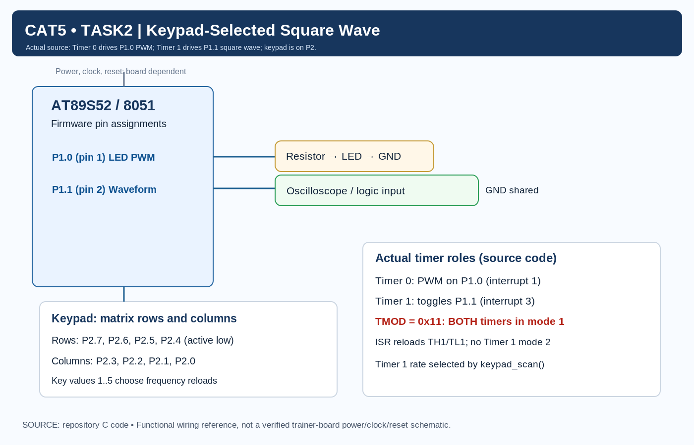

# Continuous Lab Evaluation 5 — Task 2 (Task5B): Variable-Frequency Square-Wave Generation Using Timers and Keypad

## Aim
To generate square waves of selectable frequencies using Timer 1 interrupts on an AT89S52 microcontroller, with frequency selection through a 4×4 matrix keypad. The same implementation concurrently operates Timer 0 for an independent software PWM LED fading output on Port 1.

---

## Hardware Components Required

- **AT89S52 Microcontroller Development Board**
- **4×4 Matrix Keypad**
- **Light Emitting Diode (LED)** with current-limiting resistor ($330\,\Omega$ nominal)
- **Oscilloscope or Logic Analyzer** (for waveform verification, where available)
- **Breadboard and Jumper Wires**
- **Regulated DC Power Supply** (5V DC)
- **Keil µVision IDE and C51 Toolchain**

---

## Pin Configuration

| Component / Signal | Microcontroller Pin | Physical Pin | Purpose / Function |
|---|---|---|---|
| **PWM LED** | P1.0 | 1 | Independent software PWM fading output |
| **Square-Wave Output** | P1.1 | 2 | Variable-frequency square-wave test point |
| **Keypad Row 0** | P2.7 | 28 | Keypad row scanning (Row 0, active-LOW drive) |
| **Keypad Row 1** | P2.6 | 27 | Keypad row scanning (Row 1, active-LOW drive) |
| **Keypad Row 2** | P2.5 | 26 | Keypad row scanning (Row 2, active-LOW drive) |
| **Keypad Row 3** | P2.4 | 25 | Keypad row scanning (Row 3, active-LOW drive) |
| **Keypad Column 0** | P2.3 | 24 | Keypad column sense (Column 0, input with pull-up) |
| **Keypad Column 1** | P2.2 | 23 | Keypad column sense (Column 1, input with pull-up) |
| **Keypad Column 2** | P2.1 | 22 | Keypad column sense (Column 2, input with pull-up) |
| **Keypad Column 3** | P2.0 | 21 | Keypad column sense (Column 3, input with pull-up) |
| **Timer 0** | Internal Peripheral | N/A | Dedicated to software PWM timing |
| **Timer 1** | Internal Peripheral | N/A | Dedicated to square-wave frequency generation |

In `variable_frequency_square_wave.c`, the output pins are declared as:
```c
sbit LED = P1^0;
sbit OUTPUT = P1^1;
```

---

## Circuit Diagram



### Circuit Connections
- **PWM LED (Pin 1 / P1.0):** Connects through a current-limiting resistor to the LED anode, with the cathode returning to common ground.
- **Waveform Test Point (Pin 2 / P1.1):** Connects directly to an oscilloscope channel probe or logic analyzer input, referenced to common ground.
- **Keypad Matrix Rows (P2.7, P2.6, P2.5, P2.4):** Connect to row lines 0 through 3 of the 4×4 keypad matrix.
- **Keypad Matrix Columns (P2.3, P2.2, P2.1, P2.0):** Connect to column lines 0 through 3 of the 4×4 keypad matrix.
- **Common Ground:** The trainer board GND, oscilloscope ground clip, and LED cathode share a common reference.

> [!NOTE]
> If a simplified keypad block is depicted in a schematic diagram, refer to the Pin Configuration table above for the exact individual row (P2.7–P2.4) and column (P2.3–P2.0) wiring defined in firmware.

---

## Theory

An 8051 hardware timer increments on every internal machine cycle ($12 / F_{\text{osc}}$). When a 16-bit timer reaches `0xFFFF` and rolls over to `0x0000`, the hardware sets its corresponding overflow flag and invokes an enabled interrupt service routine (ISR).

In this dual-timer design:
1. **Timer 1 as Waveform Generator:** Every Timer 1 overflow triggers `timer1_ISR` (interrupt vector 3), which reloads the timer and toggles the output pin P1.1 (`OUTPUT = ~OUTPUT;`).
2. **Two Toggles per Cycle:** Because the pin toggles on each overflow, one complete square-wave period ($T$) requires **two successive timer overflows** (one overflow for the HIGH half-period and one overflow for the LOW half-period):
   $$T_{\text{period}} = 2 \times T_{\text{half}}$$
3. **Frequency Control:** Frequency is modified on-the-fly by altering the 16-bit reload values placed into registers `TH1` and `TL1` during each interrupt.

---

## Timer Configuration

Both hardware timers are initialized to operate simultaneously:

```c
TMOD = 0x11;

TH0 = 0xFF;
TL0 = 0xF7;

TH1 = reload_high;
TL1 = reload_low;

ET0 = 1;
ET1 = 1;
EA = 1;

TR0 = 1;
TR1 = 1;
```

### Configuration Breakdown
- **`TMOD = 0x11`**: Sets both timers into **Mode 1 (16-bit Timer Mode)**.
  - Lower nibble (`0x01`): Timer 0 in Mode 1 (`GATE = 0, C/T = 0, M1 = 0, M0 = 1`).
  - Upper nibble (`0x10`): Timer 1 in Mode 1 (`GATE = 0, C/T = 0, M1 = 0, M0 = 1`).
- **Concurrent Operation:** Timer 0 independently drives LED PWM fading on P1.0 via interrupt vector 1 (`0x000B`). Timer 1 independently drives square-wave toggling on P1.1 via interrupt vector 3 (`0x001B`).
- **Interrupt Enables:** `ET0 = 1` enables Timer 0 interrupts, `ET1 = 1` enables Timer 1 interrupts, and `EA = 1` enables global interrupts.
- **Run Bits:** `TR0 = 1` and `TR1 = 1` start both timers.

> [!IMPORTANT]
> **Timer Mode Verification:** Timer 1 is configured in **16-bit Mode 1**, requiring software reload inside its ISR (`TH1 = reload_high; TL1 = reload_low;`). It does not use 8-bit auto-reload (Mode 2).

---

## Frequency Selection

The firmware defines an active frequency lookup table accessed when a key is detected:

```c
void set_frequency(unsigned char mode)
{
    switch(mode)
    {
        case 1: // 100Hz
            reload_high = 0xEE;
            reload_low  = 0x00;
            break;

        case 2: // 500Hz
            reload_high = 0xFC;
            reload_low  = 0x66;
            break;

        case 3: // 1kHz
            reload_high = 0xFE;
            reload_low  = 0x33;
            break;

        case 4: // 2kHz
            reload_high = 0xFF;
            reload_low  = 0x1A;
            break;

        case 5: // 5kHz
            reload_high = 0xFF;
            reload_low  = 0xA4;
            break;

        default:
            break;
    }
}
```

### Frequency Table

| Key Pressed | Nominal Target Frequency | `TH1` (Hex) | `TL1` (Hex) | Preload ($N$) | Counts to Overflow | Ideal Half-Period |
|:---:|:---:|:---:|:---:|:---:|:---:|:---:|
| **1** | **100 Hz** | `0xEE` | `0x00` | 60928 | 4608 | 5.000 ms |
| **2** | **500 Hz** | `0xFC` | `0x66` | 64614 | 922 | 1.000 ms |
| **3** | **1 kHz** | `0xFE` | `0x33` | 65075 | 461 | 0.500 ms |
| **4** | **2 kHz** | `0xFF` | `0x1A` | 65306 | 230 | 0.250 ms |
| **5** | **5 kHz** | `0xFF` | `0xA4` | 65444 | 92 | 0.100 ms |

*Note: The target frequencies reflect nominal theoretical design values assuming an 11.0592 MHz crystal. Actual frequencies depend on interrupt latency, ISR execution overhead, and manual reload timing.*

---

## Frequency Calculation

Let $N$ be the combined 16-bit reload value formed by `(TH1 << 8) | TL1`.

1. **Counts to Overflow:**
   $$\text{Counts} = 65536 - N$$

2. **Nominal Half-Period:**
   $$T_{\text{half}} = (65536 - N) \times \frac{12}{F_{\text{osc}}}$$

3. **Complete Square-Wave Period:**
   $$T_{\text{period}} \approx 2 \times T_{\text{half}}$$

4. **Waveform Frequency:**
   $$f \approx \frac{1}{2 \times T_{\text{half}}}$$

### Worked Example: Key 2 (500 Hz Nominal Target)
- Preload Value: `0xFC66` ($N = 64614_{10}$)
- Counts to Overflow: $65536 - 64614 = 922$ machine cycles
- At $F_{\text{osc}} = 11.0592\text{ MHz}$, machine cycle period $T_{\text{machine}} \approx 1.08507\,\mu\text{s}$:
  $$T_{\text{half}} = 922 \times 1.08507\,\mu\text{s} \approx 1.00043\text{ ms}$$
  $$T_{\text{period}} = 2 \times 1.00043\text{ ms} \approx 2.00086\text{ ms}$$
  $$f = \frac{1}{2.00086\text{ ms}} \approx 499.78\text{ Hz} \approx 500\text{ Hz}$$

> [!NOTE]
> This derivation represents an ideal timer-count estimate. Real-world oscilloscope measurements will exhibit slight timing expansion due to ISR entry latency and manual register reload instructions.

---

## Code Explanation

### Pin Declarations
```c
sbit LED = P1^0;
sbit OUTPUT = P1^1;
```

### Timer 1 Interrupt Service Routine
The square wave is synthesized entirely by hardware interrupt vector 3:
```c
void timer1_ISR(void) interrupt 3
{
    TH1 = reload_high;
    TL1 = reload_low;

    OUTPUT = ~OUTPUT;
}
```
Every time Timer 1 overflows, it reloads `TH1` and `TL1` from the active global variables and inverts P1.1.

### Keypad Scanning & Frequency Updating
The main program loop continuously polls the matrix keypad:
```c
while(1)
{
    key = keypad_scan();

    if(key != -1)
    {
        set_frequency(key);
    }
}
```
When a valid key (1 through 5) is detected, `set_frequency()` updates `reload_high` and `reload_low`. Timer 1 continues running uninterrupted; on its very next overflow, it picks up the updated reload values, immediately shifting the output frequency without glitches or blocking loops.

---

## Algorithm

1. Initialize Timer 0 and Timer 1 by loading `TMOD = 0x11` (both in 16-bit Mode 1).
2. Set initial preload values for Timer 0 (`TH0 = 0xFF, TL0 = 0xF7`) and Timer 1 (`TH1 = 0xFE, TL1 = 0x33` default 1 kHz).
3. Enable Timer 0 interrupt (`ET0 = 1`), Timer 1 interrupt (`ET1 = 1`), and global interrupts (`EA = 1`).
4. Start Timer 0 (`TR0 = 1`) and Timer 1 (`TR1 = 1`).
5. In `main()`, enter an infinite polling loop.
6. Sequentially scan keypad rows (P2.7–P2.4) by driving each LOW and reading columns (P2.3–P2.0).
7. If a key press is detected (`key != -1`), invoke `set_frequency(key)`.
8. Update global reload registers `reload_high` and `reload_low` based on key (1 to 5).
9. On every Timer 1 overflow:
   - Reload `TH1 = reload_high` and `TL1 = reload_low`.
   - Invert P1.1 (`OUTPUT = ~OUTPUT`).
10. Concurrently, on every Timer 0 overflow, service the independent LED PWM fading logic on P1.0.

---

## Expected Output

- **Pin P1.1:** Outputs a continuous square wave with a 50% duty cycle whose frequency changes immediately when Keys 1 through 5 are pressed:
  - Key 1: ~100 Hz
  - Key 2: ~500 Hz
  - Key 3: ~1 kHz
  - Key 4: ~2 kHz
  - Key 5: ~5 kHz
- **Pin P1.0:** Concurrently outputs a continuous software PWM signal, smoothly fading an external LED without interference from keypad scanning or square-wave generation.

---

## Important Observations

- **Dual Concurrent Hardware Timers:** Both Timer 0 and Timer 1 operate concurrently in 16-bit Mode 1 without mutual interference.
- **Waveform Generation on Timer 1:** Timer 1 drives the variable-frequency square-wave output on P1.1 via interrupt vector 3.
- **Independent PWM on Timer 0:** Timer 0 drives the software PWM LED output on P1.0 via interrupt vector 1.
- **Port 2 Keypad Interface:** Keypad scanning is performed on Port 2 (rows on upper nibble P2.7–P2.4, columns on lower nibble P2.3–P2.0).
- **Asynchronous Non-Blocking Execution:** No software delay loops are used for waveform timing.
- **Keypad Debounce Consideration:** The provided keypad-scanning function does not include a dedicated hardware debounce delay; in a physical build, switch contact bounce may register repeated key entries.
- **Theoretical Target Frequencies:** Frequency values cited in source code comments are nominal design targets and require oscilloscope measurement for exact hardware verification.

---

## Additional Task 2 Signal Projects

This directory also contains three independent signal generation implementations:

- [DIFFERENT_SIGNALS/SIGNAL1 — Square-Wave Generation](DIFFERENT_SIGNALS/SIGNAL1/README.md)
- [DIFFERENT_SIGNALS/SIGNAL2 — Variable Duty Cycle Waveform](DIFFERENT_SIGNALS/SIGNAL2/README.md)
- [DIFFERENT_SIGNALS/SIGNAL3 — Pulse Train Generation](DIFFERENT_SIGNALS/SIGNAL3/README.md)

---

## Viva Questions & Answers

### 1. What is a square wave?
A square wave is a periodic digital waveform that alternates symmetrically between steady HIGH and LOW voltage levels with equal duration (50% duty cycle).

### 2. What is Timer Mode 1 in the 8051?
Mode 1 is a 16-bit timer/counter mode where `THx` and `TLx` form a 16-bit counting register (0 to 65535). It does not automatically reload upon overflow; software must reload initial values in the ISR.

### 3. Why does one complete period require two timer interrupts?
Because the output pin toggles once per interrupt, one interrupt creates the HIGH level and the next creates the LOW level. Two consecutive interrupts are required to complete one cycle.

### 4. How is the square-wave frequency calculated?
$$f = \frac{1}{2 \times (65536 - N) \times T_{\text{machine}}}$$
where $N$ is the 16-bit preload value (`(TH1 << 8) | TL1`).

### 5. What are `TH1` and `TL1`?
They are the 8-bit Timer 1 High and Low byte registers. In Mode 1, they concatenate to form the 16-bit timer counter.

### 6. What is the role of the 4×4 matrix keypad?
The keypad allows the user to select predefined frequency modes (Keys 1–5) interactively by modifying the reload values applied to Timer 1.

### 7. Can Timer 0 and Timer 1 operate simultaneously?
Yes. The 8051 contains two distinct hardware timers with independent control bits (`TR0`, `TR1`), separate interrupt enable flags (`ET0`, `ET1`), and distinct interrupt vectors (1 and 3).

### 8. What happens when reload values change during operation?
The updated reload values take effect on the very next Timer 1 overflow, causing the square wave to transition smoothly to the new frequency without stopping the timer.

---

## Result

An Embedded C application was implemented for the AT89S52 microcontroller demonstrating dual-timer operation. Timer 1 generates square waves of selectable frequencies (100 Hz, 500 Hz, 1 kHz, 2 kHz, and 5 kHz nominal targets) on P1.1 driven by a 4×4 matrix keypad on Port 2, while Timer 0 simultaneously drives software PWM on P1.0. All operations are non-blocking and interrupt-driven.
