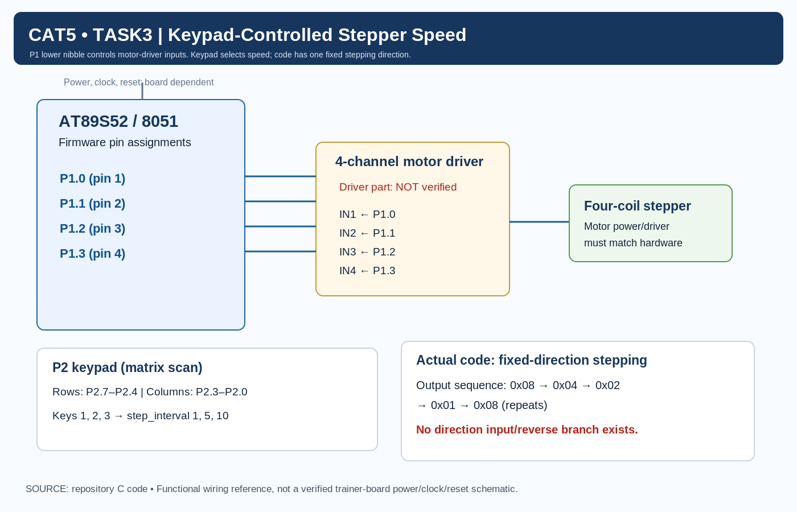

# Continuous Lab Evaluation 5 — Task 3 (Task5C): Stepper Motor Speed Control Using Timer Interrupts

## Aim
To control the stepping speed of a stepper motor using the AT89S52 microcontroller, Timer 0 interrupts, and a 4×4 matrix keypad.

> [!IMPORTANT]
> **Implementation Scope Note:** Although the evaluator's original laboratory syllabus title refers to *"Stepper Motor Speed and Direction Control"*, the verified repository source code (`stepper_motor_speed_control.c`) exclusively implements speed selection with a single **fixed stepping direction**. The firmware contains no direction input parsing, reversal flags, or bidirectional excitation branches. Direction reversal is therefore documented as not implemented in the current codebase.

---

## Hardware Components Required

- **AT89S52 Microcontroller Development Board**
- **Stepper Motor** (4-phase unipolar / bipolar configuration)
- **Compatible Stepper Motor Driver Stage** (e.g., ULN2003A Darlington array or equivalent power buffer)
- **4×4 Matrix Keypad**
- **External DC Power Supply** (dedicated supply suitable for motor voltage and current rating)
- **Connecting Wires and Breadboard**
- **Keil µVision IDE and C51 Toolchain**

> [!WARNING]
> **Driver Requirement & Inductive Loads:** The microcontroller's GPIO pins cannot drive stepper motor coils directly due to current limitations (maximum sink/source of a few milliamperes) and inductive back-EMF spikes. An intermediate power driver stage (such as a ULN2003 transistor array) with clamp diodes and a dedicated external motor supply must always be used. The specific driver model, supply voltage, and pin connections must be confirmed against actual laboratory hardware.

---

## Pin Configuration

| Component / Function | 8051 Port | Physical Pin | Purpose / Wiring |
|---|---|---|---|
| **Motor Step Output 1** | P1.0 | 1 | Drives Driver Input 1 (IN1) |
| **Motor Step Output 2** | P1.1 | 2 | Drives Driver Input 2 (IN2) |
| **Motor Step Output 3** | P1.2 | 3 | Drives Driver Input 3 (IN3) |
| **Motor Step Output 4** | P1.3 | 4 | Drives Driver Input 4 (IN4) |
| **Keypad Rows** | P2.7–P2.4 | Pins 28–25 | Matrix row scanning (active-LOW output drive) |
| **Keypad Columns** | P2.3–P2.0 | Pins 24–21 | Matrix column detection (inputs with internal pull-ups) |
| **Timer 0** | Internal | N/A | Periodic hardware timer for base step interval |
| **Ground** | GND | Pin 20 | Common ground reference between 8051 and driver |

---

## Circuit Diagram



### Circuit Connections
- **Port 1 Lower Nibble (P1.0–P1.3):** Connected directly to the inputs (IN1–IN4) of the 4-channel power motor driver.
- **Motor Driver Outputs:** Connected to the four stator phase windings of the stepper motor.
- **Power Supplies:** 
  - The AT89S52 development board operates on a regulated +5V logic supply.
  - The motor driver stage is powered by a dedicated motor power supply matching motor specifications.
  - Ground rails of the microcontroller and motor driver are bonded together to form a common reference.
- **Keypad Matrix:** Rows connect to P2.7–P2.4 and columns connect to P2.3–P2.0.

> [!NOTE]
> The circuit diagram depicts verified signal connections between the microcontroller and the driver inputs. Any specific driver IC part numbers or motor voltages shown in reference drawings are illustrative and must be verified against actual lab hardware.

---

## Theory

A stepper motor is an electromechanical actuator that converts digital electrical pulses into discrete mechanical angular movements (steps). The motor shaft rotates in fixed increments when its stator windings are energized in a specific predetermined sequence:
1. **Direction of Rotation:** Dictated by the directional progression of the excitation states (e.g., advancing phase $A \to B \to C \to D$ vs. $D \to C \to B \to A$).
2. **Speed of Rotation:** Controlled by the time interval elapsed between successive step pulses. Shorter intervals produce faster stepping; longer intervals produce slower stepping.

In this implementation:
- A four-state single-phase (wave drive) excitation sequence is generated on Port 1 lower nibble (`P1.0`–`P1.3`).
- Timer 0 operates in 16-bit Mode 1 to produce a stable 10 ms base tick.
- A software counter (`timer_count`) accumulates base ticks until reaching a user-selected threshold (`step_interval`), triggering the next commutation step.

---

## Timer Initialization

Timer 0 is configured in 16-bit Mode 1:

```c
void timer0_init(void)
{
    TMOD = 0x01;      // Timer 0, Mode 1 (16-bit)

    TH0 = 0xDC;
    TL0 = 0x00;

    ET0 = 1;          // Enable Timer 0 interrupt
    EA  = 1;          // Enable global interrupts
    TR0 = 1;          // Start Timer 0
}
```

### Timer Calculations
Assuming a standard 11.0592 MHz crystal oscillator:

1. **Machine Cycle Period:**
   $$T_{\text{machine}} = \frac{12}{11.0592\text{ MHz}} \approx 1.08507\,\mu\text{s}$$

2. **Preload Value (`0xDC00`):**
   $$\text{Preload} = 0\text{xDC00}_{16} = 56320_{10}$$

3. **Counts to Overflow:**
   $$\text{Counts} = 65536 - 56320 = 9216\text{ machine cycles}$$

4. **Nominal Timer 0 Tick Interval:**
   $$T_{\text{tick}} = 9216 \times 1.08507\,\mu\text{s} \approx 10.000\,\text{ms} \approx 10\text{ ms}$$

*Note: This is the theoretical timer interval excluding interrupt entry and reload instruction overhead.*

---

## Speed Selection

The matrix keypad modifies the stepping rate by assigning different values to `step_interval`:

```c
void set_speed(int key)
{
    switch(key)
    {
        case 1: step_interval = 1; break;
        case 2: step_interval = 5; break;
        case 3: step_interval = 10; break;
    }
}
```

### Speed Table

| Key Pressed | `step_interval` | Timer Ticks Required | Ideal Step Interval | Relative Speed |
|:---:|:---:|:---:|:---:|:---:|
| **1** | **1** | 1 tick | $1 \times 10\text{ ms} = 10\text{ ms}$ | **Fast** |
| **2** | **5** | 5 ticks | $5 \times 10\text{ ms} = 50\text{ ms}$ | **Medium** |
| **3** | **10** | 10 ticks | $10 \times 10\text{ ms} = 100\text{ ms}$ | **Slow** |

> [!IMPORTANT]
> The intervals above ($10\text{ ms}, 50\text{ ms}, 100\text{ ms}$) are derived directly from the source code multipliers ($1, 5, 10$). Do not substitute alternative values (such as 20 ms) not supported by the implementation.

---

## Stepping Sequence

The firmware defines an initial coil state and updates it sequentially:

```c
unsigned char coil = 0x08; // Initial coil state

void step_motor(void)
{
    if (coil == 0x01)
    {
        coil = 0x08;
    }
    else
    {
        coil = coil >> 1;
    }

    P1 = coil;
}
```

### Coil Excitation Sequence
Starting from `0x08`, right-shifting by 1 (`coil >> 1`) and wrapping from `0x01` back to `0x08` produces:

$$\text{0x08} \longrightarrow \text{0x04} \longrightarrow \text{0x02} \longrightarrow \text{0x01} \longrightarrow \text{0x08 (repeats)}$$

In binary:
$$\mathbf{00001000}_2 \longrightarrow \mathbf{00000100}_2 \longrightarrow \mathbf{00000010}_2 \longrightarrow \mathbf{00000001}_2 \longrightarrow \mathbf{00001000}_2$$

### Pin Excitation Mapping

| Step State | Hex Value | P1.3 (IN4) | P1.2 (IN3) | P1.1 (IN2) | P1.0 (IN1) |
|:---:|:---:|:---:|:---:|:---:|:---:|
| **State 1** | `0x08` | **1** | 0 | 0 | 0 |
| **State 2** | `0x04` | 0 | **1** | 0 | 0 |
| **State 3** | `0x02` | 0 | 0 | **1** | 0 |
| **State 4** | `0x01` | 0 | 0 | 0 | **1** |

> [!NOTE]
> Only bits P1.0–P1.3 represent motor-step control lines. The mechanical rotation per 4-step sequence depends on the motor's internal step angle (e.g., $1.8^\circ$ or $7.5^\circ$) and gear reduction. One 4-state sequence does not equate to one full mechanical revolution of the rotor shaft.

---

## Interrupt & Keypad Logic

### Interrupt Service Routine
On every Timer 0 overflow, `timer0_ISR` executes:
```c
void timer0_ISR(void) interrupt 1
{
    TH0 = 0xDC;
    TL0 = 0x00;

    timer_count++;
    if(timer_count >= step_interval) {
        timer_count = 0;
        step_motor(); // Advance to next coil state
    }
}
```

1. Reloads `TH0 = 0xDC` and `TL0 = 0x00` (~10 ms reload).
2. Increments `timer_count`.
3. Compares `timer_count` with `step_interval`.
4. When `timer_count >= step_interval`, resets `timer_count = 0` and calls `step_motor()`.
5. Outputs the updated pattern to Port 1.

### Keypad Polling in `main()`
The main function initializes Timer 0 and continuously polls the matrix keypad on Port 2:
```c
void main() {
    timer0_init();
    P1 = coil; // Initialize P1 with the initial coil state
    while(1) {
        int key = keypad_scan();
        if(key != -1) {
            set_speed(key);
        }
    }
}
```
Only keypad values 1, 2, and 3 are mapped in `set_speed()`. Any other key press returns a code that does not alter `step_interval`, preserving the current speed.

---

## Algorithm

1. Initialize `coil` variable to `0x08` and `step_interval` to 1.
2. Configure Timer 0 in 16-bit Mode 1 (`TMOD = 0x01`).
3. Preload Timer 0 with `TH0 = 0xDC` and `TL0 = 0x00` (~10 ms base tick).
4. Enable Timer 0 interrupt (`ET0 = 1`) and global interrupts (`EA = 1`).
5. Start Timer 0 (`TR0 = 1`).
6. Output the initial coil state on Port 1 (`P1 = coil`).
7. In the main loop, continuously scan the 4×4 keypad on Port 2.
8. When Key 1, 2, or 3 is detected, update `step_interval` accordingly.
9. On each Timer 0 interrupt:
   - Reload `TH0 = 0xDC` and `TL0 = 0x00`.
   - Increment `timer_count`.
   - If `timer_count >= step_interval`:
     - Reset `timer_count = 0`.
     - Advance `coil`: if `coil == 0x01`, reset to `0x08`; else shift right (`coil >> 1`).
     - Write `P1 = coil`.
10. Repeat continuously without software delay loops.

---

## Expected Output

- **Rotation:** The stepper motor rotates continuously in a single fixed direction determined by the `0x08 -> 0x04 -> 0x02 -> 0x01` sequence.
- **Key 1 Pressed:** Motor steps at the fastest rate (~10 ms between steps).
- **Key 2 Pressed:** Motor steps at a medium rate (~50 ms between steps).
- **Key 3 Pressed:** Motor steps at the slowest rate (~100 ms between steps).
- **Other Keys Pressed:** Motor maintains its current stepping speed without change.
- Actual shaft RPM depends on the motor's step angle, gear train, and driver hardware.

---

## Important Observations

- **Hardware Timer Pacing:** Timer 0 interrupts handle step timing asynchronously, freeing the CPU for keypad polling.
- **Predefined Speed Levels:** Keypad keys 1, 2, and 3 select three distinct, deterministic stepping speeds.
- **Lower Nibble Control:** Port 1 bits 0–3 output the 4-phase excitation pattern.
- **Fixed Logical Direction:** The sequence shifts exclusively rightward (`coil >> 1`), enforcing unidirectional rotation.
- **No Direction Reversal:** A direction reversal interface (bidirectional switching) is not implemented in the current firmware.
- **External Driver Mandatory:** Microcontroller outputs must pass through an external power stage (e.g., ULN2003) to drive inductive motor coils safely.
- **Non-Blocking Control:** Step progression uses hardware interrupts rather than CPU-blocking software delays.
- **Theoretical Timing Basis:** Step intervals ($10\text{ ms}, 50\text{ ms}, 100\text{ ms}$) are calculated based on an assumed 11.0592 MHz clock and do not include minor ISR overhead.

---

## Viva Questions & Answers

### 1. What is a stepper motor?
A stepper motor is a brushless DC motor that divides a full $360^\circ$ rotation into a number of equal angular steps. It moves by energizing stator coils in sequence without position feedback sensors.

### 2. Why is an external motor driver required?
8051 GPIO pins cannot supply the hundreds of milliamperes required by motor coils and can be destroyed by inductive back-EMF voltage spikes generated when coils are de-energized. A driver stage buffers current and provides flyback diode protection.

### 3. What is the purpose of the coil excitation sequence?
The excitation sequence energizes adjacent stator electromagnets in order, pulling the permanent magnet rotor into alignment with the active pole and producing continuous rotary motion.

### 4. How does Timer 0 control motor speed?
Timer 0 generates an interrupt every ~10 ms. By counting a variable number of these interrupts (`step_interval = 1, 5, 10`) before advancing to the next coil state, the firmware changes the step period and thus the motor speed.

### 5. What happens when Key 1 is pressed on the keypad?
`set_speed(1)` sets `step_interval = 1`. The motor steps on every Timer 0 interrupt (~10 ms), producing the fastest programmed stepping rate.

### 6. What does `step_interval` represent in code?
It represents the software divider: the number of 10 ms Timer 0 ticks that must elapse before the `step_motor()` function is invoked.

### 7. What is the function of `coil >> 1` in `step_motor()`?
It right-shifts the active bit by one position, transitioning the active drive line from P1.3 (`0x08`) to P1.2 (`0x04`) to P1.1 (`0x02`) to P1.0 (`0x01`), advancing the motor by one step.

### 8. Does this code implement motor direction reversal?
No. The code only shifts the active bit rightward (`coil >> 1`) and wraps back to `0x08`. It does not support left-shifting (`coil << 1`) or direction control keys.

---

## Result

An Embedded C program was developed and verified for the AT89S52 microcontroller to control a stepper motor using Timer 0 in 16-bit Mode 1 and a 4×4 matrix keypad. The implementation outputs a 4-state wave drive excitation pattern on Port 1 (P1.0–P1.3) and provides three keypad-selectable speed levels (nominal 10 ms, 50 ms, and 100 ms step intervals). Direction reversal is not implemented in the current firmware. Physical hardware execution requires deployment on the laboratory trainer board with an appropriate motor driver.
