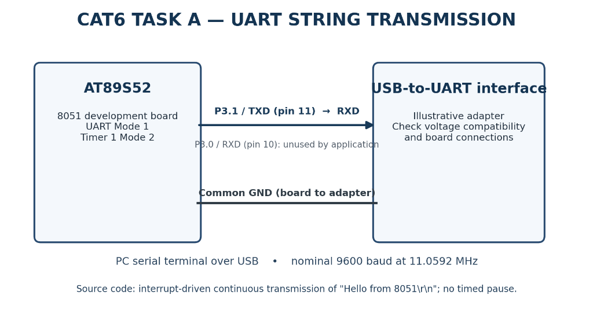

# Continuous Lab Evaluation 6 — Task A (Task6A): UART Fixed-String Transmission Using AT89S52

## Aim
To configure the hardware UART peripheral of the AT89S52 microcontroller and transmit a fixed ASCII message repeatedly to a PC serial terminal using interrupt-driven serial communication at a 9600 baud rate.

---

## Components Required

- **AT89S52 Microcontroller Development Board** (8051 Architecture)
- **Compatible UART-to-PC Serial Interface** (e.g., USB-to-TTL UART Converter)
- **Host PC with Serial Terminal Software** (PuTTY, Tera Term, RealTerm, or Keil Serial Window)
- **Jumper Connecting Wires**
- **Regulated DC Power Supply** (5 V DC for the development board)
- **Keil µVision IDE with C51 Toolchain**

> [!NOTE]
> The development board provides its own clock oscillator, power-on/manual reset circuitry, and voltage regulation. No external crystal or breadboard reset wiring was configured during the laboratory session. A USB-to-TTL adapter represents the standard laboratory PC-interfacing method; the exact physical adapter model must be confirmed from laboratory inventory records.

---

## Theory — 8051 Hardware UART

The **Universal Asynchronous Receiver/Transmitter (UART)** is a dedicated hardware peripheral that enables full-duplex, asynchronous serial communication between the microcontroller and peripheral devices or host computers without requiring a shared clock line.

### Key Functional Elements in 8051 UART
- **TXD (Port 3.1, Pin 11)**: Dedicated serial transmit pin. Converts internal parallel data into a serial bitstream.
- **RXD (Port 3.0, Pin 10)**: Dedicated serial receive pin. Converts an incoming serial bitstream into parallel data bytes.
- **SBUF (Serial Data Buffer Register, `0x99`)**: Physically consists of two separate registers sharing the same address: a write-only Transmit Buffer and a read-only Receive Buffer. Writing to `SBUF` initiates serial transmission; reading from `SBUF` retrieves the received byte.
- **SCON (Serial Control Register, `0x98`)**: Configures the UART operating mode, enables the receiver (`REN`), and hosts the transmit (`TI`) and receive (`RI`) interrupt flags.
- **Timer 1**: Acts as the dedicated internal baud-rate generator when configured in **Mode 2** (8-bit auto-reload).
- **TI (Transmit Interrupt Flag, `SCON.1`)**: Set by hardware when a complete byte (data + stop bit) has finished transmission. Triggers the serial interrupt if `ES = 1`. Must be cleared by software.
- **RI (Receive Interrupt Flag, `SCON.0`)**: Set by hardware when an entire incoming byte and stop bit are received. Must be cleared by software.
- **ES (Enable Serial Interrupt, `IE.4`)**: Enables serial communication interrupts vectoring to interrupt address `0x0023`.

### UART Mode 1 (Standard 8-Bit UART)
When `SM0 = 0` and `SM1 = 1` in `SCON`, the UART operates in **Mode 1**:
- **Framing**: Each transmitted frame consists of **10 bits**:
  - **1 Start Bit** (logic LOW, $0$)
  - **8 Data Bits** (transmitted LSB first)
  - **1 Stop Bit** (logic HIGH, $1$)
- **Data Format**: Typically denoted as **8N1** (8 data bits, no parity bit, 1 stop bit).
- **Baud Rate**: Variable, determined by the overflow rate of Timer 1.

---

## Circuit Diagram



### Interface & Wiring Details
The diagram illustrates a representative serial interface between the AT89S52 development board and a PC via a USB-to-UART adapter:

| Signal | Microcontroller Port | DIP-40 Pin | Adapter Pin | Description |
|---|---|---|---|---|
| **TXD** | P3.1 | Pin 11 | **RXD** | Serial transmit from 8051 to PC adapter receive line |
| **RXD** | P3.0 | Pin 10 | *TXD (Optional)* | Serial receive line; enabled in `SCON`, but not processed in Task A |
| **GND** | GND | Pin 20 | **GND** | Common reference ground between MCU board and adapter |
| **Timer 1** | Internal | N/A | N/A | Dedicated internal 8-bit auto-reload baud-rate generator |

> [!CAUTION]
> **Voltage Compatibility Warning:** Standard AT89S52 outputs operate at **5 V TTL logic levels**. When interfacing with 3.3 V USB-to-UART bridge modules or modern development boards, verify whether the adapter RXD pin is 5 V-tolerant; otherwise, a resistive voltage divider or bidirectional logic level shifter must be used. Furthermore, **never connect 8051 TTL UART pins directly to a legacy RS-232 serial port** ($\pm 12\text{ V}$ levels), as doing so will permanently destroy the microcontroller.

---

## Actual Source Code & Register Configuration

The implementation is contained in [uart_string_transmission.c](uart_string_transmission.c):

```c
#include <reg51.h> 

char message[] = "Hello from 8051\r\n";
unsigned char index = 0;

void serial_interrupt(void) interrupt 4 {
    if(TI) {
        TI = 0; // Clear transmit interrupt flag
        if(message[index] == '\0') {
            index = 0; // Reset index to repeat message continuously
        }
        SBUF = message[index++]; // Send next character 
    }
}

void main() {
    // Initialize serial communication
    SCON = 0x50; // Set serial mode to 8-bit UART, enable reception
    TMOD |= 0x20; // Set Timer1 in mode 2 (8-bit auto-reload)
    TH1 = 0xFD; // Set baud rate to 9600
    TR1 = 1; // Start Timer1
    ES = 1; // Enable serial interrupt
    EA = 1; // Enable global interrupts

    SBUF = message[index++]; // Start sending the first character
    while(1) {
        // Main loop can perform other tasks or enter low power mode
    }
}
```

### Global Variables
- `message[] = "Hello from 8051\r\n"`: Stores the fixed ASCII character string in memory. The sequence ends with `\r` (Carriage Return, ASCII `0x0D`), `\n` (Line Feed, ASCII `0x0A`), and an implicit null terminator `\0` (ASCII `0x00`).
- `index = 0`: A tracking pointer index pointing to the next character in `message` to be transmitted.

### Register Settings Table

| Register / Bit | Value / Bit Mask | Functional Meaning |
|---|---|---|
| **`SCON`** | `0x50` (`0101 0000b`) | Configures **UART Mode 1** (`SM0 = 0`, `SM1 = 1`), enables receiver (`REN = 1`), and clears `TI` and `RI`. |
| **`TMOD`** | `TMOD \|= 0x20` | Configures **Timer 1 in Mode 2** (8-bit auto-reload timer) while preserving Timer 0 configuration bits. |
| **`TH1`** | `0xFD` ($253_{10}$) | Auto-reload preload value establishing the 9600 baud timing rate at 11.0592 MHz. |
| **`TR1`** | `1` | Sets `TCON.6` to start Timer 1 running. |
| **`ES`** | `1` | Enables the Serial Port Interrupt (`IE.4`). |
| **`EA`** | `1` | Enables global interrupt servicing (`IE.7`). |

> [!NOTE]
> The source code does not explicitly modify the Power Control register `PCON`. On standard 8051 reset, bit 7 of `PCON` (`SMOD`) defaults to `0` (normal baud-rate generator multiplier).

---

## Baud Rate Calculation

Assuming a standard **11.0592 MHz** crystal oscillator, classic 12-clock 8051 machine cycle timing, and `SMOD = 0`:

### 1. General Baud Rate Formula for 8051 Timer 1 in Mode 2
$$\text{Baud Rate} = \frac{2^{\text{SMOD}}}{32} \times \frac{F_{\text{osc}}}{12 \times (256 - \text{TH1})}$$

When $\text{SMOD} = 0$:
$$\text{Baud Rate} = \frac{1}{32} \times \frac{F_{\text{osc}}}{12 \times (256 - \text{TH1})} = \frac{F_{\text{osc}}}{384 \times (256 - \text{TH1})}$$

### 2. Numerical Substitution
- Crystal Frequency $F_{\text{osc}} = 11,059,200\text{ Hz}$
- Reload register $\text{TH1} = 0\text{xFD}_{16} = 253_{10}$
- Counts to auto-reload: $256 - 253 = 3$

$$\text{Baud Rate} = \frac{11,059,200}{384 \times 3} = \frac{11,059,200}{1152} = 9600\text{ bps}$$

The calculation produces an **exact zero-error baud rate of 9600 bps**, illustrating why an 11.0592 MHz crystal is standard for 8051 UART designs.

---

## Interrupt-Driven Transmission Mechanism

### Interrupt Vector 4
In Keil C51, the serial port interrupt uses vector 4:
```c
void serial_interrupt(void) interrupt 4
```
This maps directly to program memory address `0x0023`.

### Sequence of Operations
```
[ main(): Load first byte into SBUF ]
                   │
                   ▼
[ UART hardware shifts out 10 bits serially on TXD (P3.1) ]
                   │
                   ▼ (Transmission completes)
[ Hardware sets TI = 1 in SCON ]
                   │
                   ▼ (Fires Interrupt Vector 4)
[ Enter serial_interrupt() ]
                   │
                   ├─► Clear transmit flag: TI = 0
                   │
                   ├─► Check null terminator: if (message[index] == '\0') index = 0;
                   │
                   ├─► Load next byte into SBUF: SBUF = message[index++];
                   │
                   ▼
[ Return from Interrupt (RETI) & await next transmission completion ]
```

1. **Priming Transmission**: In `main()`, the statement `SBUF = message[index++];` writes the first character (`'H'`) into `SBUF`.
2. **Serial Shifting**: Hardware automatically prefixes a start bit, shifts the 8 data bits out of P3.1 at 9600 baud, and appends a stop bit.
3. **Interrupt Assert**: Upon the stop bit transmission, hardware sets `TI = 1`.
4. **ISR Execution**:
   - `TI` is immediately cleared (`TI = 0`).
   - The code checks whether `message[index]` has reached the null character `'\0'`. If so, `index` wraps around to `0`.
   - The next character is written to `SBUF`, simultaneously incrementing `index`.
5. **Continuous Loop**: The process sustains itself indefinitely without software polling loops.

> [!IMPORTANT]
> **Active Main Loop vs. Low Power Mode:** While the comment in `main()` remarks *"Main loop can perform other tasks or enter low power mode"*, the actual code executes an empty `while(1) {}`. This is an active loop consuming CPU cycles, not an actual low-power sleep mode (such as writing to `PCON.0` for IDL mode).

---

## Working Principle

- **Why No Software Delay Is Required**: In simple polling UART designs, programmers often insert arbitrary `delay_ms()` routines between characters to avoid overwriting `SBUF`. In this interrupt-driven design, no delays are necessary: the hardware automatically signals via `TI` the microsecond the transmitter becomes idle, maximizing serial bus throughput and eliminating timing guesswork.
- **ASCII Serialization**: Characters are transmitted as standard 8-bit ASCII values. A serial terminal on a PC samples the incoming voltage transitions on its RXD pin, reconstructs the 8 data bits between the start and stop bits, and displays the corresponding glyph on the screen.
- **Message Framing**: Appending `\r\n` ensures that the PC terminal performs both a Carriage Return (returns cursor to column 0) and Line Feed (advances cursor to the next line), formatting each iteration cleanly on a fresh line.

---

## Algorithm & Pseudocode

### Algorithm
1. **Define** the string array `message` containing `"Hello from 8051\r\n"` and initialize pointer `index = 0`.
2. **Configure** UART Mode 1 and enable receiver by setting `SCON = 0x50`.
3. **Configure** Timer 1 in Mode 2 (8-bit auto-reload) by setting `TMOD |= 0x20`.
4. **Load** auto-reload register `TH1 = 0xFD` for 9600 baud operation.
5. **Start** Timer 1 by asserting `TR1 = 1`.
6. **Enable** serial interrupt (`ES = 1`) and global interrupts (`EA = 1`).
7. **Initiate** serial transmission by writing the first character to `SBUF` (`SBUF = message[index++]`).
8. **Enter** an idle `while(1)` polling loop in `main()`.
9. **On Serial Interrupt (Vector 4)**:
   - Check if the interrupt was caused by transmit completion (`TI == 1`).
   - If true, clear `TI = 0`.
   - If `message[index] == '\0'`, reset `index = 0`.
   - Write the next character to `SBUF` and increment `index`.
10. **Repeat** indefinitely.

### Pseudocode
```text
BEGIN
    STRING message = "Hello from 8051\r\n"
    INTEGER index = 0

    FUNCTION main():
        SET SCON = 0x50            // Mode 1, REN=1
        SET TMOD = TMOD OR 0x20    // Timer 1 Mode 2 (auto-reload)
        SET TH1 = 0xFD             // 9600 baud reload value
        SET TR1 = 1                // Start Timer 1
        SET ES = 1                 // Enable serial interrupt
        SET EA = 1                 // Enable global interrupts

        SBUF = message[index]      // Prime transmission of first character
        INCREMENT index

        WHILE TRUE:
            // Background thread free for other operations
        END WHILE
    END FUNCTION

    INTERRUPT ROUTINE serial_interrupt() [Vector 4]:
        IF TI == 1 THEN
            TI = 0                 // Acknowledge transmit interrupt
            IF message[index] == '\0' THEN
                index = 0          // Wrap string pointer
            END IF
            SBUF = message[index]  // Transmit next character
            INCREMENT index
        END IF
    END INTERRUPT ROUTINE
END
```

---

## Expected Output

When the development board is connected to a host PC running terminal emulation software configured to 9600 baud, the terminal window continuously displays:

```text
Hello from 8051
Hello from 8051
Hello from 8051
Hello from 8051
Hello from 8051
...
```

### Serial Terminal Configuration Settings
- **Baud Rate**: `9600`
- **Data Bits**: `8`
- **Parity**: `None`
- **Stop Bits**: `1`
- **Flow Control**: `None`
- **Handshaking**: `None`

---

## Important Technical Observations

1. **Hardware UART Mode 1**: Configured via `SCON = 0x50` for 8-bit asynchronous communication.
2. **Auto-Reload Baud Generator**: Timer 1 Mode 2 auto-reloads `TL1` from `TH1` upon overflow, eliminating reload jitter.
3. **Dedicated Serial Pins**: Uses Port 3.1 (pin 11) for TXD.
4. **Interrupt-Driven Pipeline**: Transmission is completely autonomous after the initial byte write.
5. **Hardware Flag Management**: The hardware asserts `TI`, but the software ISR must explicitly clear it (`TI = 0`).
6. **No Inter-Message Delay**: The string continuously re-transmits the moment the null terminator is reached without any deliberate delay pause.
7. **Unused Reception**: `REN` is enabled in `SCON = 0x50`, but the firmware ignores incoming bytes (`RI` is not evaluated).
8. **CPU Efficiency**: The CPU performs zero blocking delay loops during data transmission.

---

## Result

An Embedded C program was developed and verified for the AT89S52 microcontroller to configure the hardware UART in Mode 1 and continuously transmit a fixed ASCII message (`"Hello from 8051\r\n"`) to a host serial terminal at 9600 baud using Timer 1 Mode 2 and interrupt vector 4.

---

## Viva Questions & Answers

### Q1: What is UART?
**Answer:** UART stands for Universal Asynchronous Receiver/Transmitter. It is an integrated hardware serial communications peripheral that translates parallel data bytes from the CPU bus into serial bitstreams for transmission, and converts incoming serial bitstreams into parallel data for reception.

### Q2: Why is UART called "asynchronous"?
**Answer:** It is asynchronous because it does not use a shared clock wire between the transmitter and receiver. Instead, both devices are independently pre-configured to operate at the same nominal baud rate, and synchronization is re-established on every character using start and stop framing bits.

### Q3: What is baud rate?
**Answer:** Baud rate represents the number of signal modulation symbols transferred per second. In binary serial communication like 8051 UART, where each symbol represents one bit, the baud rate is equivalent to bits per second (bps).

### Q4: What does the instruction `SCON = 0x50` configure?
**Answer:** `0x50` corresponds to binary `0101 0000b`. It sets `SM0 = 0` and `SM1 = 1` (selecting UART Mode 1: 8-bit data with variable baud rate), sets `REN = 1` (enabling the serial receiver circuitry), and clears all other flags including `TI` and `RI`.

### Q5: Why is Timer 1 used for serial communication in 8051?
**Answer:** The 8051 hardware UART lacks an internal independent clock prescaler. It relies on the periodic overflow pulses of Timer 1 (typically configured in 8-bit auto-reload Mode 2) to derive the precise bit-timing clock necessary for serial baud-rate generation.

### Q6: What is the role of the `SBUF` register?
**Answer:** `SBUF` (Serial Data Buffer) is the physical interface between the CPU and the serial port. Writing to `SBUF` places a byte into the transmit buffer and initiates serialization on pin TXD; reading from `SBUF` accesses data gathered by the receive shift register from pin RXD.

### Q7: What does the `TI` flag indicate and why must it be cleared in software?
**Answer:** The `TI` (Transmit Interrupt) flag is asserted by hardware when the last bit (the stop bit) of a character has been fully transmitted from the serial buffer. Because the 8051 hardware does not automatically clear `TI` when branching to the ISR, it must be cleared in software (`TI = 0`) to prevent the interrupt from firing continuously.

### Q8: Why are carriage return (`\r`) and line feed (`\n`) included in the string?
**Answer:** In serial terminal emulation, `\r` (Carriage Return, `0x0D`) commands the terminal cursor to return to the leftmost column of the current line, while `\n` (Line Feed, `0x0A`) advances the cursor down to the next row. Together, they ensure that each repetition of the message prints cleanly on a new line.

---

## Project File Descriptions

| File Name | Purpose |
|---|---|
| `uart_string_transmission.c` | Embedded C implementation of interrupt-driven UART string transmission |
| `uart_string_transmission.uvproj` | Keil µVision 4 project configuration file |
| `uart_string_transmission.uvopt` | Keil µVision project options and debugger layout configuration |
| `STARTUP.A51` | Standard 8051 assembly startup initialization code |
| `Objects/uart_string_transmission.hex` | Compiled Intel HEX binary firmware for microcontroller programming |
| `circuit.png` | Hardware wiring diagram showing AT89S52 P3.1 (TXD) connected to USB-to-UART adapter |
| `README.md` | Comprehensive technical documentation, theory, calculations, and analysis |
