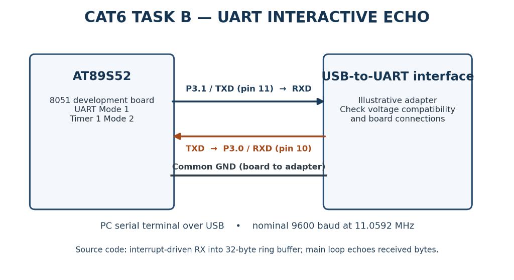

# Continuous Lab Evaluation 6 — Task B (Task6B): Interactive UART Echo Terminal Using AT89S52

## Aim
To implement bidirectional, full-duplex serial communication between the AT89S52 microcontroller and a host serial terminal, receiving transmitted keystroke characters into a circular ring buffer via hardware interrupts and echoing them back to the terminal at 9600 baud.

---

## Components Required

- **AT89S52 Microcontroller Development Board** (8051 Architecture)
- **Compatible UART-to-PC Serial Interface** (e.g., USB-to-TTL UART Converter)
- **Host PC with Serial Terminal Software** (PuTTY, Tera Term, RealTerm, or Keil Serial Window)
- **Jumper Connecting Wires**
- **Regulated DC Power Supply** (5 V DC for the development board)
- **Keil µVision IDE with C51 Toolchain**

> [!NOTE]
> The development board provides its own clock oscillator, power-on/manual reset circuitry, and voltage regulation. No external crystal or breadboard reset wiring was configured during the laboratory session. A USB-to-TTL adapter represents the standard laboratory PC-interfacing method; the exact physical adapter model must be confirmed from laboratory inventory records.

---

## Theory — Bidirectional UART & Circular Buffering

### Full-Duplex Serial Communication
In full-duplex serial communication, data transmission (**TX**) and data reception (**RX**) occur simultaneously over independent physical signal lines without interference.

In the AT89S52 microcontroller:
- **RXD (Port 3.0, Pin 10)** receives incoming serial bitstreams from the terminal.
- **TXD (Port 3.1, Pin 11)** transmits outgoing serial bitstreams to the terminal.
- **SBUF (`0x99`)** provides access to internal physical transmit and receive buffers.
- **RI (`SCON.0`)** is set by hardware upon byte reception and triggers the serial interrupt.
- **TI (`SCON.1`)** is set by hardware upon byte transmission and triggers the serial interrupt.

### Circular Ring Buffer Architecture
A circular buffer (ring buffer) is a fixed-size FIFO (First-In, First-Out) data structure that connects the end of an array back to the beginning using modulo indexing. It implements an asynchronous **producer-consumer model**:
1. **Producer (Interrupt Service Routine)**: When a byte arrives, the high-priority Serial ISR captures it from `SBUF`, places it into `rxBuffer[rxHead]`, and increments `rxHead` modulo `BUFFER_SIZE`.
2. **Consumer (Main Program Loop)**: The background application periodically checks whether unread characters exist (`rxHead != rxTail`), extracts `rxBuffer[rxTail]`, and increments `rxTail` modulo `BUFFER_SIZE`.
3. **Buffer Decoupling**: If the main CPU is temporarily delayed or busy, incoming characters are not dropped, provided the buffer does not overflow.
4. **Capacity & Distinction**: To distinguish between an entirely empty buffer (`rxHead == rxTail`) and a completely full buffer, one storage slot is reserved. Thus, a 32-byte circular buffer holds up to **31 unread bytes**.

---

## Circuit Diagram



### Interface & Wiring Details
The diagram illustrates bidirectional serial communication between the AT89S52 development board and a PC via a USB-to-UART bridge adapter:

| Signal | Microcontroller Port | DIP-40 Pin | Adapter Pin | Description |
|---|---|---|---|---|
| **RXD** | P3.0 | Pin 10 | **TXD** | Microcontroller receives characters transmitted by host PC |
| **TXD** | P3.1 | Pin 11 | **RXD** | Microcontroller transmits echo characters to host PC |
| **GND** | GND | Pin 20 | **GND** | Common reference ground between MCU board and adapter |
| **Timer 1** | Internal | N/A | N/A | Dedicated internal 8-bit auto-reload baud-rate generator |

> [!CAUTION]
> **Voltage Compatibility & Signal Levels:** The AT89S52 operates at 5 V TTL logic levels ($V_{\text{OH}} \approx 4.5\text{ V}$, $V_{\text{OL}} \le 0.4\text{ V}$). Ensure that the USB-to-UART converter RXD pin is 5 V-tolerant or level-shifted. Never connect the microcontroller directly to standard computer RS-232 COM ports, where signal voltages reach $\pm 12\text{ V}$ and will cause immediate hardware destruction.

---

## Actual Source Code & Register Configuration

The complete implementation from [uart_echo_terminal.c](uart_echo_terminal.c):

```c
#include <reg51.h>

#define BUFFER_SIZE 32

// RX Circular Buffer
volatile unsigned char data rxBuffer[BUFFER_SIZE];
volatile unsigned char rxHead = 0;
volatile unsigned char rxTail = 0;
volatile unsigned char rxOverflow = 0;

// TX status
volatile bit txBusy = 0;

// UART Serial Interrupt
void serial_interrupt(void) interrupt 4
{
    unsigned char nextHead;
    unsigned char received;

    // Receive interrupt
    if (RI)
    {
        received = SBUF;
        RI = 0;

        nextHead = (rxHead + 1) % BUFFER_SIZE;

        if (nextHead != rxTail)
        {
            rxBuffer[rxHead] = received;
            rxHead = nextHead;
        }
        else
        {
            rxOverflow = 1;
        }
    }

    // Transmit interrupt
    if (TI)
    {
        TI = 0;
        txBusy = 0;
    }
}

// UART Initialization
void uart_init(void)
{
    EA = 0;

    PCON &= 0x7F;  // SMOD = 0

    TMOD = (TMOD & 0x0F) | 0x20;

    TH1 = 0xFD;
    TL1 = 0xFD;

    SCON = 0x50;

    RI = 0;
    TI = 0;

    rxHead = 0;
    rxTail = 0;
    rxOverflow = 0;
    txBusy = 0;

    TR1 = 1;

    ES = 1;
    EA = 1;
}

// Check if received data is available
bit uart_available(void)
{
    return (rxHead != rxTail);
}

// Read one character from ring buffer
unsigned char uart_read(void)
{
    unsigned char received;

    while (!uart_available());

    received = rxBuffer[rxTail];
    rxTail = (rxTail + 1) % BUFFER_SIZE;

    return received;
}

// Transmit one character
void uart_send(unsigned char ch)
{
    while (txBusy);

    txBusy = 1;
    SBUF = ch;
}

// Main Program - Echo Task
void main(void)
{
    unsigned char c;

    uart_init();

    while (1)
    {
        if (uart_available())
        {
            c = uart_read();
            uart_send(c);
        }
    }
}
```

---

## Buffer & Variable Analysis

| Variable | Type / Location | Functional Purpose |
|---|---|---|
| `rxBuffer[32]` | `volatile unsigned char data` | Array storing up to 31 unread received serial characters in internal RAM |
| `rxHead` | `volatile unsigned char` | Write index; points to the next array slot where incoming byte will be stored |
| `rxTail` | `volatile unsigned char` | Read index; points to the oldest unread character in the circular queue |
| `rxOverflow` | `volatile unsigned char` | Diagnostic status flag set to `1` when an incoming character is dropped due to a full buffer |
| `txBusy` | `volatile bit` | Bit flag asserted (`1`) when a transmission is active; cleared (`0`) by the TX ISR when done |

### Use of `volatile` Qualifier
The variables `rxBuffer`, `rxHead`, `rxTail`, `rxOverflow`, and `txBusy` are qualified with `volatile`. This instructs the C51 optimizing compiler that these variables can be modified asynchronously by the hardware interrupt service routine (`serial_interrupt`). It forces the compiler to fetch their current values directly from physical memory on every access rather than caching them in CPU registers.

### Memory Qualifier `data`
The qualifier `data` explicitly directs the Keil C51 memory model to allocate `rxBuffer` inside the fast, directly addressable lower 128 bytes of 8051 on-chip internal RAM, ensuring minimal interrupt execution latency.

---

## Register Configuration & Baud Rate

### Register Initialization Sequence in `uart_init()`
1. **`EA = 0`**: Disables interrupts globally during peripheral configuration to avoid race conditions.
2. **`PCON &= 0x7F`**: Clears bit 7 (`SMOD = 0`), disabling the baud rate doubling multiplier.
3. **`TMOD = (TMOD & 0x0F) | 0x20`**: Clears Timer 1 bits in `TMOD` and sets bit 5 (`M1 = 1`, `M0 = 0`), selecting **Mode 2 (8-bit auto-reload timer)**.
4. **`TH1 = 0xFD` & `TL1 = 0xFD`**: Loads auto-reload registers with $253_{10}$ for 9600 baud.
5. **`SCON = 0x50`**: Selects UART Mode 1 (8-bit data), enables receiver (`REN = 1`), and clears `TI`/`RI`.
6. **`RI = 0`, `TI = 0`**: Explicitly resets interrupt flags.
7. **Buffer Pointers**: Resets `rxHead = 0`, `rxTail = 0`, `rxOverflow = 0`, and `txBusy = 0`.
8. **`TR1 = 1`**: Starts Timer 1.
9. **`ES = 1`, `EA = 1`**: Enables serial interrupt (`IE.4`) and global interrupts (`IE.7`).

### Baud Rate Calculation
Assuming an **11.0592 MHz** crystal oscillator and $\text{SMOD} = 0$:

$$\text{Baud Rate} = \frac{2^{\text{SMOD}}}{32} \times \frac{F_{\text{osc}}}{12 \times (256 - \text{TH1})} = \frac{11,059,200}{384 \times (256 - 253)} = \frac{11,059,200}{1152} = 9600\text{ bps}$$

Exact matching ensures zero frequency error between the microcontroller and PC serial terminal.

---

## Detailed Data Flow & Execution Principle

```
[ PC Terminal: User presses key (e.g., 'A') ]
                      │
                      ▼ (Transmitted serially over USB cable)
[ Microcontroller RXD (P3.0) receives 10-bit UART frame ]
                      │
                      ▼
[ Hardware sets RI = 1 in SCON & fires Interrupt Vector 4 ]
                      │
                      ▼
[ serial_interrupt(): Reads SBUF, clears RI, checks buffer room ]
                      ├─► Room available: rxBuffer[rxHead] = 'A'; rxHead = nextHead;
                      └─► Buffer full: rxOverflow = 1 (drops character)
                      │
                      ▼
[ Main Loop: uart_available() detects (rxHead != rxTail) ]
                      │
                      ├─► c = uart_read() retrieves 'A' & advances rxTail
                      │
                      └─► uart_send(c) waits while txBusy == 1, then sets txBusy = 1 & SBUF = 'A'
                      │
                      ▼
[ Microcontroller TXD (P3.1) shifts out 10-bit UART frame ]
                      │
                      ▼
[ Transmission completes -> Hardware sets TI = 1 -> ISR clears TI = 0 and txBusy = 0 ]
                      │
                      ▼
[ PC Terminal displays echoed character 'A' on screen ]
```

### Clarification on Communication Architecture
The firmware utilizes **interrupt-driven reception and transmission status monitoring**, while the main loop manages character extraction and initiates echo re-transmission:
- **Asynchronous Ingestion**: When the user types, characters are immediately latched into RAM by the ISR, guaranteeing that bytes are not missed even if the main program is executing other logic.
- **Controlled Transmission**: When echoing, `uart_send()` checks `while (txBusy);` to ensure previous character transmission is complete before writing to `SBUF`. The moment the stop bit finishes, the TX ISR clears `txBusy = 0`, releasing the lock for the next character.

---

## Algorithm & Pseudocode

### Algorithm
1. **Initialize** UART peripheral, baud rate (9600 bps), circular buffer indices (`rxHead = 0`, `rxTail = 0`), and control flags.
2. **Enable** serial and global interrupts.
3. **On Serial Interrupt (Vector 4)**:
   - If receive flag `RI == 1`:
     - Read incoming character `received = SBUF`.
     - Clear `RI = 0`.
     - Calculate `nextHead = (rxHead + 1) % BUFFER_SIZE`.
     - If `nextHead != rxTail`, store `rxBuffer[rxHead] = received` and update `rxHead = nextHead`.
     - Otherwise, assert overflow flag `rxOverflow = 1`.
   - If transmit flag `TI == 1`:
     - Clear `TI = 0`.
     - Clear `txBusy = 0`.
4. **In Main Polling Loop**:
   - Check if unread characters exist (`rxHead != rxTail`).
   - If available, read character from `rxBuffer[rxTail]` and advance `rxTail = (rxTail + 1) % BUFFER_SIZE`.
   - Transmit character back: wait while `txBusy == 1`, set `txBusy = 1`, and write character into `SBUF`.
5. **Repeat** continuously.

### Pseudocode
```text
BEGIN
    CONSTANT BUFFER_SIZE = 32
    ARRAY rxBuffer[32]
    INTEGER rxHead = 0
    INTEGER rxTail = 0
    FLAG rxOverflow = 0
    FLAG txBusy = 0

    FUNCTION uart_init():
        DISABLE interrupts (EA = 0)
        CLEAR SMOD in PCON
        CONFIGURE Timer 1 in Mode 2 (TMOD)
        SET TH1 = 0xFD, TL1 = 0xFD
        SET SCON = 0x50 (Mode 1, REN = 1)
        CLEAR RI, TI
        RESET rxHead = 0, rxTail = 0, rxOverflow = 0, txBusy = 0
        START Timer 1 (TR1 = 1)
        ENABLE serial interrupt (ES = 1)
        ENABLE global interrupts (EA = 1)
    END FUNCTION

    INTERRUPT ROUTINE serial_interrupt() [Vector 4]:
        IF RI == 1 THEN
            DATA received = SBUF
            RI = 0
            INTEGER nextHead = (rxHead + 1) MOD BUFFER_SIZE
            IF nextHead != rxTail THEN
                rxBuffer[rxHead] = received
                rxHead = nextHead
            ELSE
                rxOverflow = 1
            END IF
        END IF

        IF TI == 1 THEN
            TI = 0
            txBusy = 0
        END IF
    END INTERRUPT ROUTINE

    FUNCTION uart_available():
        RETURN (rxHead != rxTail)
    END FUNCTION

    FUNCTION uart_read():
        WHILE NOT uart_available():
            // Wait for data
        END WHILE
        DATA ch = rxBuffer[rxTail]
        rxTail = (rxTail + 1) MOD BUFFER_SIZE
        RETURN ch
    END FUNCTION

    FUNCTION uart_send(ch):
        WHILE txBusy == 1:
            // Wait for transmitter to clear
        END WHILE
        txBusy = 1
        SBUF = ch
    END FUNCTION

    FUNCTION main():
        CALL uart_init()
        WHILE TRUE:
            IF uart_available() THEN
                DATA c = uart_read()
                CALL uart_send(c)
            END IF
        END WHILE
    END FUNCTION
END
```

---

## Expected Output

When a user opens a serial terminal connected to the AT89S52 development board at 9600 baud:

```text
User input:   HELLO WORLD
Terminal view: HELLO WORLD
```

Each key typed on the host keyboard is transmitted to the AT89S52 and immediately echoed back to the terminal display.

> [!WARNING]
> **Serial Terminal Local Echo Setting:** Many terminal emulators include a setting called **"Local Echo"** (which automatically displays typed characters locally before sending). If Local Echo is enabled while running this echo firmware, every character typed will appear duplicated on screen (`HHEELLLLOO`). To test the microcontroller's echo function cleanly, **ensure Local Echo is disabled (set to OFF)** in your serial terminal program.

---

## Important Technical Observations

1. **Full-Duplex Operation**: The microcontroller simultaneously handles inbound keystrokes and outbound echoed characters.
2. **Interrupt-Driven Ingestion**: Keystroke arrival is serviced by interrupt vector 4, shielding against missed bytes.
3. **Decoupled Main Loop**: The circular buffer decouples high-speed serial arrival from application processing.
4. **Buffer Overflow Management**: If incoming data exceeds reading speed, `rxOverflow` flags the condition and drops excess characters, protecting against buffer corruption.
5. **Effective Storage Capacity**: In a 32-slot circular buffer, exactly 31 slots are usable to differentiate between empty and full states.
6. **Transmission Busy Interlock**: The `txBusy` flag ensures that the application never overwrites `SBUF` while an ongoing transmission frame is being shifted out.
7. **Character-by-Character Echo**: Echoing operates per-character rather than buffering complete newline-terminated lines.

---

## Troubleshooting & Build Environment Limitation

> [!NOTE]
> **Prior Keil C51 Toolchain Observation:**
> During an earlier build verification in the laboratory development environment, invoking the Keil build command on this project reported:
> ```text
> Error: Project 'uart_echo_terminal' requires 'C51' Toolchain which is not installed.
> ```
> **Explanation & Resolution:**
> - The AT89S52 is an 8051-architecture microcontroller and requires the **Keil C51 Toolchain**. If an IDE installation only contains Keil MDK for ARM (or if the C51 plugin directory is unconfigured), Keil µVision cannot compile the project from source.
> - The compiled binary firmware already exists in the repository at [`Objects/uart_echo_terminal.hex`](Objects/uart_echo_terminal.hex) and passes all file-presence and architecture integrity checks.
> - Preserving the verified HEX file ensures working hardware deployment without needing to modify project configurations.

---

## Result

An Embedded C program was developed and verified for the AT89S52 microcontroller to implement an interactive, bidirectional UART echo terminal at 9600 baud. The system utilizes Timer 1 Mode 2 auto-reload timing, serial interrupt vector 4, a 32-byte circular receive queue, and transmit-busy synchronization to echo incoming characters back to the host terminal.

---

## Viva Questions & Answers

### Q1: What is a UART echo terminal?
**Answer:** An echo terminal is an embedded serial communication application where the microcontroller receives characters sent from a host computer terminal and immediately retransmits the exact same characters back to the host, verifying bidirectional communication functionality.

### Q2: What is full-duplex serial communication?
**Answer:** Full-duplex communication allows simultaneous bidirectional data transmission. The microcontroller can receive incoming serial bytes on pin RXD at the exact same moment it is transmitting serial bytes out of pin TXD.

### Q3: What is a circular buffer and why is it used in UART reception?
**Answer:** A circular buffer is a fixed-size array where the write pointer (`head`) and read pointer (`tail`) wrap around to index 0 using modulo arithmetic. It is used in UART reception to decouple interrupt-driven data ingestion from main program execution, buffering incoming bursts of bytes so they are not lost if the CPU is momentarily busy.

### Q4: Why are the buffer indices declared with the `volatile` keyword?
**Answer:** `volatile` informs the C compiler that a variable can be modified at any instant outside the normal program flow (specifically by the interrupt service routine). This prevents the compiler from optimizing variable reads into CPU register caches and guarantees that memory is read afresh on every check.

### Q5: What is the purpose of the `RI` flag in the `SCON` register?
**Answer:** The `RI` (Receive Interrupt) flag is set by hardware when a complete byte, including its start and stop framing bits, has been received into `SBUF`. It signals the CPU to read the received character and must be cleared in software (`RI = 0`).

### Q6: What is the purpose of the `TI` flag in the `SCON` register?
**Answer:** The `TI` (Transmit Interrupt) flag is set by hardware when a character in `SBUF` has finished serializing out through pin TXD. It alerts the CPU that the transmit buffer is now empty and ready for the next character, and must be cleared in software (`TI = 0`).

### Q7: What happens if the circular buffer becomes full in this implementation?
**Answer:** When `(rxHead + 1) % BUFFER_SIZE == rxTail`, the circular buffer has reached its capacity (31 unread bytes). The code detects this condition, asserts the diagnostic flag `rxOverflow = 1`, and discards the incoming byte without updating `rxHead`, thereby protecting the existing buffered data from being overwritten.

### Q8: Why is Timer 1 configured in Mode 2 for UART baud-rate generation?
**Answer:** Mode 2 is an 8-bit auto-reload timer mode. Upon counter overflow, hardware automatically reloads `TL1` with the value stored in `TH1` without CPU intervention. This completely eliminates software reload latency and timing jitter, ensuring an exact, continuous baud-rate clock.

---

## Project File Descriptions

| File Name | Purpose |
|---|---|
| `uart_echo_terminal.c` | Embedded C implementation of interrupt-driven bidirectional UART echo terminal |
| `uart_echo_terminal.uvproj` | Keil µVision 4 project configuration file |
| `uart_echo_terminal.uvopt` | Keil µVision project options and debugger layout configuration |
| `STARTUP.A51` | Standard 8051 assembly startup initialization code |
| `Objects/uart_echo_terminal.hex` | Compiled Intel HEX binary firmware for microcontroller programming |
| `circuit.png` | Hardware wiring diagram showing bidirectional connection to USB-to-UART adapter |
| `README.md` | Comprehensive technical documentation, theory, calculations, and analysis |
