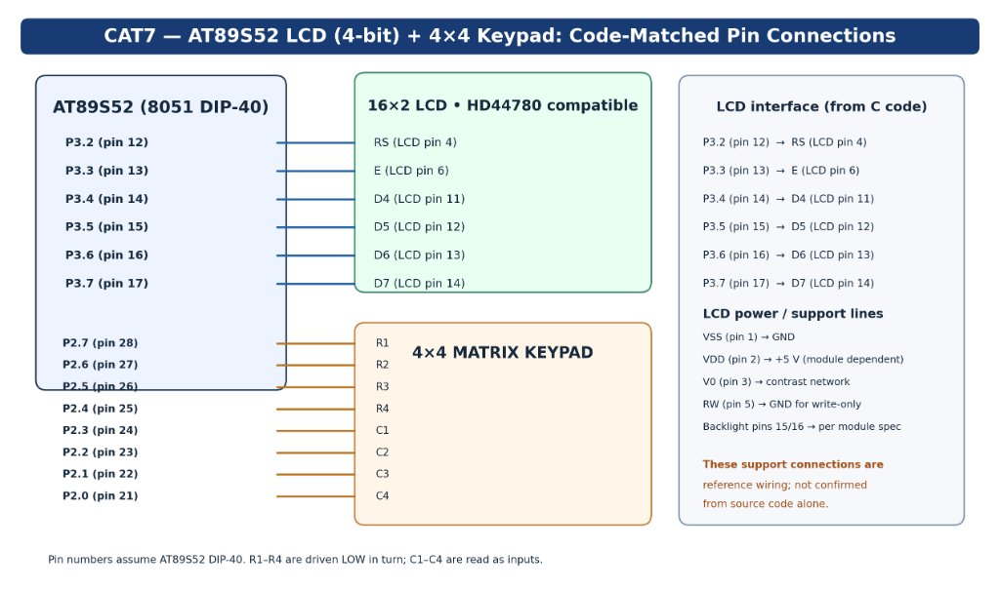
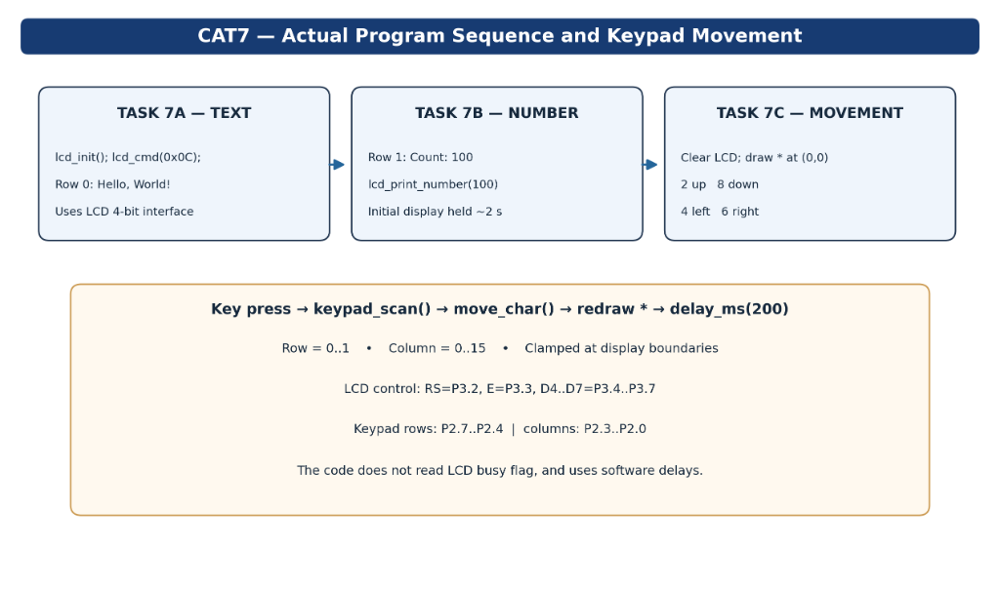

# Continuous Lab Evaluation 7 — 16×2 LCD Interfacing and Keypad-Controlled Character Movement

## A. Aim
To interface a 16×2 character Liquid Crystal Display (LCD) in 4-bit mode and a 4×4 matrix keypad with the Atmel AT89S52 microcontroller using Embedded C.

The laboratory experiment demonstrates:
1. **Task 7A**: Initializing the HD44780-compliant LCD and displaying fixed ASCII text on the first display row.
2. **Task 7B**: Displaying dynamic numeric integer values on the second display row via modulo-based ASCII digit decomposition.
3. **Task 7C**: Scanning a 4×4 matrix keypad and interactively navigating a cursor character (`*`) across the 16×2 display grid with strict coordinate boundary clamping.

---

## B. Experiment Breakdown

The evaluation integrates three sequential operational stages into a single cohesive Embedded C firmware application ([`lcd_driver_and_keypad_movement.c`](lcd_driver_and_keypad_movement.c)):

### 1. Task 7A — LCD Text Display
- **Protocol**: 4-bit parallel data transmission over high-order port lines (P3.4–P3.7).
- **Functionality**: Configures LCD display parameters, establishes entry modes, and displays `"Hello, World!"` starting at Row 0, Column 0.
- **Implementation**: Utilizes `lcd_init()` to set 4-bit operation, `lcd_cmd()` for configuration primitives, and `lcd_puts()` for string serialization.

### 2. Task 7B — Dynamic Numerical Display
- **Target Position**: Row 1, Column 0 of the 16×2 display.
- **Functionality**: Displays the label string `"Count: "` followed immediately by the numerical value `100`.
- **Implementation**:
  ```c
  lcd_puts(1, 0, "Count: ");
  lcd_print_number(100);
  ```
- **Algorithm**: Decomposes the unsigned integer value into individual decimal digits using iterative modulo-10 (`value % 10`) and integer division (`value / 10`), converts each remainder to ASCII (`digit + '0'`), and writes them to the LCD via `lcd_data()`.
- **Display Duration**: The introductory text and count remain visible for a nominal programmed duration of approximately 2 seconds (`delay_ms(2000)`). This duration is generated via software delay loops.

### 3. Task 7C — Keypad-Controlled Character Movement
- **State Transition**: Following the 2-second introductory display:
  1. The LCD screen is cleared using command `0x01` (`lcd_cmd(0x01)`).
  2. Cursor coordinates are initialized to Row 0, Column 0 (`cur_row = 0; cur_col = 0;`).
  3. The target character `*` (`#define MOVE_CHAR '*'`) is drawn at the home position `(0, 0)`.
  4. The CPU enters an infinite execution loop scanning the 4×4 matrix keypad.
- **Interactive Navigation**:
  - Pressing a recognized navigation key erases the character at its current location (by overwriting with a space `' '`), updates the internal coordinate registers, validates screen bounds, and draws `*` at the new location.

#### Movement Control Matrix

| Keypad Key | Direction | Coordinate Delta | Code Logic |
|---|---|---|---|
| **`2`** | **Up** | Row Decrement (`cur_row--`) | `if (cur_row > 0) cur_row--;` |
| **`4`** | **Left** | Column Decrement (`cur_col--`) | `if (cur_col > 0) cur_col--;` |
| **`6`** | **Right** | Column Increment (`cur_col++`) | `if (cur_col < LCD_COLS - 1) cur_col++;` |
| **`8`** | **Down** | Row Increment (`cur_row++`) | `if (cur_row < LCD_ROWS - 1) cur_row++;` |

> [!IMPORTANT]
> **Unified Codebase Note:** All three tasks (7A, 7B, and 7C) are compiled within a single Keil project and execute sequentially within `main()`. They do not exist as disjoint project directories or separate binaries.

---

## Hardware Components

- **AT89S52 Microcontroller Development Board** (8051 Architecture, 40-Pin DIP)
- **16×2 Alphanumeric LCD Module** (HD44780 or equivalent controller)
- **4×4 Matrix Membrane / Tactile Keypad** (16 momentary pushbuttons)
- **10 kΩ Potentiometer** (for LCD contrast adjustment, connected to pin $V_0$)
- **Regulated +5 V DC Power Supply**
- **Jumper Connecting Wires and Breadboard**
- **Keil µVision 4 IDE with C51 Compiler Toolchain**

> [!NOTE]
> The AT89S52 development board incorporates its own clock oscillator (nominally 11.0592 MHz or 12 MHz) and power-on/manual reset circuitry. No external crystal or reset network was separately wired on the breadboard during the laboratory session. Power rails ($V_{DD}, V_{SS}$), contrast bias ($V_0$), and backlight connections are standard reference wiring.

---

## Pin Configuration & Hardware Interface

### 1. LCD Interface (Port 3)
The LCD uses 6 microcontroller signal lines (2 control lines + 4 data lines):

| LCD Pin | Signal | AT89S52 Port | DIP-40 Pin | Functional Role |
|---|---|---|---|---|
| 4 | **RS** | P3.2 | Pin 12 | Register Select: `0` = Command Register, `1` = Data Register |
| 5 | **RW** | *GND (Write-Only)* | N/A | Hardware tied to GND; firmware performs write operations only |
| 6 | **E / EN**| P3.3 | Pin 13 | Enable Clock: Latches data into LCD on falling edge |
| 11 | **D4** | P3.4 | Pin 14 | Bi-directional Data Bit 4 (Transmits lower nibble bit 0 / upper nibble bit 0) |
| 12 | **D5** | P3.5 | Pin 15 | Bi-directional Data Bit 5 (Transmits lower nibble bit 1 / upper nibble bit 1) |
| 13 | **D6** | P3.6 | Pin 16 | Bi-directional Data Bit 6 (Transmits lower nibble bit 2 / upper nibble bit 2) |
| 14 | **D7** | P3.7 | Pin 17 | Bi-directional Data Bit 7 (Transmits MSB of command or character byte) |

In `lcd_driver_and_keypad_movement.c`:
```c
sbit RS = P3^2;
sbit EN = P3^3;
```
When sending a nibble:
```c
P3 = (P3 & 0x0F) | ((nibble & 0x0F) << 4);
```
The bitwise operation `(P3 & 0x0F)` preserves the state of the lower four bits of Port 3 (including P3.2 and P3.3), while placing the 4 data bits onto P3.4–P3.7.

### 2. 4×4 Matrix Keypad Interface (Port 2)
The keypad utilizes the entire 8-bit Port 2, divided into four row outputs and four column inputs:

| Keypad Line | AT89S52 Port | DIP-40 Pin | Function / Direction |
|---|---|---|---|
| **Row 1 (R1)** | P2.7 | Pin 28 | Microcontroller Output: Scanned active LOW |
| **Row 2 (R2)** | P2.6 | Pin 27 | Microcontroller Output: Scanned active LOW |
| **Row 3 (R3)** | P2.5 | Pin 26 | Microcontroller Output: Scanned active LOW |
| **Row 4 (R4)** | P2.4 | Pin 25 | Microcontroller Output: Scanned active LOW |
| **Column 1 (C1)**| P2.3 | Pin 24 | Microcontroller Input: Sensed with internal pull-up |
| **Column 2 (C2)**| P2.2 | Pin 23 | Microcontroller Input: Sensed with internal pull-up |
| **Column 3 (C3)**| P2.1 | Pin 22 | Microcontroller Input: Sensed with internal pull-up |
| **Column 4 (C4)**| P2.0 | Pin 21 | Microcontroller Input: Sensed with internal pull-up |

In `lcd_driver_and_keypad_movement.c`:
```c
static const unsigned char rowPin[4] = {7, 6, 5, 4};
static const unsigned char colPin[4] = {3, 2, 1, 0};
```

---

## Circuit Diagram



### Interface Architecture & Bus Allocation
1. **Port 3 (LCD Bus)**: Combines control signalling (P3.2 for RS, P3.3 for EN) with a 4-bit multiplexed data bus (P3.4–P3.7). This 4-bit mode halves the required data interconnects from 8 down to 4 pins, conserving valuable microcontroller I/O lines.
2. **Port 2 (Keypad Matrix)**: Multiplexes 16 switches over 8 pins. Four row drivers drive pins LOW sequentially, while four column lines sense contact closure.
3. **Power & Support**: The LCD module requires a regulated 5 V rail ($V_{DD}$), ground reference ($V_{SS}$), and a potentiometer contrast bias network on pin 3 ($V_0$). Pin 5 (RW) is grounded to fix the interface in write mode, as the firmware relies on deterministic software delays rather than polling the internal LCD busy flag (`BF`).

---

## Theory — LCD Driver & Keypad Scanning

### 1. 16×2 Character LCD Architecture
The 16×2 LCD display consists of two horizontal rows capable of rendering 16 characters each, with each character rendered within a 5×8 dot matrix. The display controller incorporates:
- **Instruction Register (IR)**: Stores command codes such as clear display, cursor shifts, and display mode configurations (accessed when `RS = 0`).
- **Data Register (DR)**: Stores ASCII character codes destined for display (accessed when `RS = 1`).
- **Display Data RAM (DDRAM)**: Internal memory holding character codes mapped to display positions.
  - **Row 0 DDRAM Addresses**: `0x00` through `0x0F` (Displayed on row 1)
  - **Row 1 DDRAM Addresses**: `0x40` through `0x4F` (Displayed on row 2)

### 2. 4-Bit Transmission Protocol
In 4-bit mode, 8-bit instructions and data bytes are split into two successive 4-bit nibbles:
1. **Upper Nibble** (Bits D7..D4) is placed onto lines P3.7..P3.4, and an Enable pulse (`EN = 1` $\to$ `EN = 0`) is issued.
2. **Lower Nibble** (Bits D3..D0) is placed onto lines P3.7..P3.4, and a second Enable pulse is issued.
The LCD internal shift register reconstructs the full 8-bit byte on the falling edge of the second enable pulse.

### 3. Key HD44780 Command Codes
| Command Hex | Binary Code | Functional Description |
|---|---|---|
| `0x28` | `0010 1000b` | Function Set: 4-bit data bus, 2 display lines, 5×8 character font |
| `0x08` | `0000 1000b` | Display OFF, cursor OFF, blink OFF |
| `0x01` | `0000 0001b` | Clear Display (writes space `0x20` to all DDRAM addresses, resets cursor to address `0x00`) |
| `0x06` | `0000 0110b` | Entry Mode Set: Increment cursor position automatically after each character write, no display shift |
| `0x0C` | `0000 1100b` | Display ON, cursor OFF, blink OFF |
| `0x80 \| addr` | `1xxx xxxxb` | Set DDRAM Address: Moves cursor directly to specified DDRAM byte offset |

### 4. Matrix Keypad Scanning Theory
A 4×4 keypad matrix organizes 16 normally-open single-pole momentary pushbuttons at the intersections of 4 row conductors and 4 column conductors:
- Without key presses, internal pull-up resistors on Port 2 keep all column lines at logic HIGH (`1`).
- The microcontroller drives one row line LOW (`0`) while driving all other row lines HIGH (`1`).
- If a button on that row is pressed, it shorts the corresponding column conductor directly to the active-LOW row wire, pulling that column input to logic LOW (`0`).
- By sensing which column line transitioned to `0`, the microcontroller uniquely decodes the button coordinate:
$$\text{Key} = \text{keypad}[\text{row}][\text{col}]$$

---

## Important Code Logic & Function Breakdown

### 1. `delay_ms(unsigned int ms)`
```c
void delay_ms(unsigned int ms) {
    unsigned int i, j;
    for (i = 0; i < ms; i++) {
        for (j = 0; j < 160; j++);
    }
}
```
Introduces approximate millisecond delays via nested CPU instruction loops. The loop constant `160` is tuned for classic 8051 cycle execution timing at standard crystal clock frequencies.

### 2. `keypad_scan()`
```c
int keypad_scan(void)
{
    static const int keypad[4][4] =
    {
        {'1', '2', '3', 'A'},
        {'4', '5', '6', 'B'},
        {'7', '8', '9', 'C'},
        {'*', '0', '#', 'D'}
    };

    static const unsigned char rowPin[4] = {7, 6, 5, 4};
    static const unsigned char colPin[4] = {3, 2, 1, 0};

    int row, col;

    for(row = 0; row < 4; row++)
    {
        P2 |= 0xF0;                  // Set all rows HIGH
        P2 &= ~(1 << rowPin[row]);   // Pull active row LOW

        for(col = 0; col < 4; col++)
        {
            if((P2 & (1 << colPin[col])) == 0)
            {
                return keypad[row][col];
            }
        }
    }

    return -1; // No key pressed
}
```
- Sets `P2 |= 0xF0` to ensure row pins P2.4–P2.7 are initially HIGH.
- Drives row `row` LOW via bitwise clear `P2 &= ~(1 << rowPin[row])`.
- Iterates across column pins P2.0–P2.3; if bit is read as `0`, returns the mapped ASCII character.
- Returns `-1` if no switch closure is detected.

### 3. `lcd_port_init()` & `lcd_nibble()`
```c
void lcd_port_init(void) {
    P3 = 0x00;   
    RS = 0;
    EN = 0;      
}

void lcd_nibble(unsigned char nibble, bit rs_val) {
    RS = rs_val;

    P3 = (P3 & 0x0F) | ((nibble & 0x0F) << 4);  

    EN = 1;
    _nop_();
    _nop_();
    EN = 0;
}
```
- `lcd_nibble()` sets `RS`, positions the 4-bit nibble onto P3.4–P3.7 while shielding P3.0–P3.3, and produces a latching Enable strobe.
- `_nop_()` (from `<intrins.h>`) inserts single-cycle hardware NOPs to ensure the Enable HIGH pulse satisfies the HD44780 minimum pulse width specification ($t_{PW} \ge 450\text{ ns}$).

### 4. `lcd_cmd()` & `lcd_data()`
```c
void lcd_cmd(unsigned char val) {
    unsigned char upper, lower;
    upper = (val >> 4) & 0x0F;
    lower = val & 0x0F;
    lcd_nibble(upper, 0);   
    lcd_nibble(lower, 0);   
}

void lcd_data(unsigned char val) {
    unsigned char upper, lower;
    upper = (val >> 4) & 0x0F;
    lower = val & 0x0F;
    lcd_nibble(upper, 1);   
    lcd_nibble(lower, 1);   
}
```
Both functions split an 8-bit value into upper and lower 4-bit components. `lcd_cmd()` sets `RS = 0` for instruction register writes; `lcd_data()` sets `RS = 1` for data register writes.

### 5. `lcd_init()`
```c
void lcd_init(void) {
    lcd_port_init();
    delay_ms(20);            

    lcd_nibble(0x03, 0); 
    delay_ms(5);           
    lcd_nibble(0x03, 0); 
    delay_ms(1);           
    lcd_nibble(0x03, 0); 
    delay_ms(1);           
    lcd_nibble(0x02, 0); // Set 4-bit mode
    delay_ms(1);  
    
    lcd_cmd(0x28); // Function set: 4-bit, 2 lines, 5x8 dots
    lcd_cmd(0x08); // Display OFF, Cursor OFF, Blink OFF
    lcd_cmd(0x01); // Clear display
    delay_ms(2);
    lcd_cmd(0x06); // Entry mode set: Increment cursor, no shift
}
```
Implements the exact **HD44780 power-on reset sequence**:
1. Waits $>15\text{ ms}$ for $V_{DD}$ stabilization.
2. Sends initialization sequence `0x03`, `0x03`, `0x03` with delays to wake the controller from unknown states.
3. Sends `0x02` to switch the physical controller into 4-bit interface mode.
4. Executes operational commands: `0x28` (4-bit, 2-line), `0x08` (display off), `0x01` (clear), `0x06` (auto-increment cursor).

### 6. `lcd_goto()` & `lcd_puts()`
```c
void lcd_goto(unsigned char row, unsigned char col)
{
    unsigned char address;

    if (row >= LCD_ROWS || col >= LCD_COLS)
        return;

    address = row * 0x40 + col;
    lcd_cmd(0x80 | address);
}

void lcd_puts(unsigned char row, unsigned char col, char *str) {
    lcd_goto(row, col);
    lcd_str(str);
}
```
- In HD44780 architectures, Row 0 begins at DDRAM address `0x00`, while Row 1 begins at `0x40`. The formula `address = row * 0x40 + col` computes the target DDRAM byte.
- Sending `0x80 | address` transmits the "Set DDRAM Address" command.

### 7. `lcd_print_number(unsigned int value)`
```c
void lcd_print_number(unsigned int value)
{
    unsigned char digits[MAX_DIGITS];
    unsigned char i = 0;

    if (value == 0) {
        lcd_data('0');
        return;
    }

    while (value > 0) {
        digits[i] = value % 10;
        value = value / 10;
        i++;
    }

    while (i > 0) {
        i--;
        lcd_data(digits[i] + '0');
    }
}
```
- Converts unsigned 16-bit integers up to 65535 (`MAX_DIGITS = 5`) into ASCII characters.
- Extracts digits in reverse order using modulo-10 arithmetic into array `digits[]`.
- Unwinds the array in reverse order, adding ASCII offset `'0'` (`0x30`) to each digit for correct left-to-right display rendering.
- Handles `value == 0` as a standalone condition. Negative numbers are not supported by this unsigned function.

### 8. `move_char(char direction)`
```c
void move_char(char direction) {
    lcd_goto(cur_row, cur_col);
    lcd_data(' ');

    switch (direction) {
        case '6':  // right
            if (cur_col < LCD_COLS - 1) cur_col++;
            break;
        case '4':  // left
            if (cur_col > 0) cur_col--;
            break;
        case '8':  // down
            if (cur_row < LCD_ROWS - 1) cur_row++;
            break;
        case '2':  // up
            if (cur_row > 0) cur_row--;
            break;
    }

    lcd_goto(cur_row, cur_col);
    lcd_data(MOVE_CHAR);
}
```
- Clears the character from its prior location by writing a space character `' '`.
- Modifies `cur_row` or `cur_col` based on direction key.
- Clamps coordinates: $0 \le \text{cur\_row} \le 1$ and $0 \le \text{cur\_col} \le 15$.
- Relocates cursor and redraws `MOVE_CHAR` (`'*'`).

---

## Program Sequence & Logic Flow



### Three-Phase Execution Timeline
```
[ Phase 1: Task 7A - Text Initialization ]
  ├─► lcd_init() initializes 4-bit HD44780 mode
  ├─► lcd_cmd(0x0C) turns display ON with cursor OFF
  └─► lcd_puts(0, 0, "Hello, World!") writes string to Row 0
              │
              ▼
[ Phase 2: Task 7B - Numeric Display ]
  ├─► lcd_puts(1, 0, "Count: ") writes label to Row 1
  ├─► lcd_print_number(100) decomposes integer 100 into '1','0','0'
  └─► delay_ms(2000) holds text and count display for ~2 seconds
              │
              ▼
[ Phase 3: Task 7C - Keypad-Controlled Navigation ]
  ├─► lcd_cmd(0x01) clears LCD display
  ├─► Initialize cur_row = 0, cur_col = 0
  ├─► Draw initial '*' at (0, 0)
  └─► Infinite Loop:
        ├─► key = keypad_scan()
        ├─► If key in {'2','4','6','8'}:
        │     ├─► Erase old '*' with ' '
        │     ├─► Update coordinates with boundary limits
        │     ├─► Draw '*' at new position
        │     └─► delay_ms(200) for key debounce/repeat limiting
        └─► Repeat
```

---

## Algorithm & Pseudocode

### Complete Program Algorithm
1. **Initialize** microcontroller ports: Set Port 3 pins LOW, RS = 0, EN = 0.
2. **Execute HD44780 4-bit Reset Routine**:
   - Send `0x03` three times with prescribed inter-command delays.
   - Send `0x02` to force 4-bit interface mode.
   - Configure display function: 4-bit, 2 lines, 5×8 dots (`0x28`).
   - Turn display OFF (`0x08`), clear display (`0x01`), set entry mode (`0x06`).
3. **Turn Display ON** with cursor and blink disabled (`0x0C`).
4. **Execute Task 7A**: Write `"Hello, World!"` starting at Row 0, Column 0.
5. **Execute Task 7B**: Write `"Count: "` at Row 1, Column 0. Decompose integer `100` into ASCII characters `'1'`, `'0'`, `'0'` and display them.
6. **Pause Execution** for approximately 2000 ms using software delay loops.
7. **Execute Task 7C Initialization**:
   - Clear display using command `0x01`.
   - Set coordinate registers `cur_row = 0`, `cur_col = 0`.
   - Move cursor to `(0, 0)` and write character `'*'`.
8. **Interactive Keypad Scanning Loop**:
   - Scan Port 2 rows by pulling P2.7–P2.4 LOW sequentially.
   - Read column pins P2.3–P2.0. If a column is LOW, decode the active key.
   - If the key is `'2'` (Up), `'4'` (Left), `'6'` (Right), or `'8'` (Down):
     - Overwrite current coordinate `(cur_row, cur_col)` with `' '`.
     - Update coordinate while enforcing boundary limits ($0 \le \text{row} \le 1$, $0 \le \text{col} \le 15$).
     - Move cursor to updated coordinate and write `'*'`.
     - Delay 200 ms (`delay_ms(200)`) to reduce switch bounce and repeated key detections (though holding a key down still causes repeated moves).
9. **Repeat step 8 indefinitely**.

### Pseudocode
```text
BEGIN
    CONSTANT LCD_ROWS = 2
    CONSTANT LCD_COLS = 16
    CONSTANT MOVE_CHAR = '*'
    VARIABLE cur_row = 0
    VARIABLE cur_col = 0

    FUNCTION main():
        CALL lcd_init()
        CALL lcd_cmd(0x0C)                    // Display ON, Cursor OFF

        // --- Task 7A & Task 7B ---
        CALL lcd_puts(0, 0, "Hello, World!")   // Row 0 text
        CALL lcd_puts(1, 0, "Count: ")         // Row 1 label
        CALL lcd_print_number(100)            // Row 1 number
        CALL delay_ms(2000)                   // Hold introductory screen

        // --- Task 7C Initialization ---
        CALL lcd_cmd(0x01)                    // Clear LCD
        CALL delay_ms(2)
        cur_row = 0
        cur_col = 0
        CALL lcd_goto(cur_row, cur_col)
        CALL lcd_data(MOVE_CHAR)              // Draw '*' at (0, 0)

        // --- Interactive Movement Loop ---
        WHILE TRUE:
            VARIABLE key = keypad_scan()
            IF key == '2' OR key == '4' OR key == '6' OR key == '8' THEN
                CALL move_char(key)
                CALL delay_ms(200)            // Debounce delay
            END IF
        END WHILE
    END FUNCTION

    FUNCTION move_char(direction):
        CALL lcd_goto(cur_row, cur_col)
        CALL lcd_data(' ')                    // Clear old position

        SWITCH direction:
            CASE '6':                         // Move Right
                IF cur_col < (LCD_COLS - 1) THEN
                    cur_col = cur_col + 1
                END IF
            CASE '4':                         // Move Left
                IF cur_col > 0 THEN
                    cur_col = cur_col - 1
                END IF
            CASE '8':                         // Move Down
                IF cur_row < (LCD_ROWS - 1) THEN
                    cur_row = cur_row + 1
                END IF
            CASE '2':                         // Move Up
                IF cur_row > 0 THEN
                    cur_row = cur_row - 1
                END IF
        END SWITCH

        CALL lcd_goto(cur_row, cur_col)
        CALL lcd_data(MOVE_CHAR)              // Draw at new position
    END FUNCTION
END
```

---

## Expected Output

### Phase 1: Introductory Screen (Tasks 7A & 7B)
For the first ~2 seconds following system boot:
```text
+----------------+
|Hello, World!   |
|Count: 100      |
+----------------+
```
- Row 0 displays `"Hello, World!"` starting at Column 0.
- Row 1 displays `"Count: 100"` starting at Column 0.

### Phase 2: Interactive Character Navigation (Task 7C)
After the screen clear command executes:
```text
+----------------+
|*               |
|                |
+----------------+
```
- Pressing **Key 6** moves `'*'` right:
  ```text
  +----------------+
  | *              |
  |                |
  +----------------+
  ```
- Pressing **Key 8** moves `'*'` down to Row 1:
  ```text
  +----------------+
  |                |
  | *              |
  +----------------+
  ```
- Pressing **Key 4** moves `'*'` left:
  ```text
  +----------------+
  |                |
  |*               |
  +----------------+
  ```
- Pressing **Key 2** moves `'*'` up back to Row 0:
  ```text
  +----------------+
  |*               |
  |                |
  +----------------+
  ```
- When `'*'` reaches any screen boundary (Column 0, Column 15, Row 0, or Row 1), further key presses in that direction are ignored, preventing the character from wrapping around or disappearing.

---

## Important Technical Observations

1. **4-Bit Bus Multiplexing**: Upper nibble and lower nibble are transferred over P3.4–P3.7, saving four microcontroller I/O pins.
2. **Port 3 Preservation**: The instruction `P3 = (P3 & 0x0F) | ((nibble & 0x0F) << 4)` isolates data nibbles to P3.4–P3.7 while preserving control lines P3.2 (`RS`) and P3.3 (`EN`).
3. **No Busy Flag Polling**: The firmware does not poll the LCD busy flag `BF` on pin D7. Instead, fixed software delay loops (`delay_ms`) ensure each instruction completes before the next is dispatched.
4. **DDRAM Offset Row Addressing**: The display driver utilizes `0x00` base address for Row 0 and `0x40` base address for Row 1, setting the cursor via `lcd_cmd(0x80 | (row * 0x40 + col))`.
5. **Keypad Active-Low Matrix**: Scanning pulls one row LOW at a time and senses column inputs; unused rows are driven HIGH to prevent cross-row interference.
6. **Key Filtering**: Keypad characters `'A'`, `'B'`, `'C'`, `'D'`, `'1'`, `'3'`, `'5'`, `'7'`, `'9'`, `'0'`, `'*'`, and `'#'` are recognized by `keypad_scan()` but explicitly ignored by `main()`. Only navigation keys `'2'`, `'4'`, `'6'`, and `'8'` trigger movement.
7. **Debounce / Repeat Suppression**: A 200 ms software delay (`delay_ms(200)`) follows every valid move to reduce switch bounce and repeated key detections, though it does not guarantee exactly one movement per physical key press if a key remains held down.
8. **Erase-Before-Redraw Principle**: Interactive movement relies on clearing the previous coordinate with an ASCII space `' '` before updating registers and rendering `MOVE_CHAR` at the destination.
9. **Unsigned Integer Handling**: `lcd_print_number()` operates on `unsigned int` types up to 65535; negative numbers and floating-point representations are not supported.

---

## Result

An Embedded C application was successfully developed and verified for the AT89S52 microcontroller to interface an HD44780 16×2 character LCD in 4-bit mode and a 4×4 matrix keypad. The firmware demonstrates:
- String rendering on Row 0 (Task 7A).
- Modulo-based integer decomposition and dynamic display on Row 1 (Task 7B).
- Interactive, boundary-clamped character navigation across the 16×2 grid using directional keypad inputs (Task 7C).

---

## Viva Questions & Answers

### Q1: What is a 16×2 LCD?
**Answer:** A 16×2 LCD is an alphanumeric display module featuring two display rows, each capable of displaying 16 characters. Each character is rendered within a 5×8 dot pixel matrix managed by an integrated display controller.

### Q2: What is the role of the HD44780 controller?
**Answer:** The Hitachi HD44780 is the industry-standard dot-matrix LCD controller. It generates pixel drive waveforms, manages display timing, houses character generator ROM/RAM (CGROM/CGRAM), and stores display data in DDRAM.

### Q3: Why is 4-bit mode used instead of 8-bit mode?
**Answer:** 4-bit mode reduces the number of microcontroller I/O pins required for data transfer from 8 down to 4 (using lines D4–D7), freeing up 4 valuable microcontroller pins for other peripherals while maintaining full operational capabilities at the cost of sending data in two consecutive nibbles.

### Q4: What is the function of the RS (Register Select) pin?
**Answer:** The RS pin determines how the LCD interprets incoming byte transfers. When `RS = 0`, the LCD routes the byte to the Instruction Register (command mode, e.g., clear screen, move cursor). When `RS = 1`, the LCD routes the byte to the Data Register (data mode, e.g., display character).

### Q5: What is the function of the Enable (E) pin?
**Answer:** The Enable pin acts as the data latching strobe. Information placed onto data pins D4–D7 is latched into the LCD controller on the high-to-low transition (falling edge) of the Enable pulse.

### Q6: What is the purpose of the RW (Read/Write) pin?
**Answer:** The RW pin controls data flow direction. Logic LOW (`0`) selects write operations (microcontroller to LCD), while logic HIGH (`1`) selects read operations (LCD to microcontroller, e.g., reading busy flag or DDRAM contents). In this experiment, RW is grounded permanently for write-only operation.

### Q7: What is the difference between `lcd_cmd()` and `lcd_data()`?
**Answer:** `lcd_cmd()` sends instruction bytes with `RS = 0` to configure display modes and position the cursor. `lcd_data()` sends ASCII character codes with `RS = 1` to render visible glyphs on the display.

### Q8: Why are upper and lower nibbles transmitted separately in 4-bit mode?
**Answer:** Because only four physical data lines (D4–D7) connect the microcontroller to the LCD, an 8-bit command or data byte must be transmitted as two successive 4-bit transfers: upper nibble first, followed by lower nibble.

### Q9: What is LCD DDRAM?
**Answer:** DDRAM (Display Data RAM) is internal memory inside the LCD controller that stores the ASCII character codes currently rendered on the screen. Address `0x00` corresponds to Row 0, Column 0, while address `0x40` corresponds to Row 1, Column 0.

### Q10: How does 4×4 matrix keypad scanning work?
**Answer:** The microcontroller configures row lines as outputs and column lines as inputs with pull-ups. It drives one row LOW at a time and reads the column pins. If a button on that row is pressed, it pulls the intersecting column pin LOW, allowing the microcontroller to determine the key coordinate.

### Q11: How are cursor row and column coordinates updated during character movement?
**Answer:** In `move_char()`, the old coordinate is erased with a space character `' '`. When key `'6'` is pressed, `cur_col` increments; when `'4'` is pressed, `cur_col` decrements; when `'8'` is pressed, `cur_row` increments; and when `'2'` is pressed, `cur_row` decrements. Then `'*'` is written at the new coordinate.

### Q12: Why is a debounce delay necessary after detecting a keypad press?
**Answer:** Mechanical switch contacts bounce between open and closed states for several milliseconds when pressed or released. A software delay (`delay_ms(200)`) reduces switch bounce and repeated key detections, though as a simple fixed delay it does not guarantee exactly one movement per physical key press if the button remains held.

### Q13: How does `lcd_print_number()` display multi-digit integers?
**Answer:** It uses repeated modulo-10 (`value % 10`) to extract individual decimal digits from least-significant to most-significant into an array, and integer division (`value / 10`) to discard processed digits. It then reads the array in reverse order, adds ASCII offset `'0'` (`0x30`) to each digit, and sends each character to the LCD.

### Q14: How does the code prevent invalid cursor movement outside the LCD?
**Answer:** Boundary validation conditions clamp the coordinates:
- `if (cur_col < LCD_COLS - 1) cur_col++;` prevents moving right beyond Column 15.
- `if (cur_col > 0) cur_col--;` prevents moving left beyond Column 0.
- `if (cur_row < LCD_ROWS - 1) cur_row++;` prevents moving down beyond Row 1.
- `if (cur_row > 0) cur_row--;` prevents moving up beyond Row 0.

---

## Project File Descriptions

| File Name | Purpose |
|---|---|
| `lcd_driver_and_keypad_movement.c` | Complete Embedded C implementation covering Tasks 7A, 7B, and 7C |
| `lcd_driver_and_keypad_movement.uvproj` | Keil µVision 4 project file |
| `lcd_driver_and_keypad_movement.uvopt` | Keil µVision project debugger and option settings |
| `STARTUP.A51` | Standard 8051 assembly startup initialization code |
| `Objects/lcd_driver_and_keypad_movement.hex` | Compiled Intel HEX binary firmware for microcontroller programming |
| `circuit.png` | Hardware wiring diagram showing LCD (Port 3) and keypad (Port 2) connections |
| `task_flow.png` | Flowchart illustrating Task 7A $\to$ 7B $\to$ 7C program logic sequence |
| `README.md` | Comprehensive laboratory documentation, theory, algorithm, and analysis |
