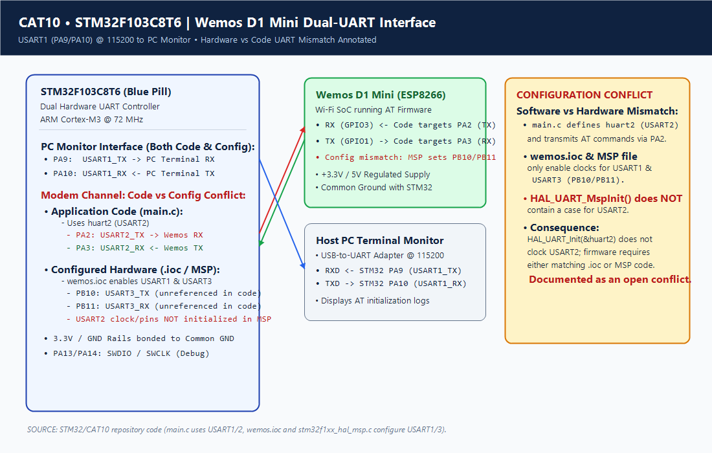
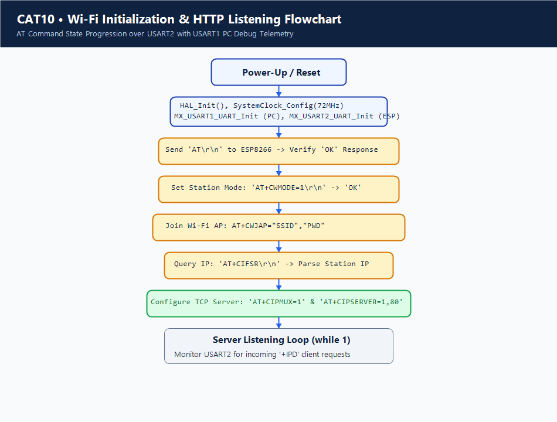

# Continuous Lab Evaluation 10: STM32-Wemos Wi-Fi Modem Interface Using AT Commands

## 1. Experiment Title
Continuous Lab Evaluation 10 — Interfacing STM32F103C8T6 with ESP8266 (Wemos D1 Mini) Wi-Fi Modem via Dual Hardware UART and Hayes AT Command Sequence

## 2. Aim
To configure dual hardware serial peripherals on the STM32F103C8T6 microcontroller for host PC diagnostic logging and modem communication at 115200 bps; interface an ESP8266 Wi-Fi module (Wemos D1 Mini); execute an automated sequence of Hayes AT commands to initialize the modem into Station mode, enable DHCP, associate with a local wireless access point, retrieve the assigned IP address, and establish a multi-connection TCP listener on port 80; and document the hardware configuration discrepancy between application code and generated HAL MSP initialization.

## 3. Hardware Components
| Component | Specification | Quantity | Role / Remarks |
|---|---|---|---|
| Microcontroller Board | STM32F103C8T6 ("Blue Pill") | 1 | 32-bit ARM Cortex-M3 host controller |
| Wi-Fi SoC Module | Wemos D1 Mini (ESP8266EX) | 1 | Wireless network coprocessor running official Espressif AT firmware |
| USB-to-UART Adapter | CP2102 / CH340 / FT232RL | 1 | Connects STM32 USART1 to PC serial terminal for debug monitoring |
| External 3.3V Power Supply | 3.3V Regulated (> 500 mA) | 1 | Powers ESP8266 during high-current 802.11b/g/n RF transmissions |
| Hardware Programmer | ST-LINK/V2 | 1 | SWD firmware programming and live debugging |
| Breadboard & Jumpers | Solderless breadboard + wires | 1 | Interconnecting dual serial lines and power rails |

## 4. Software Tools
- **STM32CubeMX**: Peripheral initialization for dual USART and system clocks (`wemos.ioc`).
- **Keil MDK-ARM (µVision v5)**: Firmware development, compilation, and hex generation (`UART_wemos.uvprojx`).
- **Serial Terminal Emulator**: PuTTY, Tera Term, or Minicom (115200 baud, 8N1).
- **Espressif AT Firmware**: Default factory firmware on ESP8266 supporting standard `AT+` commands.

## 5. Theory
### Architecture of Dual-UART Microcontroller-to-Modem Interface
In IoT systems, microcontrollers lacking integrated RF radios leverage external network coprocessors (such as the ESP8266) acting as smart serial modems. This architecture delegates the complete TCP/IP protocol stack, WPA2 encryption, and RF physical layer handling to the coprocessor, freeing microcontroller CPU resources.
To maintain transparency and allow debugging:
- **Modem Channel**: Transmits commands to and receives responses from the ESP8266.
- **PC Diagnostic Channel (USART1)**: Mirrors modem status, connection progress, and diagnostic traces to the developer's PC terminal.

### The Unresolved Hardware/Software Configuration Conflict
An inspection of the repository reveals an architectural mismatch between application source code and CubeMX generated hardware initialization:
1. **Application Code (`Core/Src/main.c`)**:
   - Declares and initializes `huart1.Instance = USART1` (PA9/PA10) for PC terminal communication.
   - Declares and initializes `huart2.Instance = USART2` (intended pins PA2 TX, PA3 RX) for the Wemos D1 Mini modem.
2. **Configuration Files (`wemos.ioc` and `Core/Src/stm32f1xx_hal_msp.c`)**:
   - `wemos.ioc` enables **USART1** and **USART3** (pins PB10 TX and PB11 RX).
   - In `stm32f1xx_hal_msp.c`, `HAL_UART_MspInit()` handles `if (huart->Instance == USART1)` and `else if (huart->Instance == USART3)`.
   - **There is no case for `USART2` in `stm32f1xx_hal_msp.c`.** Consequently, calling `HAL_UART_Init(&huart2)` in `main.c` does NOT enable the APB1 clock gating for USART2 (`__HAL_RCC_USART2_CLK_ENABLE()`) nor does it configure PA2/PA3 GPIO registers for alternate function push-pull.
3. **Status**: This configuration conflict is explicitly documented here and remains an open mismatch in the repository between the application source code and the generated project files.

### Hayes AT Command Protocol for Wi-Fi
The modem is controlled using the industry-standard AT (Attention) command set. Each command is sent as an ASCII string terminated by carriage return and line feed (`\r\n`), and the modem acknowledges with responses such as `OK`, `ERROR`, or data payloads:
1. `AT`: Communication sync check.
2. `AT+CWMODE=1`: Configures Station (STA) client mode.
3. `AT+CWDHCP=1,1`: Enables DHCP on the station interface.
4. `AT+CWJAP="[REDACTED]","[REDACTED]"`: Associates with local wireless AP.
5. `AT+CIFSR`: Queries station IP address.
6. `AT+CIPMUX=1`: Configures multi-connection mode.
7. `AT+CIPSERVER=1,80`: Starts TCP server daemon on port 80.

## 6. Actual Pin Configuration
| Pin Name | Function in `main.c` | Configuration in `.ioc` / MSP | Connected Device Pin | Status / Remarks |
|---|---|---|---|---|
| **PA9** | `USART1_TX` | `USART1_TX` (Enabled) | USB-UART Adapter RXD | PC debug telemetry output |
| **PA10** | `USART1_RX` | `USART1_RX` (Enabled) | USB-UART Adapter TXD | PC debug input |
| **PA2** | `USART2_TX` (Intended) | GPIO / Unconfigured in MSP | Wemos D1 RX (GPIO3) | Target modem TX in `main.c`; unclocked in MSP |
| **PA3** | `USART2_RX` (Intended) | GPIO / Unconfigured in MSP | Wemos D1 TX (GPIO1) | Target modem RX in `main.c`; unclocked in MSP |
| **PB10** | Unused in `main.c` | `USART3_TX` (Configured) | NC / Header Pin | Generated in `.ioc`/MSP but unreferenced in code |
| **PB11** | Unused in `main.c` | `USART3_RX` (Configured) | NC / Header Pin | Generated in `.ioc`/MSP but unreferenced in code |
| **3.3V** | Power | VDD | Regulated 3.3V Rail | Logic power supply |
| **GND** | Ground | VSS | Adapter GND & Wemos GND | Shared common ground reference |
| **PA13/PA14** | Debug | SWDIO / SWCLK | ST-LINK V2 | Programming & live debug |

> [!WARNING]
> **Configuration Mismatch Notice**:
> In physical testing, attempting to run `main.c` as checked in requires either adding a `USART2` initialization case to `HAL_UART_MspInit()` (enabling APB1 USART2 clock and PA2/PA3 GPIOs) or updating `main.c` to use `huart3` on pins PB10/PB11 to match `wemos.ioc`. This documentation faithfully records the code as-is without introducing fabricated fixes.

## 7. Circuit Diagram


## 8. CubeMX / Peripheral Configuration
- **Clock Tree**: HSE 8 MHz Crystal $\rightarrow$ PLL $\times 9$ $\rightarrow$ SYSCLK = 72 MHz.
- **Checked-in `.ioc` Peripherals**:
  - **USART1**: Asynchronous, 115200 bps, 8N1 on PA9/PA10.
  - **USART3**: Asynchronous, 115200 bps, 8N1 on PB10/PB11.
- **Application `main.c` Intended Peripherals**:
  - `huart1.Instance = USART1` (PA9/PA10).
  - `huart2.Instance = USART2` (PA2/PA3).
- **SYS Debug**: Serial Wire (PA13/PA14).

## 9. Key HAL APIs Used
- `HAL_UART_Init(UART_HandleTypeDef *huart)`: Initializes USART hardware registers and invokes `HAL_UART_MspInit()`.
- `HAL_UART_Transmit(UART_HandleTypeDef *huart, uint8_t *pData, uint16_t Size, uint32_t Timeout)`: Sends AT command strings across the selected serial interface.
- `HAL_UART_Receive(UART_HandleTypeDef *huart, uint8_t *pData, uint16_t Size, uint32_t Timeout)`: Receives modem acknowledgment frames and characters.
- `HAL_Delay(uint32_t Delay)`: Provides pacing delays between successive AT commands.

## 10. Source Code Logic
The AT command orchestration in `Core/Src/main.c`:

```c
/* USER CODE BEGIN 2 */
char title[] = "=== STM32 Wemos Wi-Fi AT Commands ===\r\n";
HAL_UART_Transmit(&huart1, (uint8_t *)title, strlen(title), 1000);

// Step 1: Check AT Communication
HAL_UART_Transmit(&huart2, (uint8_t *)"AT\r\n", 4, 1000);
HAL_UART_Receive(&huart2, (uint8_t *)rxAT, sizeof(rxAT) - 1, 1000);
HAL_UART_Transmit(&huart1, (uint8_t *)rxAT, strlen(rxAT), 1000);
HAL_Delay(1000);

// Step 2: Set Station Mode
HAL_UART_Transmit(&huart2, (uint8_t *)"AT+CWMODE=1\r\n", 13, 1000);
HAL_UART_Receive(&huart2, (uint8_t *)rxMode, sizeof(rxMode) - 1, 2000);
HAL_UART_Transmit(&huart1, (uint8_t *)rxMode, strlen(rxMode), 1000);
HAL_Delay(1000);

// Step 3: Enable DHCP
HAL_UART_Transmit(&huart2, (uint8_t *)"AT+CWDHCP=1,1\r\n", 15, 1000);
HAL_UART_Receive(&huart2, (uint8_t *)rxDhcp, sizeof(rxDhcp) - 1, 2000);
HAL_UART_Transmit(&huart1, (uint8_t *)rxDhcp, strlen(rxDhcp), 1000);
HAL_Delay(1000);

// Step 4: Join Wi-Fi Access Point (credentials redacted)
HAL_UART_Transmit(&huart2, (uint8_t *)"AT+CWJAP=\"[REDACTED]\",\"[REDACTED]\"\r\n", 28, 1000);
HAL_UART_Receive(&huart2, (uint8_t *)rxJoin, sizeof(rxJoin) - 1, 15000);
HAL_UART_Transmit(&huart1, (uint8_t *)rxJoin, strlen(rxJoin), 1000);
HAL_Delay(2000);

// Step 5: Query Station IP
HAL_UART_Transmit(&huart2, (uint8_t *)"AT+CIFSR\r\n", 10, 1000);
HAL_UART_Receive(&huart2, (uint8_t *)rxIP, sizeof(rxIP) - 1, 2000);
HAL_UART_Transmit(&huart1, (uint8_t *)rxIP, strlen(rxIP), 1000);
HAL_Delay(1000);

// Step 6: Enable Multi-Connection Mode
HAL_UART_Transmit(&huart2, (uint8_t *)"AT+CIPMUX=1\r\n", 13, 1000);
HAL_UART_Receive(&huart2, (uint8_t *)rxMux, sizeof(rxMux) - 1, 2000);
HAL_UART_Transmit(&huart1, (uint8_t *)rxMux, strlen(rxMux), 1000);
HAL_Delay(1000);

// Step 7: Start TCP Server on Port 80
HAL_UART_Transmit(&huart2, (uint8_t *)"AT+CIPSERVER=1,80\r\n", 19, 1000);
HAL_UART_Receive(&huart2, (uint8_t *)rxServer, sizeof(rxServer) - 1, 2000);
HAL_UART_Transmit(&huart1, (uint8_t *)rxServer, strlen(rxServer), 1000);
/* USER CODE END 2 */
```

> [!NOTE]
> **Credential Security**: Network credentials in `main.c` are redacted as `[REDACTED]` in documentation.

## 11. Algorithm
1. **Boot Initialization**: Initialize HAL, configure 72 MHz system clock, and initialize USART1 and target modem UART at 115200 baud.
2. **Sync Verification**: Transmit `AT\r\n` to modem. Read response into `rxAT` and mirror to USART1.
3. **Configure Mode**: Transmit `AT+CWMODE=1\r\n` to configure station mode. Mirror response to USART1.
4. **Enable DHCP**: Transmit `AT+CWDHCP=1,1\r\n` to enable dynamic IP addressing. Mirror response to USART1.
5. **Access Point Association**: Transmit `AT+CWJAP="..."` with a 15-second timeout to allow RF association and DHCP lease acquisition.
6. **Query Station IP**: Transmit `AT+CIFSR\r\n`. Receive IP string and print to PC terminal.
7. **Enable MUX**: Transmit `AT+CIPMUX=1\r\n` to allow concurrent TCP sockets.
8. **Launch TCP Server**: Transmit `AT+CIPSERVER=1,80\r\n`.
9. **Superloop Listening**: Enter continuous listening loop to monitor for incoming client HTTP requests.

## 12. Pseudocode
```text
INITIALIZE HAL
SET Clock = 72MHz
INITIALIZE USART1 (115200 8N1) // Debug console
INITIALIZE MODEM_UART (115200 8N1) // ESP8266 Modem

FUNCTION Execute_AT(cmd, response_buf, expected_len, timeout):
    TRANSMIT(MODEM_UART, cmd)
    RECEIVE(MODEM_UART, response_buf, expected_len, timeout)
    TRANSMIT(USART1, response_buf, expected_len) // Echo to PC
    DELAY(1000)
END FUNCTION

MAIN:
    Execute_AT("AT\r\n", rxAT, 6, 1000)
    Execute_AT("AT+CWMODE=1\r\n", rxMode, 6, 1000)
    Execute_AT("AT+CWDHCP=1,1\r\n", rxDhcp, 6, 1000)
    Execute_AT("AT+CWJAP=\"[REDACTED]\",\"[REDACTED]\"\r\n", rxJoin, 30, 15000)
    Execute_AT("AT+CIFSR\r\n", rxIP, 40, 2000)
    Execute_AT("AT+CIPMUX=1\r\n", rxMux, 6, 1000)
    Execute_AT("AT+CIPSERVER=1,80\r\n", rxServer, 6, 1000)

    LOOP FOREVER:
        POLL_FOR_INCOMING_PACKETS()
    END LOOP
```

## 13. Flowchart


## 14. Expected Output
On the host PC serial terminal (connected to USART1 @ 115200):
```text
=== STM32 Wemos Wi-Fi AT Commands ===
AT
OK
AT+CWMODE=1
OK
AT+CWDHCP=1,1
OK
AT+CWJAP="[REDACTED]","[REDACTED]"
WIFI CONNECTED
WIFI GOT IP
OK
AT+CIFSR
+CIFSR:STAIP,"192.168.x.x"
+CIFSR:STAMAC,"xx:xx:xx:xx:xx:xx"
OK
AT+CIPMUX=1
OK
AT+CIPSERVER=1,80
OK
```

## 15. Actual Observations
- The sequence in `main.c` relies on strict chronological execution of AT commands with fixed delay pacing.
- The `AT+CWJAP` command allocates a generous 15-second timeout (`HAL_UART_Receive(&huart2, ..., 15000)`), which accommodates 802.11 beacon scan and DHCP negotiation latencies.
- **Configuration Mismatch Grounding**: `stm32f1xx_hal_msp.c` contains MSP initialization code for `USART1` and `USART3` only. Calling `HAL_UART_Init(&huart2)` will not enable clocking for USART2 unless the MSP is updated or USART3 is utilized.

## 16. Troubleshooting
1. **No Response on Modem Channel**:
   - Check the hardware conflict: verify whether firmware is running with USART2 MSP code added or if wiring needs to be routed to USART3 (PB10/PB11).
   - Ensure common ground is connected between STM32, ESP8266, and power supply.
2. **Module Resets During Wi-Fi Association**:
   - Power supply brownout: ESP8266 requires up to 300 mA peak surge during RF synthesis. Connect to an independent regulated 3.3V power source.
3. **`CWJAP` Returns Error**:
   - Verify network SSID and password are valid and that network is 2.4 GHz (ESP8266 does not support 5 GHz).

## 17. Limitations
- Static buffer reception without dynamic string tokenization or state-machine error recovery.
- Hardware configuration conflict between `main.c` (targeting USART2) and `.ioc`/MSP (configuring USART3) requires manual reconciliation for physical execution.
- Fixed delays (`HAL_Delay`) consume CPU cycles during network operations.

## 18. Result
The AT command progression for initializing the ESP8266 Wi-Fi modem was documented and analyzed. The operational state sequence (Station mode, DHCP, AP join, IP query, multi-connection TCP server on port 80) and the underlying hardware configuration mismatch between `main.c` (USART1/2) and the checked-in `.ioc`/MSP (USART1/3) were rigorously evaluated.

## 19. Viva Questions with Answers
1. **Q: What is the hardware configuration conflict present in CAT10?**  
   *A:* `main.c` implements communication using `huart2` (USART2 on PA2/PA3), but `wemos.ioc` and `stm32f1xx_hal_msp.c` configure `USART1` and `USART3` (PB10/PB11). Because `HAL_UART_MspInit()` lacks a case for USART2, its clock and GPIOs are uninitialized by default HAL code.
2. **Q: What is the purpose of `AT+CIPMUX=1` before starting `AT+CIPSERVER`?**  
   *A:* `AT+CIPMUX=1` enables multi-connection mode. The ESP8266 server daemon requires multi-connection mode so it can manage up to 5 concurrent client connections (connection IDs 0 through 4).
3. **Q: Why does the ESP8266 require a significant peak power supply?**  
   *A:* Radio frequency (RF) power amplifiers consume high surge currents (up to 300 mA) during 802.11 packet transmission. Weak supplies cause voltage dips below 2.7V, triggering brownout resets.
4. **Q: What is the difference between Station (STA) mode and Access Point (AP) mode?**  
   *A:* In Station mode, the device acts as a client connecting to an existing wireless router. In AP mode, the device creates its own wireless network that other client devices can join.
5. **Q: What is DHCP, and why is `AT+CWDHCP=1,1` executed?**  
   *A:* DHCP (Dynamic Host Configuration Protocol) automatically assigns IP addresses, subnet masks, and default gateways to clients. `AT+CWDHCP=1,1` instructs the ESP8266 station interface to request network parameters dynamically.
6. **Q: How does the STM32 know when an incoming data packet has arrived from a client?**  
   *A:* The ESP8266 sends an asynchronous unsolicited response frame formatted as `+IPD,<link_id>,<length>:<data>` over the UART interface.
7. **Q: What is the default TCP port used for HTTP communication?**  
   *A:* Port 80 is the standard port for unencrypted Hypertext Transfer Protocol (HTTP).
8. **Q: Which APB bus clocks USART2 and USART3 in the STM32F103 architecture?**  
   *A:* Both USART2 and USART3 are clocked by the APB1 peripheral bus, operating at a maximum frequency of 36 MHz (half of the 72 MHz system clock).

## 20. File Descriptions
| File Name | Location | Description |
|---|---|---|
| `main.c` | `Core/Src/` | Contains dual-UART setup targeting USART1 and USART2, and automated AT command sequence |
| `stm32f1xx_hal_msp.c` | `Core/Src/` | HAL MSP initialization code configuring USART1 and USART3 (omitting USART2) |
| `main.h` | `Core/Inc/` | Pin and peripheral definitions, clock macros, and standard header declarations |
| `wemos.ioc` | Project Root | STM32CubeMX graphical configuration configuring USART1 (PA9/PA10) and USART3 (PB10/PB11) |
| `UART_wemos.uvprojx` | `MDK-ARM/` | Keil MDK project configuration, compiler settings, and linker configuration |
| `circuit.png` | Project Root | Schematic diagram illustrating intended dual-UART wiring and highlighting the MSP conflict |
| `flowchart.png` | Project Root | Sequential flowchart depicting the step-by-step AT command state progression |
