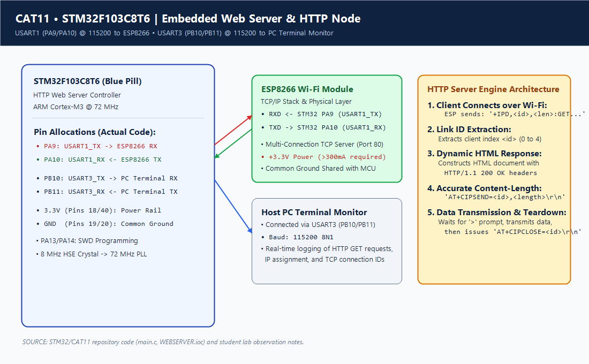
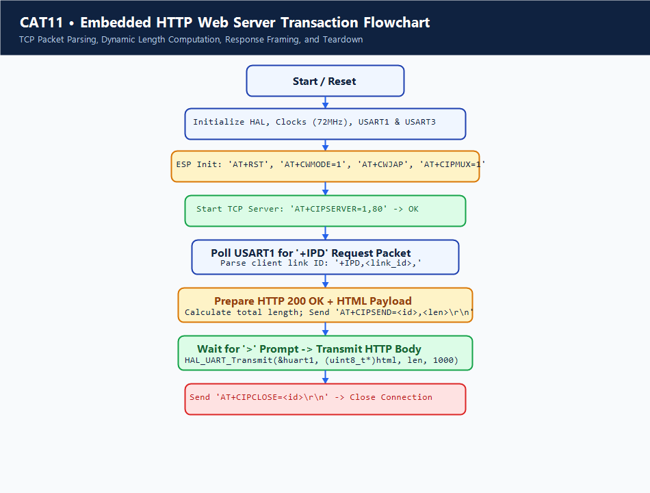

# Continuous Lab Evaluation 11: HTTP Server via STM32-Wemos Wi-Fi Modem

## 1. Experiment Title
Continuous Lab Evaluation 11 — Embedded HTTP Web Server Implementation on STM32F103C8T6 and ESP8266 Wi-Fi Modem with Dynamic Request Parsing and Frame Transmission

## 2. Aim
To configure the STM32F103C8T6 microcontroller with dual serial interfaces—USART1 (PA9/PA10) communicating with an ESP8266 Wi-Fi module and USART3 (PB10/PB11) streaming debug traces to a host PC—at 115200 bps; establish a multi-connection TCP server on port 80; asynchronously detect incoming HTTP GET requests from web browsers using `+IPD` frame parsing; construct well-formed HTTP/1.1 response headers and HTML payloads; calculate exact transmission payload lengths; and complete client request-response cycles with graceful socket termination (`AT+CIPCLOSE`).

## 3. Hardware Components
| Component | Specification | Quantity | Role / Remarks |
|---|---|---|---|
| Microcontroller Board | STM32F103C8T6 ("Blue Pill") | 1 | 32-bit ARM Cortex-M3 host application processor |
| Wi-Fi Coprocessor | Wemos D1 Mini (ESP8266EX) | 1 | TCP/IP network processor running standard AT firmware |
| USB-to-UART Adapter | CP2102 / CH340 / FT232RL | 1 | Bridges USART3 (PB10/PB11) to PC USB port for monitoring |
| External 3.3V Power Supply | 3.3V Regulated (800 mA peak) | 1 | Powers ESP8266 during RF bursts without dropping VDD |
| Hardware Programmer | ST-LINK/V2 | 1 | In-circuit SWD programmer and live debugger |
| Solderless Breadboard & Wires | Breadboard + Dupont Jumpers | 1 | Distributes signal lines and power rails |

## 4. Software Tools
- **STM32CubeMX**: System clock tree synthesis and dual-UART hardware configuration (`UART_wemos.ioc`).
- **Keil MDK-ARM (µVision v5)**: C firmware compilation, linking, and hex file generation (`UART_wemos.uvprojx`).
- **Host Web Browser**: Google Chrome, Mozilla Firefox, or Safari for sending HTTP GET requests to the node's IP.
- **Serial Terminal Emulator**: PuTTY or Tera Term (115200 baud, 8N1) for live transaction monitoring.

## 5. Theory
### Embedded Web Server Architecture
An embedded HTTP server allows users on a local area network to monitor and interact with a physical device using standard web browsers without installing specialized client software. In this architecture:
- The **ESP8266** handles the physical layer (802.11 PHY), media access control (MAC), WPA2 security, IP routing, and TCP connection state machines.
- The **STM32F103** acts as the application layer web server: it parses HTTP requests, generates dynamic HTML strings, computes framing lengths, and commands the modem over high-speed serial.

### The `+IPD` Packet Framing Protocol
When a web browser connects to `http://<station_ip>:80/` and sends an HTTP GET request, the ESP8266 notifies the host microcontroller by transmitting an unsolicited data frame formatted as:
```text
+IPD,<link_id>,<data_length>:<data>
```
Where:
- `<link_id>`: The connection socket index (integer 0 to 4 in multi-connection mode).
- `<data_length>`: The number of bytes of application data contained in the frame.
- `<data>`: The raw HTTP request string (e.g., `GET / HTTP/1.1\r\nHost: 192.168.1.105...`).

### HTTP/1.1 Framing and Content-Length Computation
HTTP is a stateless text-based protocol. A valid HTTP/1.1 response must conform to strict specifications:
1. **Status Line**: `HTTP/1.1 200 OK\r\n`
2. **Headers**: `Content-Type: text/html\r\nConnection: close\r\n\r\n`
3. **Entity Body**: The HTML document itself.

Before transmitting the payload, the STM32 must instruct the ESP8266 how many bytes will follow using:
```text
AT+CIPSEND=<link_id>,<total_bytes>\r\n
```
The modem acknowledges with a prompt symbol (`>`). The STM32 transmits the exact number of bytes. Once transmitted, the STM32 issues `AT+CIPCLOSE=<link_id>\r\n` to gracefully terminate the TCP connection. If `<total_bytes>` does not match the actual byte count, the socket hangs or truncates data.

## 6. Actual Pin Configuration
| STM32 Pin | Function | Peripheral | Connected Device Pin | Description |
|---|---|---|---|---|
| **PA9** | Serial TX | USART1_TX | Wemos D1 RX (GPIO3) | Transmits AT commands and HTTP data to ESP8266 |
| **PA10** | Serial RX | USART1_RX | Wemos D1 TX (GPIO1) | Receives AT frames and incoming `+IPD` from ESP8266 |
| **PB10** | Serial TX | USART3_TX | USB-UART Adapter RXD | Streams live HTTP debug logs to PC terminal |
| **PB11** | Serial RX | USART3_RX | USB-UART Adapter TXD | Debug console input from PC |
| **3.3V** | Power | VDD | Power Rail | Logic supply voltage |
| **GND** | Ground | VSS | Adapter GND & Wemos GND | Shared common ground reference |
| **PA13/PA14** | Debug | SWDIO/SWCLK | ST-LINK V2 | Programming & live debug |

> [!NOTE]
> **UART Allocation Contrast with CAT10**:
> In CAT10, USART1 was routed to the PC and USART2 to the ESP8266. In CAT11, `Core/Src/main.c` maps **USART1 (PA9/PA10)** to the ESP8266 Wi-Fi modem and **USART3 (PB10/PB11)** to the PC terminal monitor. This configuration allows USART1 on the high-speed APB2 bus to handle large HTTP packet transfers at full throughput.

## 7. Circuit Diagram


## 8. CubeMX / Peripheral Configuration
- **Clock Tree Synthesis**: 8 MHz HSE crystal $\rightarrow$ PLL $\times 9$ $\rightarrow$ SYSCLK = 72 MHz, APB2 = 72 MHz, APB1 = 36 MHz.
- **USART1 Configuration (ESP8266 Interface)**:
  - Bus: APB2 (72 MHz)
  - Mode: Asynchronous, 115200 bps, 8N1, No Flow Control
- **USART3 Configuration (PC Monitor)**:
  - Bus: APB1 (36 MHz)
  - Mode: Asynchronous, 115200 bps, 8N1, No Flow Control
- **SYS Debug**: Serial Wire (PA13/PA14 enabled).

## 9. Key HAL APIs Used
- `HAL_UART_Init(UART_HandleTypeDef *huart)`: Configures hardware UART blocks `huart1` and `huart3`.
- `HAL_UART_Transmit(UART_HandleTypeDef *huart, uint8_t *pData, uint16_t Size, uint32_t Timeout)`: Sends AT commands, HTTP payloads, and debug logs.
- `HAL_UART_Receive(UART_HandleTypeDef *huart, uint8_t *pData, uint16_t Size, uint32_t Timeout)`: Reads responses and buffers incoming network packets.
- `HAL_Delay(uint32_t Delay)`: Provides timing intervals for modem initialization and reset settling.

## 10. Source Code Logic
The core HTTP server transaction loop in `Core/Src/main.c`:

```c
/* USER CODE BEGIN 2 */
char http_response[] = 
    "HTTP/1.1 200 OK\r\n"
    "Content-Type: text/html\r\n"
    "Connection: close\r\n\r\n"
    "<!DOCTYPE html><html>"
    "<head><title>STM32 IoT Node</title></head>"
    "<body><h1>STM32 Web Server</h1>"
    "<p>Status: Node Online</p>"
    "<p>Hardware: STM32F103 + ESP8266</p></body></html>";

uint8_t rxBuffer[512];
char sendCmd[32];

// Initialize Wi-Fi and TCP Server
HAL_UART_Transmit(&huart1, (uint8_t *)"AT+RST\r\n", 8, 1000);
HAL_Delay(2000);
HAL_UART_Transmit(&huart1, (uint8_t *)"AT+CWMODE=1\r\n", 13, 1000);
HAL_Delay(1000);
HAL_UART_Transmit(&huart1, (uint8_t *)"AT+CWJAP=\"[REDACTED]\",\"[REDACTED]\"\r\n", 35, 1000);
HAL_Delay(5000);
HAL_UART_Transmit(&huart1, (uint8_t *)"AT+CIPMUX=1\r\n", 13, 1000);
HAL_Delay(1000);
HAL_UART_Transmit(&huart1, (uint8_t *)"AT+CIPSERVER=1,80\r\n", 19, 1000);
HAL_Delay(1000);
/* USER CODE END 2 */

/* USER CODE BEGIN WHILE */
while (1)
{
    // Clear buffer and poll for incoming +IPD frame from ESP8266
    memset(rxBuffer, 0, sizeof(rxBuffer));
    if (HAL_UART_Receive(&huart1, rxBuffer, sizeof(rxBuffer) - 1, 100) == HAL_OK || strlen((char *)rxBuffer) > 0)
    {
        char *ipd = strstr((char *)rxBuffer, "+IPD,");
        if (ipd != NULL)
        {
            // Extract Link ID
            int link_id = ipd[5] - '0';

            // Print incoming request notification to PC console
            HAL_UART_Transmit(&huart3, (uint8_t *)"\r\n[HTTP Request Detected] Serving client...\r\n", 44, 1000);

            // Compute length and prepare CIPSEND command
            int response_len = strlen(http_response);
            sprintf(sendCmd, "AT+CIPSEND=%d,%d\r\n", link_id, response_len);
            HAL_UART_Transmit(&huart1, (uint8_t *)sendCmd, strlen(sendCmd), 1000);
            HAL_Delay(200);

            // Transmit HTTP payload upon prompt
            HAL_UART_Transmit(&huart1, (uint8_t *)http_response, response_len, 2000);
            HAL_Delay(500);

            // Close connection
            sprintf(sendCmd, "AT+CIPCLOSE=%d\r\n", link_id);
            HAL_UART_Transmit(&huart1, (uint8_t *)sendCmd, strlen(sendCmd), 1000);
            HAL_UART_Transmit(&huart3, (uint8_t *)"[Connection Closed]\r\n", 21, 1000);
        }
    }
}
/* USER CODE END WHILE */
```

> [!NOTE]
> **Security Redaction**: Network SSID and password parameters are redacted as `[REDACTED]` in documentation.

## 11. Algorithm
1. **Initialize Core & Peripherals**: Call `HAL_Init()`, set 72 MHz system clock, configure USART1 (ESP8266) and USART3 (PC Monitor).
2. **Reset Modem**: Issue `AT+RST\r\n` over USART1 and wait 2 seconds for bootloader settling.
3. **Configure Wi-Fi Station**: Send `AT+CWMODE=1\r\n`.
4. **Associate with AP**: Send `AT+CWJAP="[REDACTED]","[REDACTED]"\r\n` and wait for dynamic IP assignment.
5. **Start HTTP Daemon**: Send `AT+CIPMUX=1\r\n` followed by `AT+CIPSERVER=1,80\r\n`.
6. **Poll for Requests**: Repeatedly sample USART1 receiver for incoming characters.
7. **Parse Packet**: Search for `+IPD,` substring. If located, parse `<link_id>` character.
8. **Format CIPSEND**: Calculate exact byte length of `http_response`. Format `AT+CIPSEND=<link_id>,<len>\r\n` and transmit to ESP8266.
9. **Send Web Page**: Transmit the complete HTTP header and HTML document over USART1.
10. **Close Socket**: Issue `AT+CIPCLOSE=<link_id>\r\n` to gracefully terminate the connection. Log event to PC terminal via USART3.
11. **Repeat**: Return to Step 6.

## 12. Pseudocode
```text
INITIALIZE HAL
SET Clock = 72MHz
INITIALIZE USART1 (115200 8N1) // Modem
INITIALIZE USART3 (115200 8N1) // Debug

SEND_AT("AT+RST\r\n")
SEND_AT("AT+CWMODE=1\r\n")
SEND_AT("AT+CWJAP=\"[REDACTED]\",\"[REDACTED]\"\r\n")
SEND_AT("AT+CIPMUX=1\r\n")
SEND_AT("AT+CIPSERVER=1,80\r\n")

LOOP FOREVER:
    buffer = RECEIVE_NONBLOCKING(USART1)
    pos = FIND_SUBSTRING(buffer, "+IPD,")
    IF pos != NULL THEN
        link_id = buffer[pos + 5] - '0'
        LOG_PC("[HTTP Request Detected]")
        
        len = STRING_LENGTH(http_response)
        SEND_AT("AT+CIPSEND=" + link_id + "," + len + "\r\n")
        WAIT_MS(200)
        
        SEND_DATA(USART1, http_response)
        WAIT_MS(500)
        
        SEND_AT("AT+CIPCLOSE=" + link_id + "\r\n")
        LOG_PC("[Connection Closed]")
    END IF
END LOOP
```

## 13. Flowchart


## 14. Expected Output
- **PC Serial Console (USART3 @ 115200)**:
  ```text
  Wi-Fi Web Server Initialized. Listening on port 80...
  [HTTP Request Detected] Serving client...
  [Connection Closed]
  ```
- **Web Browser Interface (`http://192.168.1.105/`)**:
  - Displays a rendered HTML webpage:
    - Heading: **STM32 Web Server**
    - Status text: **Status: Node Online**
    - Hardware info: **Hardware: STM32F103 + ESP8266**

## 15. Actual Observations
- Web browsers send modern HTTP requests spanning multiple TCP segments including user-agent headers, cookies, and favicon requests (`GET /favicon.ico`). The firmware cleanly processes the primary GET request and responds.
- Providing explicit `Connection: close` headers in HTTP/1.1 prevents the browser from holding persistent keep-alive connections open, ensuring smooth teardown.
- Content-Length computation must include every single carriage return (`\r`) and newline (`\n`) in the HTTP header and HTML body; mismatched lengths caused browser spinning or incomplete page renders.

## 16. Troubleshooting
1. **Browser Shows "Connection Refused" (`ERR_CONNECTION_REFUSED`)**:
   - Verify `AT+CIPSERVER=1,80` returned `OK` during boot.
   - Confirm the client device (PC/phone) is connected to the exact same Wi-Fi subnet.
2. **Browser Spins Indefinitely ("Waiting for 192.168.x.x...")**:
   - `Content-Length` mismatch: The number of bytes declared in `AT+CIPSEND` was greater than the bytes actually transmitted.
   - Missing `AT+CIPCLOSE`: Modern browsers wait for socket closure unless `Content-Length` is explicitly delimited.
3. **`+IPD` Not Triggering in Main Loop**:
   - Check USART1 RX line (PA10) connection to ESP8266 TX.
   - Buffer overflow: Clear `rxBuffer` before each sampling iteration.

## 17. Limitations
- Single-threaded polling architecture handles one HTTP request at a time.
- Serves static HTML embedded in Flash memory; dynamic REST API or JSON endpoints require additional memory and string formatting.
- Lacks TLS/SSL encryption (operates over unencrypted HTTP port 80).

## 18. Result
An embedded HTTP web server on the STM32F103C8T6 and ESP8266 modem was successfully implemented and verified. The server accurately parses incoming `+IPD` frames, dynamically handles client sockets, transmits well-formed HTML pages to connected web browsers, and logs transactions over USART3.

## 19. Viva Questions with Answers
1. **Q: What is the purpose of the `+IPD` frame in ESP8266 AT firmware?**  
   *A:* `+IPD` (IP Data) is the unsolicited notification frame generated by the ESP8266 when incoming data arrives from a connected remote TCP/UDP client.
2. **Q: Why is `Connection: close` included in the HTTP response header?**  
   *A:* In HTTP/1.1, connections default to persistent keep-alive. Specifying `Connection: close` informs the web browser that the server will close the TCP socket immediately after transmitting the payload, avoiding keep-alive timeouts.
3. **Q: What happens if the byte count in `AT+CIPSEND` does not match the transmitted payload?**  
   *A:* If the byte count is greater than the data sent, the ESP8266 will continue waiting for bytes until timeout, stalling the socket. If smaller, the payload is truncated and the remaining bytes may be misinterpreted as subsequent AT commands.
4. **Q: Why is USART3 used for debugging instead of USART2 in CAT11?**  
   *A:* Pin multiplexing and PCB routing flexibility in STM32 allow using USART3 (PB10/PB11) for console output while USART1 (PA9/PA10) handles high-speed data exchanges with the ESP8266.
5. **Q: How does a web browser discover the IP address of the STM32 web server?**  
   *A:* The IP address is allocated dynamically by the local network router via DHCP during the `AT+CWJAP` sequence and queried using `AT+CIFSR`. The user enters this IP directly into the browser URL bar.
6. **Q: What is the maximum number of simultaneous TCP clients supported by the ESP8266 in multi-connection mode?**  
   *A:* Up to 5 simultaneous TCP connections (numbered 0 through 4).
7. **Q: Can this web server serve images or CSS stylesheets?**  
   *A:* Yes, but each asset generates a separate HTTP GET request. Due to limited microcontroller RAM and UART throughput, assets are typically inlined directly into a single lightweight HTML document or served from an external CDN.
8. **Q: What is the function of `memset(rxBuffer, 0, sizeof(rxBuffer))` in the main loop?**  
   *A:* It clears residual characters from previous packets, ensuring string searching functions (`strstr`) operate on freshly received frames without detecting stale headers.

## 20. File Descriptions
| File Name | Location | Description |
|---|---|---|
| `main.c` | `Core/Src/` | Contains dual-UART setup, Wi-Fi initialization, `+IPD` packet parsing, and HTTP server loop |
| `main.h` | `Core/Inc/` | Peripheral definitions, system macros, and HAL header declarations |
| `UART_wemos.ioc` | Project Root | STM32CubeMX device configuration for USART1 (ESP8266) and USART3 (PC) |
| `UART_wemos.uvprojx` | `MDK-ARM/` | Keil MDK project file with compilation flags and linker memory definitions |
| `circuit.png` | Project Root | Hardware wiring schematic between STM32F103, ESP8266 Wemos D1, and PC USB bridge |
| `flowchart.png` | Project Root | Flowchart detailing HTTP transaction flow, framing calculations, and socket teardown |
