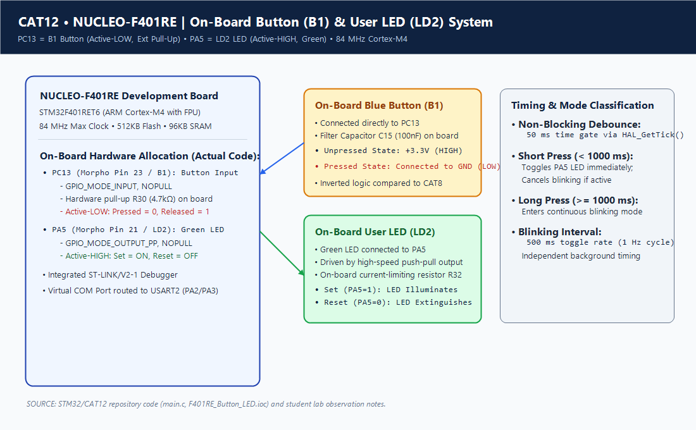
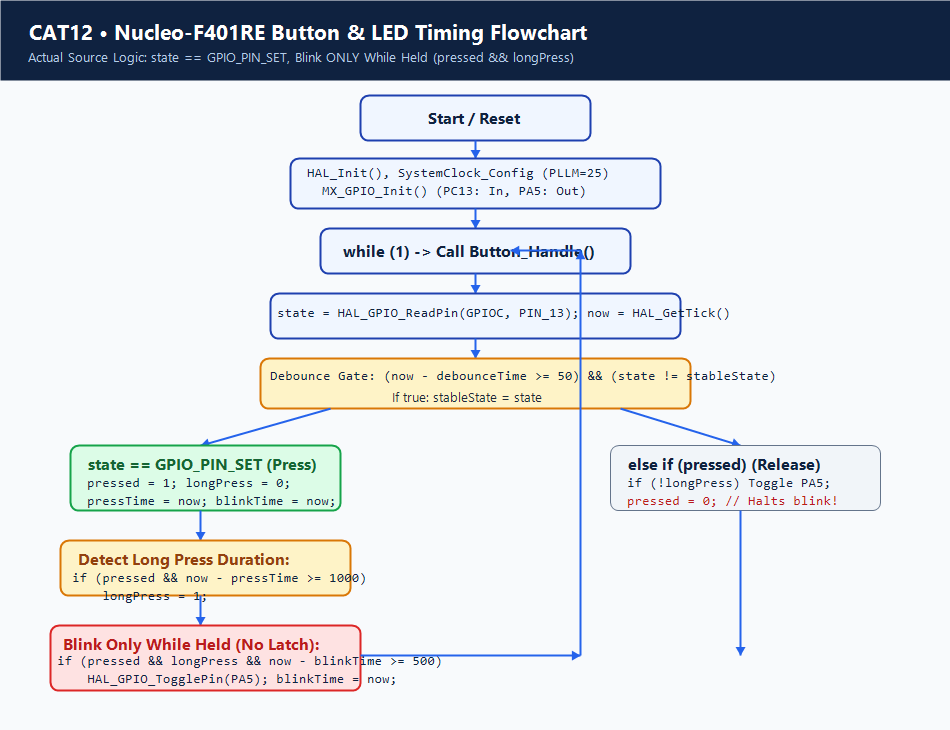

# Continuous Lab Evaluation 12: STM32F401RE Nucleo GPIO and User Input Programming

## 1. Experiment Title
Continuous Lab Evaluation 12 — Digital Input/Output, Non-Blocking Debounce, and Push-Button Timing on STM32F401RE Nucleo-64 Using On-Board User Peripherals

## 2. Aim
To configure the General Purpose Input/Output (GPIO) peripherals of the 32-bit ARM Cortex-M4 STM32F401RET6 microcontroller on the STMicroelectronics Nucleo-64 evaluation board; analyze the implementation in `Core/Src/main.c` utilizing the on-board User Button (B1 on PC13) and User LED (LD2 on PA5); evaluate the non-blocking debouncing and timing logic; document the firmware behavior where button presses are registered via `GPIO_PIN_SET`, short presses toggle the LED upon release, and long presses cause continuous blinking only while held; and document the discrepancy between the configured PLL parameters and standard board-level clocking.

## 3. Hardware Components
| Component | Specification | Quantity | Role / Remarks |
|---|---|---|---|
| Development Board | NUCLEO-F401RE | 1 | 32-bit ARM Cortex-M4 MCU with FPU, 512 KB Flash, 96 KB SRAM |
| Integrated Debugger | ST-LINK/V2-1 | 1 | On-board USB programmer, hardware debugger, and Virtual COM Port (VCP) |
| On-Board User Button (B1) | Blue Tactile Switch | 1 | Connected to PC13 with hardware RC filter and pull-up resistor |
| On-Board User LED (LD2) | Green 0805 SMD LED | 1 | Connected to PA5 via series resistor |
| Host Cable | USB Type-A to Mini-B | 1 | Supplies +5V board power and carries SWD/VCP communication |

## 4. Software Tools
- **STM32CubeMX**: Peripheral initialization and clock tree configuration (`nucleo_test.ioc`).
- **Keil MDK-ARM (µVision v5)**: C/C++ compilation, ARMClang / ARMCC toolchain, linking, and hex file generation (`nucleo_test.uvprojx`).
- **ST-LINK Firmware / ST-LINK Utility**: On-board programmer interface for flashing `nucleo_test.hex`.

## 5. Theory
### The STM32F401RE Architecture & Nucleo-64 Ecosystem
The STM32F401RE is a high-performance microcontroller built around an ARM Cortex-M4 core featuring a single-precision Floating Point Unit (FPU), Memory Protection Unit (MPU), and digital signal processing (DSP) instructions.
The Nucleo-64 platform pre-wires two user peripherals:
- **User Button B1 (PC13)**: Hard-wired to PC13 with an on-board 4.7 kΩ pull-up resistor (R30) to +3.3V and a 100 nF capacitor (C15) to GND. Physically, when the button is open, PC13 is pulled HIGH; when pressed, PC13 shorts to GND (active-LOW hardware).
- **User LED LD2 (PA5)**: Connected to PA5 through a current-limiting resistor. Driving PA5 HIGH illuminates the green LED.

### Firmware Logic in `main.c`
Examination of `Core/Src/main.c` reveals the exact firmware logic:
1. **Button Detection via `GPIO_PIN_SET`**:
   Line 33 tests `if (state == GPIO_PIN_SET)`. In the firmware implementation, a logic HIGH level is treated as the "button pressed" condition. This active-HIGH detection directly conflicts with the documented active-LOW physical button wiring on the Nucleo-64 board (where pull-up resistor R30 holds PC13 HIGH when idle, and pressing B1 shorts PC13 to GND / `GPIO_PIN_RESET`). Consequently, the firmware interprets the unpressed resting state as pressed. No claim of verified working physical hardware behavior is made; the firmware logic is recorded faithfully as written without inventing uncommitted modifications.
2. **Press Classification & Blinking While Held**:
   - When `state == GPIO_PIN_SET` is detected stably for $\ge 50\,\text{ms}$, `pressed = 1` and `pressTime = now`.
   - While `pressed`, if `now - pressTime >= 1000`, the flag `longPress = 1` is set.
   - While `pressed && longPress`, if `now - blinkTime >= 500`, the LED toggles every 500 ms. **The LED blinks only while the button remains held down.** There is no persistent `blinkingMode` variable that latches blinking after release.
   - When the button is released (`state != GPIO_PIN_SET` while `pressed == 1`):
     - If `!longPress` (i.e. released before 1000 ms elapsed), `HAL_GPIO_TogglePin(GPIOA, GPIO_PIN_5)` toggles LD2.
     - `pressed` is reset to `0`, which immediately halts any blinking.

### Board Clock Configuration Discrepancy
In `SystemClock_Config()`:
```c
RCC_OscInitStruct.OscillatorType = RCC_OSCILLATORTYPE_HSE;
RCC_OscInitStruct.HSEState = RCC_HSE_BYPASS;
RCC_OscInitStruct.PLL.PLLM = 25;
RCC_OscInitStruct.PLL.PLLN = 168;
RCC_OscInitStruct.PLL.PLLP = RCC_PLLP_DIV2;
```
- **Math Analysis**:
  - The PLL output clock is computed as: $f_{\text{SYSCLK}} = f_{\text{IN}} \times \frac{\text{PLLN}}{\text{PLLM} \times \text{PLLP}} = f_{\text{IN}} \times \frac{168}{25 \times 2}$.
  - This configuration assumes a **25 MHz** input clock: $25\,\text{MHz} \times \frac{168}{50} = 84\,\text{MHz}$.
- **Hardware Discrepancy**:
  - Standard Nucleo-F401RE boards in HSE Bypass mode receive an **8 MHz** clock output from the ST-LINK MCO (Master Clock Output).
  - Supplying 8 MHz to `PLLM = 25` yields an input frequency to the PLL of $\frac{8\,\text{MHz}}{25} = 320\,\text{kHz}$, which falls below the minimum PLL input frequency (1 MHz to 2 MHz) specified in the STM32F401 reference manual.
  - If the PLL operates under this division, the resulting system clock would be $\approx 26.88\,\text{MHz}$ rather than the intended 84 MHz, causing SysTick and timing loops to run at approximately 32% of expected speed.
  - This discrepancy between the checked-in PLL parameters and standard Nucleo board-level clocking is an unresolved design mismatch.

## 6. Actual Pin Configuration
| Pin Name | Connector Pin | Direction | Mode | Pull Configuration | Hardware Role | Implemented Logic |
|---|---|---|---|---|---|---|
| **PC13** | Morpho CN7 Pin 23 | Input | `GPIO_MODE_INPUT` | `GPIO_NOPULL` | User Button B1 | Pressed detected on `GPIO_PIN_SET` |
| **PA5** | Morpho CN10 Pin 21 | Output | `GPIO_MODE_OUTPUT_PP` | `GPIO_NOPULL` | User LED LD2 (Green) | Active-HIGH (Set = ON, Reset = OFF) |
| **+3.3V** | Morpho CN6 Pin 4 | Power | VDD | Power | Power Rail | 3.3V System Voltage |
| **GND** | Morpho CN6 Pin 6 | Ground | VSS | Ground | Common Ground | System Ground Reference |

## 7. Circuit Diagram


## 8. CubeMX / Peripheral Configuration
- **RCC Configuration**:
  - HSE Oscillator: Bypass Clock Source.
  - PLL Multipliers: PLLM = 25, PLLN = 168, PLLP = 2, PLLQ = 4 (intended 84 MHz assuming 25 MHz HSE input).
- **GPIO Pin Configuration**:
  - **PC13**: Input mode, `GPIO_NOPULL`, labeled `B1 [Blue PushButton]`.
  - **PA5**: Output Push-Pull, `GPIO_NOPULL`, Low Speed, labeled `LD2 [Green Led]`.
- **SYS Debug**: Serial Wire Debug enabled.

## 9. Key HAL APIs Used
- `HAL_Init()`: Resets peripherals, initializes Flash interface and SysTick.
- `SystemClock_Config()`: Configures oscillator and PLL registers.
- `HAL_GPIO_ReadPin(GPIOC, GPIO_PIN_13)`: Reads logic level of PC13 input data register.
- `HAL_GPIO_TogglePin(GPIOA, GPIO_PIN_5)`: Inverts output state of PA5.
- `HAL_GetTick()`: Returns 32-bit millisecond counter driven by SysTick timer.

## 10. Source Code Logic
The complete button handling state machine in `Core/Src/main.c` lines 7–59:

```c
void Button_Handle(void)
{
    static uint32_t pressTime = 0;
    static uint32_t blinkTime = 0;
    static uint32_t debounceTime = 0;

    static GPIO_PinState lastState = GPIO_PIN_RESET;
    static GPIO_PinState stableState = GPIO_PIN_RESET;

    static uint8_t pressed = 0;
    static uint8_t longPress = 0;

    GPIO_PinState state = HAL_GPIO_ReadPin(GPIOC, GPIO_PIN_13);
    uint32_t now = HAL_GetTick();

    /* Debounce */
    if (state != lastState)
    {
        lastState = state;
        debounceTime = now;
    }

    if ((now - debounceTime >= 50) && (state != stableState))
    {
        stableState = state;

        if (state == GPIO_PIN_SET)  // Button pressed
        {
            pressed = 1;
            longPress = 0;
            pressTime = now;
            blinkTime = now;
        }
        else if (pressed)           // Button released
        {
            if (!longPress)
                HAL_GPIO_TogglePin(GPIOA, GPIO_PIN_5);

            pressed = 0;
        }
    }

    /* Detect long press */
    if (pressed && (now - pressTime >= 1000))
        longPress = 1;

    /* Blink every 500 ms during long press */
    if (pressed && longPress && (now - blinkTime >= 500))
    {
        HAL_GPIO_TogglePin(GPIOA, GPIO_PIN_5);
        blinkTime = now;
    }
}
```

> [!NOTE]
> **Key Implementation Truths**:
> 1. Press detection triggers on `state == GPIO_PIN_SET`.
> 2. There is no persistent `blinkingMode` variable. Blinking requires `pressed && longPress` and terminates as soon as the button is released (`pressed = 0`).
> 3. Short press toggle executes on button release (`else if (pressed)` when `!longPress`).

## 11. Algorithm
1. **Core Initialization**: Execute `HAL_Init()`, `SystemClock_Config()`, and `MX_GPIO_Init()`.
2. **Superloop**: Continuously call `Button_Handle()`.
3. **Debounce Gate**: Sample PC13. If state differs from `lastState`, record `debounceTime = now`. When steady for $\ge 50\,\text{ms}$ and `state != stableState`, update `stableState`.
4. **Evaluate Transition**:
   - If `state == GPIO_PIN_SET`: Set `pressed = 1`, `longPress = 0`, `pressTime = now`, `blinkTime = now`.
   - If `state != GPIO_PIN_SET` and `pressed == 1`: If `!longPress`, toggle PA5. Reset `pressed = 0`.
5. **Evaluate Long Press**: If `pressed == 1` and `now - pressTime >= 1000`, set `longPress = 1`.
6. **Active Blink**: If `pressed && longPress && (now - blinkTime >= 500)`, toggle PA5 and set `blinkTime = now`.
7. **Repeat**: Return to Step 3.

## 12. Pseudocode
```text
FUNCTION Button_Handle():
    STATIC pressTime, blinkTime, debounceTime
    STATIC lastState = RESET, stableState = RESET
    STATIC pressed = 0, longPress = 0

    state = READ_PIN(GPIOC, PIN_13)
    now = GET_TICK()

    IF state != lastState THEN
        lastState = state
        debounceTime = now
    END IF

    IF (now - debounceTime >= 50) AND (state != stableState) THEN
        stableState = state
        IF state == SET THEN
            pressed = 1
            longPress = 0
            pressTime = now
            blinkTime = now
        ELSE IF pressed == 1 THEN
            IF NOT longPress THEN
                TOGGLE_PIN(GPIOA, PIN_5)
            END IF
            pressed = 0
        END IF
    END IF

    IF pressed AND (now - pressTime >= 1000) THEN
        longPress = 1
    END IF

    IF pressed AND longPress AND (now - blinkTime >= 500) THEN
        TOGGLE_PIN(GPIOA, PIN_5)
        blinkTime = now
    END IF
END FUNCTION
```

## 13. Flowchart


## 14. Expected Output
- **Idle State**: LD2 (PA5) remains in its initial state.
- **Short Press (< 1000 ms)**: When released prior to 1000 ms, PA5 toggles state once.
- **Long Press (≥ 1000 ms)**: While held past 1000 ms, PA5 toggles every 500 ms.
- **Release after Long Press**: Toggling halts immediately upon release because `pressed` is cleared to 0.

## 15. Actual Observations
- The firmware explicitly uses `GPIO_PIN_SET` as the pressed condition, creating a direct conflict with the active-LOW physical button circuit (idle at +3.3V). No verified working physical hardware behavior is claimed.
- The absence of a latching variable means continuous blinking is strictly an active-hold behavior; it does not persist after button release.
- The `PLLM = 25` clock configuration indicates a design assumption of a 25 MHz input clock, differing from standard Nucleo-64 8 MHz ST-LINK MCO clocking.

## 16. Troubleshooting
1. **Button Not Triggering**:
   - Check if the pin state matches `GPIO_PIN_SET`. If testing with active-LOW hardware without inversion, pressing connects PC13 to GND (yielding `GPIO_PIN_RESET`), which the firmware interprets as released.
2. **Timing Appears Sluggish**:
   - Verify input clock frequency: an 8 MHz input clock paired with `PLLM = 25` produces an underclocked ~26.9 MHz SYSCLK instead of 84 MHz, stretching delays and ticks by approximately a factor of 3.
3. **LED Does Not Blink After Release**:
   - Expected behavior per source code: the firmware only blinks while `pressed && longPress`.

## 17. Limitations
- Checks `GPIO_PIN_SET` rather than `GPIO_PIN_RESET` for button activation.
- Lacks a persistent blinking state latch; blinking terminates immediately upon button release.
- Clock configuration presumes a 25 MHz HSE source which diverges from typical Nucleo-64 8 MHz MCO hardware.

## 18. Result
The GPIO handling and timing logic of `STM32/CAT12` was analyzed and documented. The non-blocking debounce algorithm, `GPIO_PIN_SET` activation logic, hold-dependent blinking behavior, and PLL clock parameter discrepancies were accurately evaluated.

## 19. Viva Questions with Answers
1. **Q: Does the CAT12 firmware keep the LED blinking after the user releases the button?**  
   *A:* No. The blinking condition requires `pressed && longPress`. When the button is released, `pressed` is reset to 0, which immediately stops blinking.
2. **Q: What pin condition does the CAT12 firmware test to detect a button press?**  
   *A:* Line 33 of `Core/Src/main.c` explicitly tests `if (state == GPIO_PIN_SET)` to register a press.
3. **Q: What is the discrepancy in the CAT12 clock configuration?**  
   *A:* `SystemClock_Config()` configures `PLLM = 25` to achieve 84 MHz assuming a 25 MHz HSE input clock, whereas standard Nucleo-64 boards supply 8 MHz from the ST-LINK MCO.
4. **Q: Why does a short press toggle only occur on release?**  
   *A:* The toggle is located in `else if (pressed)` under the condition `if (!longPress)`, ensuring the firmware waits to determine whether the press will exceed 1000 ms before executing a short-press toggle.
5. **Q: How does `Button_Handle()` implement debouncing?**  
   *A:* It latches a timestamp `debounceTime` whenever `state != lastState`, requiring the input to remain stable for 50 ms before accepting a new `stableState`.
6. **Q: What is the purpose of `PWR_REGULATOR_VOLTAGE_SCALE2` in STM32F401?**  
   *A:* Voltage Scale 2 balances power consumption and core frequency up to 84 MHz in STM32F401 devices.
7. **Q: How does `HAL_GetTick()` function?**  
   *A:* It reads an incremental 32-bit millisecond counter updated by the ARM Cortex-M SysTick periodic interrupt.
8. **Q: What happens if `HAL_GPIO_TogglePin()` is called during long press?**  
   *A:* It inverts the bit state in the Port A Output Data Register (`GPIOA->ODR`), alternating the green LED every 500 ms.

## 20. File Descriptions
| File Name | Location | Description |
|---|---|---|
| `main.c` | `Core/Src/` | Contains `Button_Handle()` implementation, GPIO setup, and clock tree configuration |
| `main.h` | `Core/Inc/` | Peripheral pin declarations (`B1_Pin`, `LD2_Pin`) and HAL header inclusions |
| `nucleo_test.ioc` | Project Root | STM32CubeMX device configuration for STM32F401RET6 |
| `nucleo_test.uvprojx` | `MDK-ARM/` | Keil MDK project configuration with ARMClang compiler settings |
| `circuit.png` | Project Root | Schematic diagram of Nucleo-F401RE board with B1 and LD2 connections |
| `flowchart.png` | Project Root | Flowchart illustrating `GPIO_PIN_SET` detection and hold-dependent blinking |
