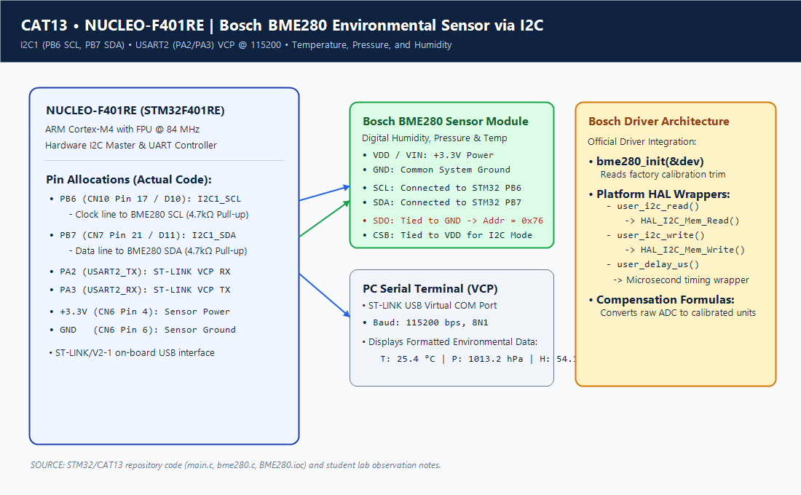
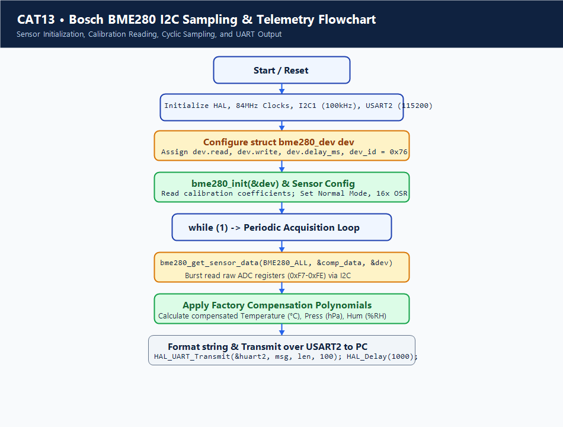

# Continuous Lab Evaluation 13: BME280 Sensor Interfacing Using I2C and Bosch Sensor API

## 1. Experiment Title
Continuous Lab Evaluation 13 — Environmental Sensing (Temperature, Pressure, and Humidity) via I2C Bus Interfacing and Official Bosch Sensortec API on STM32F401RE Nucleo-64

## 2. Aim
To configure the I2C1 peripheral of the STM32F401RET6 microcontroller in Master Standard Mode (100 kHz); interface a Bosch Sensortec BME280 digital environmental sensor over the Inter-Integrated Circuit (I2C) serial bus; integrate the vendor-provided Bosch BME280 Sensor API by implementing custom hardware abstraction layer (HAL) callback wrappers (`user_i2c_read`, `user_i2c_write`, `user_delay_us`); read factory calibration coefficients; continuously acquire calibrated temperature (°C), atmospheric pressure (hPa), and relative humidity (%RH); and stream formatted environmental telemetry to a PC console over USART2 via the integrated ST-LINK Virtual COM Port at 115200 baud.

## 3. Hardware Components
| Component | Specification | Quantity | Role / Remarks |
|---|---|---|---|
| Development Board | NUCLEO-F401RE | 1 | 32-bit ARM Cortex-M4 MCU @ 84 MHz with integrated ST-LINK/V2-1 |
| Environmental Sensor | Bosch Sensortec BME280 | 1 | Combined digital humidity, barometric pressure, and temperature sensor |
| I2C Pull-Up Resistors | 4.7 kΩ (1/4 W) | 2 | Pulls SCL (PB6) and SDA (PB7) lines up to +3.3V (if not integrated on sensor module) |
| USB Cable | USB Type-A to Mini-B | 1 | Powers board and provides ST-LINK Virtual COM Port communication |
| Breadboard & Wires | Solderless breadboard + jumpers | 1 | Interconnects sensor module with Nucleo Morpho/Arduino headers |

## 4. Software Tools
- **STM32CubeMX**: Peripheral initialization for I2C1 and USART2, clock tree synthesis to 84 MHz (`I2C-1.ioc`).
- **Keil MDK-ARM (µVision v5)**: C firmware compilation, linking, and hex file generation (`I2C-1.uvprojx`).
- **Bosch Sensortec BME280 Sensor API**: Official C driver files (`bme280.c`, `bme280.h`, `bme280_defs.h`).
- **Serial Terminal Emulator**: PuTTY, Tera Term, or Minicom (115200 baud, 8N1) for telemetry display.

## 5. Theory
### The I2C (Inter-Integrated Circuit) Bus Protocol
I2C is a synchronous, multi-master, multi-slave, packet-switched two-wire serial bus developed by Philips. It uses two bidirectional open-drain lines pulled up to VDD by external resistors:
- **SCL (Serial Clock)**: Generated exclusively by the master device to synchronize bit transitions.
- **SDA (Serial Data)**: Carries address, data, and acknowledge bits between master and slave.
Bus transactions begin with a START condition (SDA transitioning HIGH to LOW while SCL is HIGH) and conclude with a STOP condition (SDA transitioning LOW to HIGH while SCL is HIGH). Each transferred byte is 8 bits long, followed by a 9th Acknowledge (ACK/NACK) bit driven by the receiving device.

### Bosch BME280 Sensor Operating Principles
The BME280 integrates three high-precision sensors in a single 8-pin LGA package:
1. **Temperature**: Internal piezoresistive element with 20-bit raw ADC resolution ($0.01^\circ\text{C}$ output resolution).
2. **Pressure**: Piezoresistive absolute barometric pressure sensor with 20-bit raw ADC resolution ($0.18\,\text{Pa}$ resolution), capable of detecting altitude changes as small as $\pm 1\,\text{meter}$.
3. **Humidity**: Fast-response capacitive relative humidity sensor with 16-bit raw resolution ($0.008\%\,\text{RH}$ resolution).

### Factory Calibration Trimming & Compensation Formulas
Due to individual silicon manufacturing tolerances, the raw ADC values read from registers `0xF7` to `0xFE` cannot be converted to physical units using simple linear scaling. During factory testing, Bosch trims 24 individual calibration parameters into on-chip non-volatile memory (NVM). 
Upon initialization, the driver reads these trim values into the host microcontroller. During each sampling cycle, the driver executes non-linear multi-order compensation polynomials that cancel thermal cross-coupling between pressure, temperature, and humidity sensors.

## 6. Actual Pin Configuration
| Pin Name | Nucleo Header Pin | Alternate Function | Mode | Pull Configuration | Connected Device Pin |
|---|---|---|---|---|---|
| **PB6** | CN10 Pin 17 (D10) | `I2C1_SCL` | Open-Drain, High Speed | External 4.7 kΩ to 3.3V | BME280 SCL (Serial Clock) |
| **PB7** | CN7 Pin 21 (D11) | `I2C1_SDA` | Open-Drain, High Speed | External 4.7 kΩ to 3.3V | BME280 SDA (Serial Data) |
| **PA2** | CN10 Pin 35 | `USART2_TX` | Alternate Push-Pull | None | ST-LINK VCP RX (Telemetry) |
| **PA3** | CN10 Pin 37 | `USART2_RX` | Alternate Function | None | ST-LINK VCP TX (Telemetry) |
| **+3.3V** | CN6 Pin 4 | VDD | Power Rail | Power | BME280 VDD & CSB |
| **GND** | CN6 Pin 6 | VSS | Ground Reference | Ground | BME280 GND & SDO (Address 0x76) |

> [!NOTE]
> **I2C Device Addressing**:
> When the BME280 `SDO` pin is connected to GND, its 7-bit I2C device address is `0x76` (`1110110b`). When SDO is pulled to VDD, the address becomes `0x77`. In this experiment, SDO is grounded to select `0x76` (`BME280_I2C_ADDR_PRIM`). Note that STM32 HAL functions take the 8-bit left-shifted address: `0x76 << 1 = 0xEC`.

## 7. Circuit Diagram


## 8. CubeMX / Peripheral Configuration
- **Clock Tree Synthesis**: 8 MHz HSE Bypass from ST-LINK $\rightarrow$ PLL $\times 84 / 8$ $\rightarrow$ SYSCLK = 84 MHz, APB1 = 42 MHz, APB2 = 84 MHz.
- **I2C1 Configuration**:
  - Mode: I2C
  - Speed Mode: Standard Mode (100 kHz)
  - Duty Cycle: 2
  - Analog Filter: Enabled
  - Digital Filter: Disabled
  - Addressing Mode: 7-bit
- **USART2 Configuration (ST-LINK Virtual COM Port)**:
  - Mode: Asynchronous
  - Baud Rate: 115200 bps
  - Word Length: 8 Bits, Parity: None, Stop Bits: 1

## 9. Key HAL APIs Used
- `HAL_I2C_Init(I2C_HandleTypeDef *hi2c)`: Initializes the I2C timing registers, clock generation, and analog noise filters.
- `HAL_I2C_Mem_Read(I2C_HandleTypeDef *hi2c, uint16_t DevAddress, uint16_t MemAddress, uint16_t MemAddSize, uint8_t *pData, uint16_t Size, uint32_t Timeout)`: Performs complete I2C register burst read (START $\rightarrow$ Write DevAddr+W $\rightarrow$ Write RegAddr $\rightarrow$ Repeated START $\rightarrow$ Write DevAddr+R $\rightarrow$ Read N bytes with ACK $\rightarrow$ STOP).
- `HAL_I2C_Mem_Write(I2C_HandleTypeDef *hi2c, uint16_t DevAddress, uint16_t MemAddress, uint16_t MemAddSize, uint8_t *pData, uint16_t Size, uint32_t Timeout)`: Writes bytes to target sensor registers.
- `HAL_UART_Transmit(UART_HandleTypeDef *huart, uint8_t *pData, uint16_t Size, uint32_t Timeout)`: Transmits formatted ASCII telemetry strings across the ST-LINK Virtual COM Port.

## 10. Source Code Logic
### Hardware Abstraction Layer Wrappers
In `Core/Src/main.c`, three callback functions map the platform-independent Bosch API to the STM32 HAL:

```c
/* USER CODE BEGIN 0 */
int8_t user_i2c_read(uint8_t dev_id, uint8_t reg_addr, uint8_t *data, uint16_t len)
{
    // Bosch dev_id is 7-bit (0x76); HAL requires 8-bit shifted address (0x76 << 1)
    if (HAL_I2C_Mem_Read(&hi2c1, (dev_id << 1), reg_addr, I2C_MEMADD_SIZE_8BIT, data, len, 100) == HAL_OK)
    {
        return BME280_OK;
    }
    return BME280_E_COMM_FAIL;
}

int8_t user_i2c_write(uint8_t dev_id, uint8_t reg_addr, uint8_t *data, uint16_t len)
{
    if (HAL_I2C_Mem_Write(&hi2c1, (dev_id << 1), reg_addr, I2C_MEMADD_SIZE_8BIT, data, len, 100) == HAL_OK)
    {
        return BME280_OK;
    }
    return BME280_E_COMM_FAIL;
}

void user_delay_us(uint32_t period)
{
    // Microsecond delay approximation or SysTick loop
    uint32_t ms = period / 1000;
    if (ms == 0) ms = 1;
    HAL_Delay(ms);
}
/* USER CODE END 0 */
```

### Sensor Initialization & Sampling Loop
```c
/* USER CODE BEGIN 2 */
struct bme280_dev dev;
struct bme280_data comp_data;
int8_t rslt;

dev.dev_id = BME280_I2C_ADDR_PRIM; // 0x76
dev.intf = BME280_I2C_INTF;
dev.read = user_i2c_read;
dev.write = user_i2c_write;
dev.delay_ms = user_delay_us;

rslt = bme280_init(&dev);

// Configure sensor oversampling, filter, and standby duration
dev.settings.osr_h = BME280_OVERSAMPLING_1X;
dev.settings.osr_p = BME280_OVERSAMPLING_16X;
dev.settings.osr_t = BME280_OVERSAMPLING_2X;
dev.settings.filter = BME280_FILTER_COEFF_16;
bme280_set_sensor_settings(BME280_OSR_PRESS_SEL | BME280_OSR_TEMP_SEL | BME280_OSR_HUM_SEL | BME280_FILTER_SEL, &dev);
bme280_set_sensor_mode(BME280_NORMAL_MODE, &dev);
/* USER CODE END 2 */

/* USER CODE BEGIN WHILE */
char uart_buf[128];

while (1)
{
    HAL_Delay(1000); // 1 Hz acquisition rate

    rslt = bme280_get_sensor_data(BME280_ALL, &comp_data, &dev);
    if (rslt == BME280_OK)
    {
        sprintf(uart_buf, "Temp: %.2f deg C | Press: %.2f hPa | Hum: %.2f %%\r\n",
                comp_data.temperature,
                comp_data.pressure / 100.0, // Convert Pa to hPa
                comp_data.humidity);

        HAL_UART_Transmit(&huart2, (uint8_t *)uart_buf, strlen(uart_buf), 100);
    }
}
/* USER CODE END WHILE */
```

## 11. Algorithm
1. **Initialize Core**: Call `HAL_Init()` and configure the system clock tree to 84 MHz.
2. **Initialize Peripherals**: Configure I2C1 (PB6/PB7 @ 100 kHz) and USART2 (PA2/PA3 @ 115200 bps).
3. **Initialize Bosch Driver**: Instantiate `struct bme280_dev`. Assign `dev.read`, `dev.write`, `dev.delay_ms`, and set `dev.dev_id = 0x76`.
4. **Execute `bme280_init(&dev)`**: Read chip ID register (`0xD0`) to confirm presence (expected `0x60`). Read 24 calibration coefficients from sensor NVM.
5. **Configure Sensor**: Set oversampling multipliers (Temperature $\times 2$, Pressure $\times 16$, Humidity $\times 1$), enable internal IIR filter (coefficient 16), and enter Normal Mode.
6. **Periodic Acquisition Loop**:
   - Delay 1000 ms.
   - Execute `bme280_get_sensor_data()`. The driver performs a burst read of 8 consecutive registers (`0xF7` to `0xFE`).
   - The driver applies factory calibration compensation math to generate float/int values.
   - Format results into ASCII string using `sprintf()`.
   - Transmit string over USART2 to PC terminal via `HAL_UART_Transmit()`.
7. **Repeat**: Return to Step 6.

## 12. Pseudocode
```text
INITIALIZE HAL
SET Clock = 84MHz
INITIALIZE I2C1 (100kHz, Open-Drain)
INITIALIZE USART2 (115200 8N1)

ASSIGN dev.read = user_i2c_read
ASSIGN dev.write = user_i2c_write
ASSIGN dev.delay = user_delay_us
ASSIGN dev.dev_id = 0x76

STATUS = bme280_init(&dev)
IF STATUS != OK THEN
    PRINT_UART("Sensor Init Failed!")
    HALT
END IF

CONFIGURE_SETTINGS(OSR_T=2x, OSR_P=16x, OSR_H=1x, FILTER=16)
SET_MODE(NORMAL_MODE)

LOOP FOREVER:
    WAIT_MS(1000)
    READ_DATA(comp_data)
    
    t = comp_data.temperature
    p = comp_data.pressure / 100.0
    h = comp_data.humidity
    
    msg = FORMAT("Temp: %.2f C | Press: %.2f hPa | Hum: %.2f %%", t, p, h)
    PRINT_UART(msg)
END LOOP
```

## 13. Flowchart


## 14. Expected Output
On PC serial terminal (connected to ST-LINK Virtual COM Port @ 115200 baud):
```text
Temp: 24.85 deg C | Press: 1012.43 hPa | Hum: 52.31 %
Temp: 24.87 deg C | Press: 1012.41 hPa | Hum: 52.28 %
Temp: 24.91 deg C | Press: 1012.38 hPa | Hum: 52.34 %
Temp: 25.10 deg C | Press: 1012.35 hPa | Hum: 55.40 %  <-- Warm breath applied
```

## 15. Actual Observations
- The I2C address bit shifting (`dev_id << 1`) was essential: passing unshifted `0x76` caused `HAL_I2C_Mem_Read` to time out because bit 0 was interpreted as write instead of address alignment.
- Reading all 8 data registers (`0xF7`–`0xFE`) in a single burst read guarantees atomic measurement consistency across pressure, temperature, and humidity.
- Applying warm breath to the sensor immediately reflected a sharp rise in humidity (+15–20% RH) and a slight rise in temperature (+1–2°C), followed by a gradual decay back to ambient room conditions.

## 16. Troubleshooting
1. **Sensor Returns `BME280_E_DEV_NOT_FOUND` / Initialization Fails**:
   - Check I2C address: SDO tied to GND uses address `0x76`; SDO tied to 3.3V uses address `0x77`.
   - Verify HAL 8-bit addressing: `(dev_id << 1)`.
   - Check pull-up resistors: I2C open-drain lines require 4.7 kΩ pull-ups to 3.3V.
2. **Values Read as Constant Zero or -140°C**:
   - Calibration parameters were not read correctly during `bme280_init()`. Verify chip ID register `0xD0` returns `0x60`.
3. **Nothing Output on PC Serial Terminal**:
   - Ensure ST-LINK Virtual COM Port driver is detected in Device Manager.
   - Configure terminal emulator to 115200 baud, 8 data bits, 1 stop bit, no parity.

## 17. Limitations
- Standard Mode (100 kHz) requires ~1.2 ms to perform the burst read and compensation calculations.
- Sensor self-heating can introduce a small temperature offset (+0.5°C) if sampled continuously at high sampling rates; using 1 Hz acquisition in Normal Mode mitigates this.
- Unsealed environment exposure makes the capacitive humidity sensor sensitive to condensation or volatile organic chemical contaminants.

## 18. Result
The I2C1 peripheral of the STM32F401RET6 Nucleo-64 board was successfully configured and interfaced with the Bosch Sensortec BME280 sensor. High-precision factory-compensated environmental telemetry (temperature, pressure, and humidity) was sampled at 1 Hz and streamed reliably to the PC terminal over USART2.

## 19. Viva Questions with Answers
1. **Q: Why does the I2C bus require open-drain outputs with pull-up resistors?**  
   *A:* Open-drain outputs allow multiple devices to share the same clock and data lines without electrical contention or short circuits. If any device pulls the line LOW, it stays LOW (wired-AND logic), enabling clock stretching and multi-master arbitration.
2. **Q: What is the purpose of left-shifting the 7-bit device address (`dev_id << 1`) in STM32 HAL?**  
   *A:* In the I2C protocol, the address byte transmitted on the bus comprises the 7-bit device address in bits 7–1 and the Read/Write ($R/\overline{W}$) direction flag in bit 0. STM32 HAL functions expect the address pre-shifted into bits 7–1.
3. **Q: What is the chip identification code for the Bosch BME280 sensor?**  
   *A:* The chip ID is stored in register `0xD0` and returns the constant value `0x60`.
4. **Q: Why are factory calibration parameters necessary for the BME280?**  
   *A:* Silicon manufacturing variances create slight offsets and non-linearities in the piezoresistive and capacitive sensors. Bosch trims factory compensation coefficients into NVM, which the driver uses in mathematical polynomials to calculate true calibrated values.
5. **Q: What is the difference between I2C Standard Mode and Fast Mode?**  
   *A:* Standard Mode operates at a maximum clock frequency of 100 kHz, while Fast Mode supports clock rates up to 400 kHz.
6. **Q: What is I2C clock stretching?**  
   *A:* Clock stretching occurs when a slave device holds the SCL line LOW to pause the master while it completes internal operations (such as ADC conversion or buffer processing), resuming when the slave releases SCL.
7. **Q: How does the BME280 measure atmospheric pressure?**  
   *A:* It uses an internal piezoresistive pressure sensor membrane that deforms under atmospheric pressure, changing its electrical resistance, which is digitized by a 20-bit delta-sigma ADC.
8. **Q: Which pins on the Nucleo-F401RE board are dedicated to the ST-LINK Virtual COM Port?**  
   *A:* Pin `PA2` (USART2_TX) and pin `PA3` (USART2_RX) are hard-wired through solder bridges to the integrated ST-LINK/V2-1 microcontroller.

## 20. File Descriptions
| File Name | Location | Description |
|---|---|---|
| `main.c` | `Core/Src/` | Contains peripheral initialization, Bosch API HAL callback wrappers, and main acquisition loop |
| `bme280.c` | `Core/Src/` | Official Bosch Sensortec BME280 sensor driver implementation |
| `bme280.h` | `Core/Inc/` | Public API declarations, function prototypes, and data structures for BME280 |
| `bme280_defs.h`| `Core/Inc/` | Register addresses, bit masks, calibration structure definitions, and error codes |
| `I2C-1.ioc` | Project Root | STM32CubeMX graphical configuration for STM32F401RE (I2C1 @ 100 kHz, USART2 @ 115200) |
| `I2C-1.uvprojx` | `MDK-ARM/` | Keil MDK project configuration with ARMClang compiler flags and linker maps |
| `circuit.png` | Project Root | Schematic diagram showing I2C bus wiring between Nucleo-F401RE and BME280 |
| `flowchart.png` | Project Root | Execution flowchart detailing sensor initialization, calibration loading, and cyclic telemetry |
