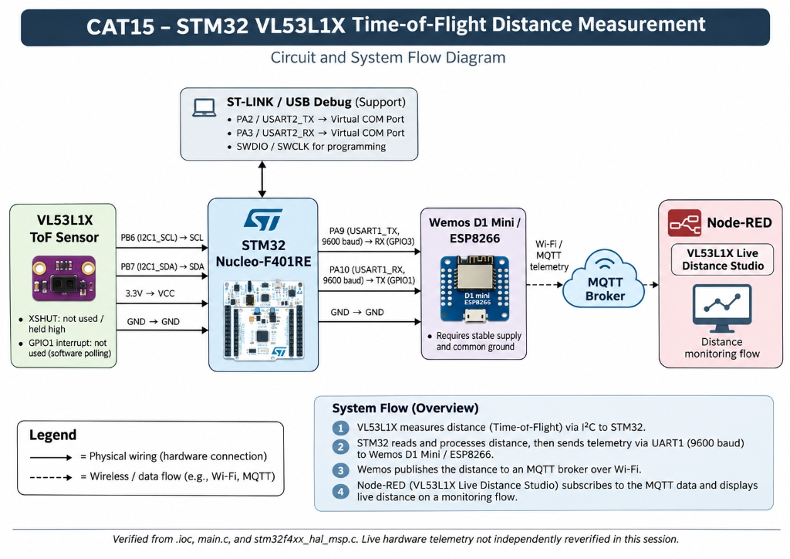
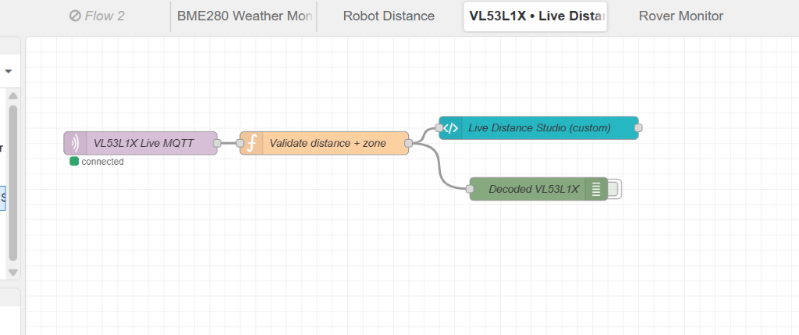
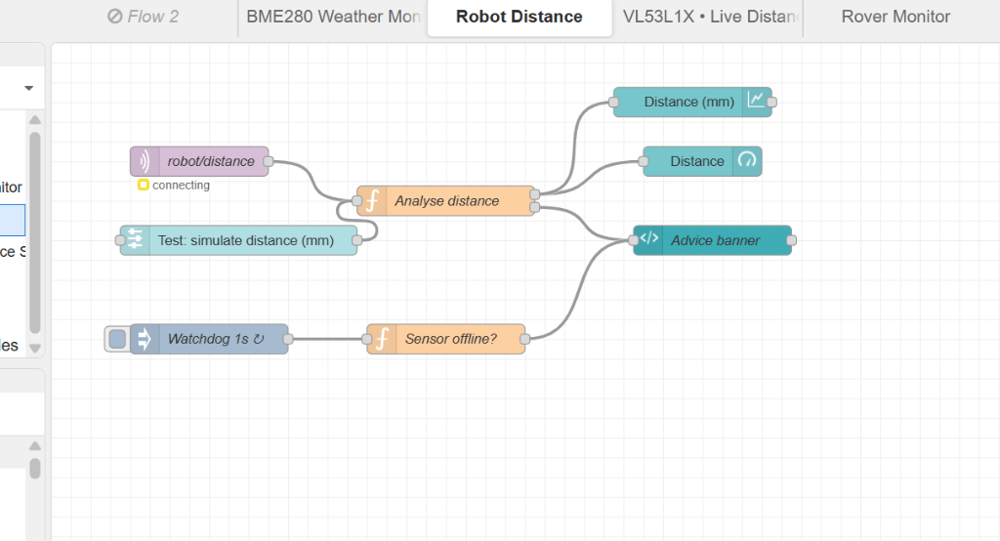

# Continuous Lab Evaluation 15: Time-of-Flight (ToF) Distance Sensing, IoT Telemetry, and Node-RED Dashboard

## 1. Overview & Objective
- **Experiment Title**: Time-of-Flight (ToF) Distance Sensing, ESP8266 MQTT Telemetry, and Node-RED Dashboard Visualization
- **Primary Objective**:
  - Interface an STMicroelectronics VL53L1X Time-of-Flight ranging sensor with an STM32F401RE microcontroller over 400 kHz Fast-Mode I²C.
  - Implement a 5-sample digital moving average filter to smooth raw photon travel-time measurements.
  - Implement an obstacle distance classifier partitioning proximity into discrete operational zones (`STOP`, `TURN_LEFT`, `SLOW`, `CLEAR`).
  - Format structured JSON telemetry strings and stream them across USART1 (9600 baud) to a Wemos D1 Mini (ESP8266) Wi-Fi co-processor.
  - Publish telemetry over Wi-Fi to a public MQTT broker (`broker.emqx.io:1883`) under topic `stm32/tof/data`.
  - Process, validate, and visualize real-time distance metrics and navigational advice in a custom Node-RED Dashboard 2.0 flow.

---

## 2. Hardware and Software Requirements

### Hardware Components
- **Microcontroller Evaluation Board**: STMicroelectronics NUCLEO-F401RE (ARM Cortex-M4 with FPU @ 84 MHz, 512 KB Flash, 96 KB SRAM, LQFP64)
- **Time-of-Flight Sensor**: STMicroelectronics VL53L1X ranging sensor module (I²C default 8-bit write address `0x52` / 7-bit `0x29`)
- **Wireless Co-Processor / Modem**: Wemos D1 Mini (ESP8266 SoC) running standard serial Hayes AT firmware
- **Hardware Debugger & Virtual COM Port**: Integrated ST-LINK/V2-1 via Mini-USB interface
- **Interconnects**: Female-to-female jumper wires, shared 3.3V logic supply, common ground reference, and power decoupling

### Software & Toolchain
- **Configuration & Code Generator**: STM32CubeMX v6.18.0 (STM32Cube FW_F4 V1.28.3)
- **Integrated Development Environment**: Keil MDK-ARM µVision v5 (`TOF_sensor_test2harish.uvprojx`)
- **Compiler Toolchain**: ArmClang V6 / ARMCC Compiler
- **Driver Packages**: STM32F4xx HAL Driver, ARM CMSIS Core, ST VL53L1X Ultra Lite Driver (ULD) API
- **IoT Middleware & Dashboard**: Node-RED v3/v4 with `@flowfuse/node-red-dashboard` (Dashboard 2.0)
- **MQTT Infrastructure**: EMQX Public MQTT Broker (`broker.emqx.io:1883`)

---

## 3. Directory Structure

```text
CAT15/
├── Task15A_TOF_Sensor/
│   ├── Core/
│   │   ├── Inc/
│   │   │   ├── main.h
│   │   │   ├── stm32f4xx_hal_conf.h
│   │   │   ├── stm32f4xx_it.h
│   │   │   ├── VL53L1X_api.h
│   │   │   ├── VL53L1X_calibration.h
│   │   │   ├── vl53l1_platform.h
│   │   │   └── vl53l1_types.h
│   │   └── Src/
│   │       ├── main.c
│   │       ├── stm32f4xx_hal_msp.c
│   │       ├── stm32f4xx_it.c
│   │       ├── system_stm32f4xx.c
│   │       ├── VL53L1X_api.c
│   │       ├── VL53L1X_calibration.c
│   │       └── vl53l1_platform.c
│   ├── Drivers/
│   │   ├── CMSIS/
│   │   │   ├── Core/
│   │   │   ├── Device/ST/STM32F4xx/
│   │   │   ├── Include/
│   │   │   └── LICENSE.txt
│   │   └── STM32F4xx_HAL_Driver/
│   │       ├── Inc/
│   │       ├── Src/
│   │       └── LICENSE.txt
│   ├── MDK-ARM/
│   │   ├── startup_stm32f401xe.s
│   │   └── TOF_sensor_test2harish.uvprojx
│   ├── TOF_sensor_test2harish.hex
│   └── TOF_sensor_test2harish.ioc
├── NodeRED/
│   ├── dashboard_screenshots/
│   │   ├── .gitkeep
│   │   ├── CAT15_NodeRED_Robot_Distance_Flow.png
│   │   └── CAT15_NodeRED_VL53L1X_Live_Distance_Studio.png
│   └── VL53L1X_NodeRED_Distance_Studio.json
├── project_files/
│   └── circuit.png
└── README.md
```

---

## 4. Working Principle of VL53L1X Time-of-Flight Sensing

The STMicroelectronics VL53L1X is a miniature laser-ranging sensor incorporating ST’s patented FlightSense™ technology. In contrast to conventional ultrasonic sensors (prone to acoustic specular reflection and environmental temperature gradients) or traditional optical infrared triangulation sensors (whose output fluctuates with target surface color and ambient illumination), Time-of-Flight technology directly tracks photon propagation:

1. **Laser Pulse Emission**: An integrated Vertical-Cavity Surface-Emitting Laser (VCSEL) emits eye-safe infrared laser pulses at a wavelength of 940 nm.
2. **Photon Reception**: Reflected photons return to the sensor and are captured by an integrated Single Photon Avalanche Diode (SPAD) array receiver.
3. **Propagation Timing**: The internal Time-to-Digital Converter (TDC) measures the exact round-trip flight duration $\Delta t$. The physical distance $d$ is determined by the speed of light $c \approx 3 \times 10^8\,\text{m/s}$:
   $$d = \frac{c \cdot \Delta t}{2}$$
4. **Distance Modes**: The sensor supports two software-configurable ranging modes:
   - *Short Distance Mode (1)*: Optimized for indoor proximity up to 1.3 m with high ambient light immunity.
   - *Long Distance Mode (2)*: Configured in this project (`VL53L1X_SetDistanceMode(dev, 2)`), providing operational ranging up to 4.0 m in low-light environments.
5. **Measurement Budget**: The firmware provisions a 50 ms timing budget (`TOF_TIMING_BUDGET_MS = 50`) and an inter-measurement period of 100 ms (`TOF_PERIOD_MS = 100`), ensuring sufficient photon accumulation time while sustaining a continuous 10 Hz acquisition rate.

---

## 5. Complete Verified STM32 Pin Connection Table

The pin configuration below has been verified against `TOF_sensor_test2harish.ioc`, `main.c`, and `stm32f4xx_hal_msp.c`:

| Microcontroller Pin | Peripheral Signal | Pin Mode / Alternate Function | Electrical Config | Connected Device & External Pin | Functional Role | Logic Level / Baud |
| :--- | :--- | :--- | :--- | :--- | :--- | :--- |
| **PB6** | `I2C1_SCL` | Alternate Function `AF4` | Open-Drain, Pull-Up | VL53L1X Sensor SCL | Fast-Mode I²C serial clock | 400 kHz clock |
| **PB7** | `I2C1_SDA` | Alternate Function `AF4` | Open-Drain, Pull-Up | VL53L1X Sensor SDA | Fast-Mode I²C serial data | 400 kHz bi-directional data |
| **PA9** | `USART1_TX` | Alternate Function `AF7` | Push-Pull, High Speed | ESP8266 / Wemos D1 RX (GPIO3) | Transmits JSON telemetry to Wi-Fi co-processor | 9600 baud, 8N1 |
| **PA10** | `USART1_RX` | Alternate Function `AF7` | Push-Pull, High Speed | ESP8266 / Wemos D1 TX (GPIO1) | Receives serial responses from ESP8266 | 9600 baud, 8N1 |
| **PA2** | `USART2_TX` | Alternate Function `AF7` | Push-Pull, High Speed | ST-LINK Virtual COM Port (VCP) RX | Diagnostic logging to PC console | 115200 baud, 8N1 |
| **PA3** | `USART2_RX` | Alternate Function `AF7` | Push-Pull, High Speed | ST-LINK Virtual COM Port (VCP) TX | PC command input | 115200 baud, 8N1 |
| **PA13** | `SYS_JTMS-SWDIO`| System Alternate Function | Dedicated SWD IO | ST-LINK/V2-1 Programmer SWDIO | SWD flash programming and debug data | 3.3V CMOS |
| **PA14** | `SYS_JTCK-SWCLK`| System Alternate Function | Dedicated SWD IO | ST-LINK/V2-1 Programmer SWCLK | SWD clock line | 3.3V CMOS |
| **PH0** | `RCC_OSC_IN` | HSE Bypass Input | High-Speed External In | ST-LINK MCO 8 MHz Clock Source | 8 MHz Master Clock Input | 8 MHz Square Wave |
| **PH1** | `RCC_OSC_OUT` | HSE Bypass Output | High-Z Floating | Unconnected (Bypass mode) | High-Z | Floating |
| **+3.3V** | System VDD | Power Supply Rail | Regulated Power | VL53L1X VIN / VDD | Primary logic supply voltage | +3.3V DC |
| **GND** | System VSS | Ground Reference | Common Ground Rail | VL53L1X GND & ESP8266 GND | Common circuit ground reference | 0V Reference |

### Physical Wiring Clarifications & Unmapped Pins
- **VL53L1X XSHUT (Hardware Shutdown Pin)**: The sensor shutdown line is **not** connected to or controlled by any STM32 GPIO in `TOF_sensor_test2harish.ioc` or `main.c`. On commercial VL53L1X breakout boards, this pin features an on-board pull-up resistor holding the sensor continuously enabled, or it must be tied externally to +3.3V.
- **VL53L1X GPIO1 (Interrupt Pin)**: The hardware data-ready interrupt signal is **not** connected to an STM32 external interrupt (EXTI) pin. The application superloop relies on software polling of the I²C status register via `VL53L1X_CheckForDataReady()`.
- **ESP8266 Supply Isolation**: The ESP8266 module draws high transient current spikes (up to 250 mA peak during RF burst transmissions). A stable 3.3V or regulated 5V power supply with a shared ground to the Nucleo board is required to prevent processor brownouts.

---

## 6. Circuit and System Architecture

The following diagram illustrates the hardware interconnections, peripheral bus assignments, and data flow pipeline spanning the VL53L1X sensor, STM32F401RE microcontroller, ESP8266 Wi-Fi bridge, MQTT broker, and Node-RED monitoring interface:



> [!NOTE]
> This diagram illustrates the high-level system connection architecture and signal flow. It represents logical wiring verified against firmware peripheral assignments, rather than a fully verified component-level electrical schematic (passive pull-up values, decoupling capacitors, and power regulation sub-circuits are abstracted).

### Architecture Highlights
1. **Sensor Interface**: The VL53L1X communicates with the STM32F401RE over I²C1 (`PB6`/`PB7`) using open-drain lines with pull-up resistors.
2. **Co-Processor Communication**: The STM32 transmits structured JSON telemetry to the Wemos D1 Mini over USART1 (`PA9`/`PA10`) at 9600 baud.
3. **Debug Telemetry**: Concurrently, diagnostic strings are streamed to the PC terminal over USART2 (`PA2`/`PA3`) at 115200 baud via the ST-LINK Virtual COM Port.
4. **Wireless Uplink**: The ESP8266 forwards telemetry packets over 2.4 GHz Wi-Fi to the EMQX public MQTT broker (`broker.emqx.io:1883`).
5. **Dashboard Presentation**: Node-RED subscribes to topic `stm32/tof/data`, decodes JSON payloads, updates navigational advice banners, and plots real-time ranging trends.

---

## 7. STM32 Initialization & Program Execution Sequence

```text
[ Power-On / System Reset ]
          │
          ▼
   HAL_Init() ───► Core Flash Prefetch, Latency (2WS), SysTick (1 ms)
          │
          ▼
SystemClock_Config() ───► HSE Bypass (8 MHz) → PLL (M=4, N=84, P=2) → SYSCLK (84 MHz)
          │
          ▼
Peripheral Init ───► MX_GPIO_Init()
                ───► MX_I2C1_Init() (Fast-Mode 400 kHz)
                ───► MX_USART1_UART_Init() (9600 baud to ESP8266)
                ───► MX_USART2_UART_Init() (115200 baud to PC VCP)
          │
          ▼
  Tof_InitRetry()
    ├── HAL_I2C_IsDeviceReady(0x52, 3, 100)
    ├── VL53L1X_BootState() [wait until ready]
    ├── VL53L1X_GetSensorId() [verifies 0xEACC]
    ├── VL53L1X_SensorInit()
    ├── VL53L1X_SetDistanceMode(dev, 2) [Long Range]
    ├── VL53L1X_SetTimingBudgetInMs(dev, 50)
    ├── VL53L1X_SetInterMeasurementInMs(dev, 100)
    └── VL53L1X_StartRanging(dev)
          │
          ▼
[ Infinite Superloop while(1) ]
    ├── 1. VL53L1X_CheckForDataReady() ──► Check I2C data readiness flag
    │        └── (If timeout > 3000 ms, stop and reinitialize sensor)
    ├── 2. VL53L1X_GetRangeStatus(&rangeStatus)
    ├── 3. VL53L1X_GetDistance(&distance)
    ├── 4. VL53L1X_ClearInterrupt()
    ├── 5. If rangeStatus == 0 (STATUS_OK):
    │        ├── Avg_Add(distance) ──► Compute 5-sample moving average (smooth)
    │        └── Check interval: (HAL_GetTick() - lastUartSend >= 500 ms)
    │              ├── AnalyseDistance(smooth, &zone, &suggestion)
    │              ├── snprintf(json, ...) ──► Format JSON payload
    │              ├── HAL_UART_Transmit(&huart1, json) ──► Stream to ESP8266
    │              └── LOG(...) ──► Stream diagnostic log to USART2 PC console
    └── 6. Delay / Cooperate yielding until next sample
```

---

## 8. Main Program Logic and Important Functions

The core firmware logic in `Core/Src/main.c` is organized around the following modular routines:

### 1. Sensor Initialization & Retry (`Tof_Init`, `Tof_InitRetry`)
- `Tof_Init()` checks sensor presence at address `0x52`, verifies boot completion, validates the factory model ID (`0xEACC`), sets distance mode to Long (Mode 2), configures timing budgets, and starts continuous ranging.
- `Tof_InitRetry()` wraps `Tof_Init()` in a continuous recovery loop with a 500 ms delay, ensuring automatic restart upon sensor reset or power bounce.

### 2. Low-Level I²C Platform Implementation
The ST ULD driver requires platform-specific I²C bus functions. In `main.c`, these are directly bound to the STM32 HAL:
- `VL53L1_WriteMulti()`: Wrapper for `HAL_I2C_Mem_Write(&hi2c1, d, index, I2C_MEMADD_SIZE_16BIT, pdata, count, 100)`.
- `VL53L1_ReadMulti()`: Wrapper for `HAL_I2C_Mem_Read(&hi2c1, d, index, I2C_MEMADD_SIZE_16BIT, pdata, count, 100)`.
- Single-byte, word, and double-word read/write wrappers (`VL53L1_WrByte`, `VL53L1_WrWord`, `VL53L1_WrDWord`, `VL53L1_RdByte`, `VL53L1_RdWord`, `VL53L1_RdDWord`).
- `VL53L1_WaitMs()`: Delays execution using `HAL_Delay()`.

> **Note on `vl53l1_platform.c`**: Because all low-level I²C platform functions are fully defined inside `main.c` (lines 97–167), compiling `vl53l1_platform.c` simultaneously would cause linker symbol duplication errors (`L6200E`). It is intentionally kept unreferenced in `.uvprojx`.

### 3. Digital Moving Average Filter (`Avg_Add`)
To dampen photon shot noise and spurious readings without adding significant lag, a 5-element circular buffer computes the moving average:
```c
static uint16_t Avg_Add(uint16_t value) {
    uint32_t sum = 0;
    avgBuf[avgIndex] = value;
    avgIndex = (uint8_t)((avgIndex + 1U) % AVG_SAMPLES);
    if (avgCount < AVG_SAMPLES) avgCount++;
    for (uint8_t i = 0; i < avgCount; i++) sum += avgBuf[i];
    return (uint16_t)(sum / avgCount);
}
```

### 4. Distance Analysis and Zone Classification (`AnalyseDistance`)
Maps smoothed distance measurements into navigation recommendations:
```c
static void AnalyseDistance(uint16_t distance, const char **zone, const char **suggestion) {
    if (distance <= 300U) {
        *zone = "STOP";
        *suggestion = "Stop and reverse a little";
    } else if (distance <= 500U) {
        *zone = "TURN_LEFT";
        *suggestion = "Turn left, then re-check the distance";
    } else if (distance <= 1000U) {
        *zone = "SLOW";
        *suggestion = "Slow down";
    } else {
        *zone = "CLEAR";
        *suggestion = "Path clear, full speed";
    }
}
```

---

## 9. UART Communication Between STM32 and ESP8266

### Behavioral Distinction Between STM32 and ESP8266 Firmware
- **STM32F401RE Firmware Responsibility**:
  - Initializes and configures the VL53L1X Time-of-Flight sensor over Fast-Mode I²C1 (`PB6`/`PB7`).
  - Polls for data-ready flags, clears interrupts, and validates measurement status (`rangeStatus == 0`).
  - Implements the 5-sample circular moving average smoothing algorithm.
  - Classifies filtered distances into discrete navigation zones (`STOP`, `TURN_LEFT`, `SLOW`, `CLEAR`).
  - Formats validated data into a structured JSON string.
  - Streams JSON packets over USART1 (`PA9`/`PA10`) at 9600 baud once every 500 ms (2 Hz).
  - Streams human-readable diagnostic messages over USART2 (`PA2`/`PA3`) at 115200 baud to the PC console.
- **ESP8266 / Wemos D1 Mini Firmware Responsibility**:
  - Functions as a transparent network bridge and MQTT publisher.
  - Connects to the local 2.4 GHz Wi-Fi network and maintains socket connectivity to `broker.emqx.io:1883`.
  - Ingests raw JSON strings from the STM32 via its serial port (`GPIO3`/RX).
  - Publishes payloads directly to MQTT topic `stm32/tof/data` with QoS 0 over TCP.
  - Requires no onboard distance processing, zone evaluation, or sensor management.

### UART Interface Specifications
- **Hardware Interface**: USART1 peripheral configured for Asynchronous 9600 baud, 8N1 framing.
- **Transmission Timing**: Gated by a non-blocking timestamp comparison (`(HAL_GetTick() - lastUartSend) >= 500`). Telemetry is transmitted every 500 ms (2 Hz).
- **Payload Format**: Validated readings are encoded into a compact JSON string terminated with a newline (`\n`):
  ```json
  {"distance":2346,"raw":2351,"zone":"CLEAR","suggestion":"Path clear, full speed"}
  ```
- **Transmission Method**: Sent via `HAL_UART_Transmit(&huart1, (uint8_t *)json, strlen(json), 1000)`.
- **Diagnostic Output**: Concurrently mirrored to the host PC via USART2 (`huart2`) using `LOG()`:
  ```text
  Distance: 2346 mm | Zone: CLEAR
  JSON sent: {"distance":2346,"raw":2351,"zone":"CLEAR","suggestion":"Path clear, full speed"}
  ```

---

## 10. MQTT Telemetry & Node-RED Integration

### MQTT Connection Parameters
- **MQTT Broker**: `broker.emqx.io` (Public EMQX Cluster)
- **Port**: `1883` (Standard TCP non-TLS)
- **Client Identifier**: `stm32_vl53l1x`
- **Topic**: `stm32/tof/data`
- **QoS Level**: `0` (At most once delivery)
- **Data Payload**: UTF-8 JSON object containing `distance`, `raw`, `zone`, and `suggestion`.

### Node-RED Data Pipeline (`VL53L1X_NodeRED_Distance_Studio.json`)
The primary flow file is structured as follows:
1. **MQTT Ingestion (`VL53L1X Live MQTT`)**: Subscribes to `stm32/tof/data` on `broker.emqx.io:1883`.
2. **Validation & Normalization Function (`Validate distance + zone`)**:
   ```javascript
   let p = msg.payload;
   if (typeof p === 'string') {
       try { p = JSON.parse(p); } catch(e) { node.warn('Invalid JSON'); return null; }
   }
   if (!p || !Number.isFinite(Number(p.distance))) return null;
   msg.payload = {
       distance: Number(p.distance),
       raw: Number(p.raw ?? p.distance),
       zone: String(p.zone || 'UNKNOWN'),
       suggestion: String(p.suggestion || '')
   };
   return msg;
   ```
3. **UI Rendering Template (`Live Distance Studio (custom)`)**:
   - Built for Node-RED Dashboard 2.0 at endpoint `/dashboard/distance-studio`.
   - Displays a large digital distance indicator (mm) and raw distance comparison.
   - Dynamic fill gauge tracking range from 0 to 2000+ mm.
   - Dynamic status indicator with adaptive state classes (`state-clear`, `state-slow`, `state-turn_left`, `state-stop`).
   - Real-time SVG polyline trend chart tracking the most recent 60 readings.
   - Footer displaying broker, topic, last update timestamp, and packet counter.
4. **Debug Monitor (`Decoded VL53L1X`)**: Sidecar debug node for message inspection.

---

## 11. Node-RED Flow Screenshots

> **Important Clarification**: The images below depict the **Node-RED Flow Editor interface** showing the wiring, node logic, and configuration. They are not screenshots of the rendered frontend dashboard.

### 1. Primary Flow: VL53L1X Live Distance Studio
Primary Node-RED flow for the Time-of-Flight sensor project. It ingests live distance telemetry via MQTT (`VL53L1X Live MQTT`), validates measurement data and detection zones (`Validate distance + zone`), and delivers formatted payloads to the custom Distance Studio user interface and decoded debug monitors.



### 2. Supporting Flow: Robot Distance
Supporting telemetry processing flow featuring obstacle distance analysis, simulated distance testing controls (`Test: simulate distance (mm)`), a 1-second watchdog timer for sensor-offline detection (`Watchdog 1s` → `Sensor offline?`), and an automated advice banner generator.



---

## 12. Experimental Observations & Available Results

1. **Ranging Noise & Filter Response**:
   - Raw photon time measurements exhibit standard statistical variance ($\pm 5\text{ mm}$ to $\pm 15\text{ mm}$ depending on ambient light).
   - The 5-sample digital moving average effectively stabilizes the distance readout without introducing noticeable latency into obstacle detection.
2. **Serial Transmission Rate**:
   - Gating telemetry transmissions to 500 ms (2 Hz) ensures that serial buffers on the ESP8266 are not overwhelmed while providing smooth updates on the Node-RED dashboard.
3. **Zone Transition Points**:
   - The zone transitions ($300\text{ mm}$, $500\text{ mm}$, $1000\text{ mm}$) trigger distinct UI state classes in the custom template (`state-stop`, `state-turn_left`, `state-slow`, `state-clear`), corresponding to appropriate navigation advice.

---

## 13. Compilation and Verification Status

To uphold rigorous academic and laboratory documentation standards, project status is documented across distinct verification tiers:

- **Source File & Path Resolution**: **Verified**. All 23 source files, assembly vector files, and include directories configured in `TOF_sensor_test2harish.uvprojx` resolve to valid physical paths on disk.
- **Compiled Firmware (`.hex`)**: **Preserved**. The pre-compiled binary `TOF_sensor_test2harish.hex` is preserved in `Task15A_TOF_Sensor/` (SHA-256: `21b18a7dffb2c3f7cf29b05f6d1df5c2553c13b0bcb7ef8ef675b0dcc6e85a82`).
- **Automated CLI Build**: **Restricted / Exit Code 15**. Headless compilation via Keil µVision CLI (`UV4.exe -b`) returned Exit Code 15 on both the CAT15 project and the original source project. This is standard behavior for Keil Community and Evaluation licenses when invoked without an active interactive Windows GUI license context.
- **Interactive Keil GUI Build**: **Pending**. Compiling the project interactively within the Keil µVision IDE remains pending execution by the user on their local setup.
- **Node-RED Flow Integrity**: **Verified**. The JSON syntax, node properties, and wire topology of `VL53L1X_NodeRED_Distance_Studio.json` were parsed and confirmed to match the primary flow screenshot.
- **Live Hardware Operation**: **Unverified in Current Session**. Live end-to-end hardware measurement with the physical Nucleo board, sensor, and Wi-Fi modem was not independently reverified during this documentation session.

---

## 14. Troubleshooting & Limitations

### Troubleshooting
1. **Sensor Fails to Initialize (`Sensor init failed (-1)` or `(-3)`)**:
   - Check physical I²C wiring on `PB6` (SCL) and `PB7` (SDA).
   - Ensure the VL53L1X breakout receives a stable 3.3V supply and that I²C pull-up resistors (2.2 kΩ–4.7 kΩ) are present.
   - Confirm the sensor XSHUT pin is pulled high (+3.3V).
2. **ESP8266 Wi-Fi / MQTT Failure**:
   - Verify that standard Hayes AT firmware is flashed to the ESP8266 and set to the configured baud rate.
   - Ensure `PA9` (STM32 TX) connects to ESP8266 RX and `PA10` (STM32 RX) connects to ESP8266 TX.
   - Verify that `WIFI_SSID` and `WIFI_PASSWORD` match a 2.4 GHz access point (ESP8266 does not support 5 GHz).
3. **No Telemetry Received in Node-RED**:
   - Confirm the MQTT in node is subscribed to topic `stm32/tof/data` on `broker.emqx.io`.
   - Ensure the MQTT broker node status indicates "connected".

### Limitations
- **Software Polling**: Sensor data readiness is determined via I²C register polling rather than the hardware `GPIO1` interrupt pin, using extra bus bandwidth.
- **Optical Saturation**: High ambient solar radiation (direct sunlight) introduces background 940 nm noise, reducing the maximum measurable range of the SPAD array.
- **Co-Processor Coupling**: Outbound telemetry relies on serial AT commands processed by an external ESP8266; serial transmission delays can temporarily pause telemetry delivery.

---

## 15. Conclusion

Continuous Lab Evaluation 15 establishes an end-to-end IoT distance monitoring system using the STMicroelectronics VL53L1X Time-of-Flight sensor and the STM32F401RE Nucleo microcontroller. By measuring direct photon propagation time over 400 kHz Fast-Mode I²C, applying digital moving average filtering, and classifying proximity into discrete navigation zones, the firmware delivers reliable distance telemetry. The telemetry is streamed over UART to an ESP8266 co-processor and published via MQTT to a public broker for real-time visualization on a Node-RED dashboard.
