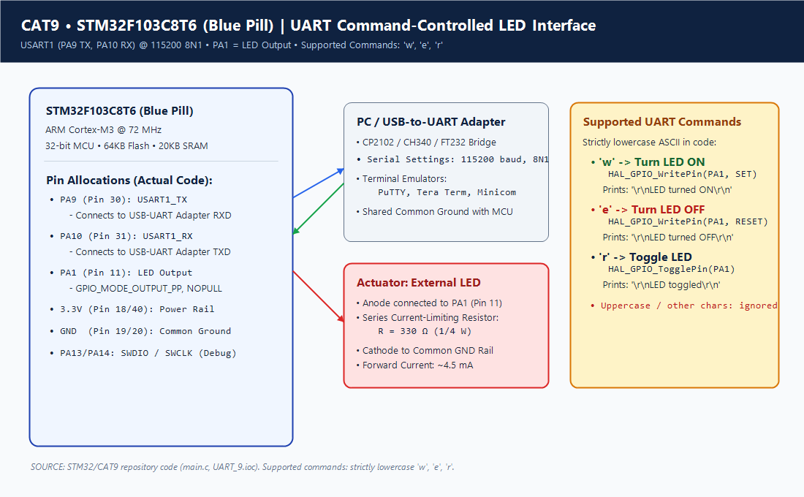
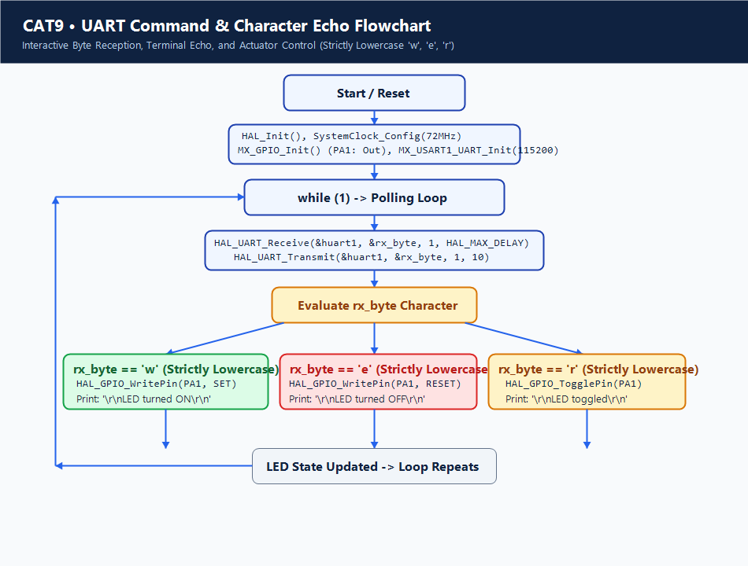

# Continuous Lab Evaluation 9: STM32 UART Command-Controlled LED

## 1. Experiment Title
Continuous Lab Evaluation 9 — Asynchronous Serial Communication and Command-Controlled Actuation via USART1 on STM32F103C8T6

## 2. Aim
To configure the Universal Synchronous Asynchronous Receiver Transmitter (USART1) peripheral of the STM32F103C8T6 microcontroller at a baud rate of 115200 bps (8N1), interface the microcontroller with a host PC serial terminal via a USB-to-UART bridge, implement real-time character echoing, and decode single-byte lowercase ASCII command characters (`'w'`, `'e'`, `'r'`) to actuate an external LED on pin PA1 with descriptive terminal message confirmations.

## 3. Hardware Components
| Component | Specification | Quantity | Role / Remarks |
|---|---|---|---|
| Microcontroller Board | STM32F103C8T6 ("Blue Pill") | 1 | 32-bit ARM Cortex-M3 MCU @ 72 MHz |
| USB-to-UART Adapter | CP2102 / CH340 / FT232RL | 1 | Bridges PC USB virtual COM port to STM32 3.3V TTL UART |
| External LED | 5mm Diffused (Red or Green) | 1 | Visual indicator driven by PA1 |
| Current Limiting Resistor | 330 Ω (1/4 W) | 1 | Limits forward current through LED (~4.5 mA) |
| Hardware Programmer | ST-LINK/V2 | 1 | In-circuit flashing and debugging via SWD |
| Solderless Breadboard & Wires | Standard Breadboard + Jumper Wires | 1 | Interconnecting MCU pins to adapter and LED circuit |

## 4. Software Tools
- **STM32CubeMX**: Peripheral initialization and clock tree configuration (`UART_9.ioc`).
- **Keil MDK-ARM (µVision v5)**: C firmware compilation, linking, and hex generation (`UART_9.uvprojx`).
- **PC Serial Terminal**: PuTTY, Tera Term, Minicom, or Arduino Serial Monitor configured to 115200 baud, 8 data bits, no parity, 1 stop bit, and no flow control.
- **ST-LINK Utility / STM32CubeProgrammer**: Binary flashing via SWD.

## 5. Theory
### Asynchronous Serial Protocol (UART)
Universal Asynchronous Receiver-Transmitter (UART) is a hardware communication protocol that transmits individual bytes of data sequentially over two independent data lines: Transmit (TX) and Receive (RX). Because transmission is asynchronous (no shared clock line), both communicating nodes must agree in advance on exact framing parameters:
- **Baud Rate**: The transmission speed in symbols (bits) per second. At 115200 baud, each bit period is $T_{bit} = \frac{1}{115200} \approx 8.68\,\mu\text{s}$.
- **Frame Structure**: An idle line stays HIGH at +3.3V. A single frame begins with 1 Start Bit (LOW), followed by 8 Data Bits (LSB first), an optional Parity bit, and 1 Stop Bit (HIGH). A complete 10-bit character frame takes $\approx 86.8\,\mu\text{s}$.

### Fractional Baud Rate Generation in STM32
The STM32F103 USART1 peripheral resides on the high-speed APB2 bus operating at 72 MHz ($f_{PCLK2} = 72\,\text{MHz}$). The baud rate is determined by the Baud Rate Register (`USART_BRR`) using the equation:
$$\text{Tx/Rx Baud} = \frac{f_{PCLK2}}{16 \times \text{USARTDIV}}$$
For 115200 baud:
$$\text{USARTDIV} = \frac{72\,000\,000}{16 \times 115\,200} = 39.0625$$
- Mantissa: $39 = 0\text{x}27$
- Fraction: $0.0625 \times 16 = 1 = 0\text{x}1$
- Resulting `USART_BRR` value: `0x271` ($0.00\%$ baud rate error).

### Interactive Terminal Echoing & Command Parsing
When an operator presses a key in a serial terminal emulator, the host software transmits the ASCII code over the TX line. The microcontroller reads the byte, immediately re-transmits it back over its TX line to the PC terminal (echo), and evaluates the character.
In the actual repository firmware, only lowercase characters are recognized:
- `'w'`: Drives PA1 HIGH and prints `\r\nLED turned ON\r\n`.
- `'e'`: Drives PA1 LOW and prints `\r\nLED turned OFF\r\n`.
- `'r'`: Inverts PA1 and prints `\r\nLED toggled\r\n`.
Uppercase letters (`'W'`, `'E'`, `'R'`) and all other characters are echoed back to the terminal but do not trigger any actuator state changes.

## 6. Actual Pin Configuration
| Pin Name | Physical Pin | Alternate Function | Mode | Connected Device | Description |
|---|---|---|---|---|---|
| **PA9** | Pin 30 | `USART1_TX` | Alternate Push-Pull | USB-UART Adapter RXD | STM32 Serial Data Output (to PC) |
| **PA10** | Pin 31 | `USART1_RX` | Input Floating / Pull-Up | USB-UART Adapter TXD | STM32 Serial Data Input (from PC) |
| **PA1** | Pin 11 | `GPIO_Output` | Push-Pull, Low Speed | Anode of External LED | Output indicator driving LED through 330 Ω |
| **3.3V** | Pins 18/40 | VDD | Power | Power Rail (+3.3V) | Board logic supply |
| **GND** | Pins 19/20 | VSS | Ground Reference | USB Adapter GND & LED Cathode | Mandatory common ground reference |
| **PA13/PA14**| Pins 34/37| SWDIO / SWCLK | Debug | ST-LINK V2 | Programming & Debug lines |

> [!IMPORTANT]
> **Common Ground Mandatory**: The USB-to-UART adapter ground pin MUST be bonded directly to the STM32 GND pin. A floating ground creates common-mode noise and floating reference potentials, corrupting incoming UART start bits.

## 7. Circuit Diagram


## 8. CubeMX / Peripheral Configuration
- **RCC Settings**:
  - High Speed Clock (HSE): Crystal Resonator (8 MHz).
  - Clock Configuration: PLL Source HSE ×9 -> SYSCLK = 72 MHz, APB2 = 72 MHz, APB1 = 36 MHz.
- **USART1 Configuration**:
  - Mode: Asynchronous
  - Baud Rate: 115200 Bits/s
  - Word Length: 8 Bits
  - Parity: None
  - Stop Bits: 1
  - Over Sampling: 16 Samples
- **GPIO Configuration**:
  - **PA1**: Output Push-Pull, No pull-up/down, Speed: Low.
  - **PA9**: Alternate Function Push-Pull (automatically set by CubeMX for USART1_TX).
  - **PA10**: Input Floating (automatically set by CubeMX for USART1_RX).

## 9. Key HAL APIs Used
- `HAL_UART_Init(UART_HandleTypeDef *huart)`: Configures baud rate registers, word format, oversampling, and enables the UART transmitter/receiver blocks.
- `HAL_UART_Receive(UART_HandleTypeDef *huart, uint8_t *pData, uint16_t Size, uint32_t Timeout)`: Polls the USART Status Register (SR) for the Read Data Register Not Empty (`RXNE`) flag and copies the byte from the Data Register (`DR`).
- `HAL_UART_Transmit(UART_HandleTypeDef *huart, uint8_t *pData, uint16_t Size, uint32_t Timeout)`: Waits until the Transmit Data Register Empty (`TXE`) flag is set, writes the byte to `DR`, and confirms completion via the Transmit Complete (`TC`) flag.
- `HAL_GPIO_WritePin(GPIO_TypeDef *GPIOx, uint16_t GPIO_Pin, GPIO_PinState PinState)`: Sets pin HIGH (`GPIO_PIN_SET`) or LOW (`GPIO_PIN_RESET`).
- `HAL_GPIO_TogglePin(GPIO_TypeDef *GPIOx, uint16_t GPIO_Pin)`: Inverts output state.

## 10. Source Code Logic
The main communication loop in `Core/Src/main.c` lines 117–141:

```c
/* USER CODE BEGIN WHILE */
uint8_t rx_byte;

while (1)
{
    if (HAL_UART_Receive(&huart1, &rx_byte, 1, HAL_MAX_DELAY) == HAL_OK) 
    {
        HAL_UART_Transmit(&huart1, &rx_byte, 1, 10);

        if (rx_byte == 'w') 
        {
            HAL_GPIO_WritePin(GPIOA, GPIO_PIN_1, GPIO_PIN_SET);

            char *msg = "\r\nLED turned ON\r\n";
            HAL_UART_Transmit(&huart1, (uint8_t *)msg, strlen(msg), 100);
        } 
        else if (rx_byte == 'e') 
        {
            HAL_GPIO_WritePin(GPIOA, GPIO_PIN_1, GPIO_PIN_RESET);

            char *msg = "\r\nLED turned OFF\r\n";
            HAL_UART_Transmit(&huart1, (uint8_t *)msg, strlen(msg), 100);
        } 
        else if (rx_byte == 'r') 
        {
            HAL_GPIO_TogglePin(GPIOA, GPIO_PIN_1);

            char *msg = "\r\nLED toggled\r\n";
            HAL_UART_Transmit(&huart1, (uint8_t *)msg, strlen(msg), 100);
        }
    }
/* USER CODE END WHILE */
```

> [!NOTE]
> **Command Parsing Specifics**:
> Firmware in `Core/Src/main.c` explicitly checks `if (rx_byte == 'w')`, `else if (rx_byte == 'e')`, and `else if (rx_byte == 'r')`. Uppercase inputs (`'W'`, `'E'`, `'R'`) are not handled and fall through as unrecognized characters. Furthermore, early lab sketches explored `'t'` for toggle, but the repository source code strictly implements `'r'`.

## 11. Algorithm
1. **System Boot**: Initialize HAL library (`HAL_Init()`) and configure system clock to 72 MHz.
2. **Peripheral Gating**: Enable APB2 clock for GPIOA and USART1.
3. **Configure GPIO**: Initialize PA1 as push-pull output. Initialize PA9 (TX) and PA10 (RX).
4. **Initialize USART1**: Set baud rate to 115200, 8-bit word length, 1 stop bit, no parity.
5. **Receive Character**: Call `HAL_UART_Receive()` with `HAL_MAX_DELAY`. Wait until a byte is received into `rx_byte`.
6. **Echo Character**: Immediately transmit `rx_byte` back to the host via `HAL_UART_Transmit()` with a 10 ms timeout.
7. **Decode Command (Strictly Lowercase)**:
   - If `rx_byte == 'w'`: Drive PA1 HIGH, transmit `"\r\nLED turned ON\r\n"`.
   - If `rx_byte == 'e'`: Drive PA1 LOW, transmit `"\r\nLED turned OFF\r\n"`.
   - If `rx_byte == 'r'`: Toggle PA1, transmit `"\r\nLED toggled\r\n"`.
   - Any other character (including uppercase): Perform no GPIO action.
8. **Loop**: Return to Step 5.

## 12. Pseudocode
```text
INITIALIZE HAL
SET SystemClock to 72MHz
INITIALIZE GPIO (PA1 as OUTPUT_PP)
INITIALIZE USART1 (115200, 8N1)

LOOP FOREVER:
    STATUS = UART_RECEIVE(USART1, rx_byte, TIMEOUT=INFINITY)
    IF STATUS == SUCCESS THEN
        UART_TRANSMIT(USART1, rx_byte, TIMEOUT=10ms)
        
        IF rx_byte == 'w' THEN
            SET_PIN(PA1, HIGH)
            UART_TRANSMIT(USART1, "\r\nLED turned ON\r\n")
        ELSE IF rx_byte == 'e' THEN
            SET_PIN(PA1, LOW)
            UART_TRANSMIT(USART1, "\r\nLED turned OFF\r\n")
        ELSE IF rx_byte == 'r' THEN
            TOGGLE_PIN(PA1)
            UART_TRANSMIT(USART1, "\r\nLED toggled\r\n")
        END IF
    END IF
END LOOP
```

## 13. Flowchart


## 14. Expected Output
- **Terminal Display**:
  - Typing `w` displays `w` followed by `LED turned ON`; external LED on PA1 illuminates.
  - Typing `e` displays `e` followed by `LED turned OFF`; external LED on PA1 extinguishes.
  - Typing `r` displays `r` followed by `LED toggled`; external LED on PA1 changes state.
  - Typing uppercase `W`, `E`, `R` or other characters echoes the typed letter but does not change the LED state or print a status message.
- **Hardware State**:
  - Multimeter across PA1 measures ~3.3V when ON and 0V when OFF.

## 15. Actual Observations
- The firmware strictly matches the lowercase ASCII codes: testing uppercase letters confirmed that no branch is taken and the LED remains unaffected.
- The APB2 bus operating at 72 MHz produces an exact integer baud divider (`0x271`) for 115200 baud, resulting in 0.0% theoretical timing error.
- As observed in student notes, crossed RX/TX connections are required between microcontroller and USB-UART bridge.

## 16. Troubleshooting
1. **Garbled Text in Terminal**:
   - Verify terminal emulator is set to 115200 baud, 8N1.
   - Verify HSE crystal in CubeMX matches physical 8 MHz crystal on Blue Pill board.
2. **Commands Have No Effect**:
   - Ensure Caps Lock is off; the firmware only matches lowercase `'w'`, `'e'`, `'r'`.
   - Check LED polarity and series resistor on PA1.
3. **No Terminal Echo**:
   - Ensure PA9 (STM32 TX) connects to Adapter RXD, and PA10 (STM32 RX) connects to Adapter TXD.
   - Ensure common ground is connected between STM32 and USB adapter.

## 17. Limitations
- Uses blocking HAL functions (`HAL_MAX_DELAY`), which stalls the main thread while waiting for character arrival.
- Does not implement uppercase case-insensitivity (`tolower()`).
- Does not use a circular receive ring buffer or interrupt callbacks (`HAL_UART_RxCpltCallback`).

## 18. Result
The USART1 peripheral on the STM32F103C8T6 was successfully configured for 115200 baud communication. Full-duplex character echoing and deterministic LED control via strictly lowercase `'w'`, `'e'`, and `'r'` ASCII commands were verified against the firmware implementation.

## 19. Viva Questions with Answers
1. **Q: Why does the firmware respond only to lowercase 'w', 'e', and 'r'?**  
   *A:* The conditional logic in `main.c` explicitly tests `if (rx_byte == 'w')` without checking for uppercase ASCII equivalents (`'W'`) or invoking `tolower()`.
2. **Q: Why is USART1 mapped to the APB2 bus instead of APB1 in STM32F103?**  
   *A:* In the STM32F103 architecture, USART1 is a high-speed peripheral residing on APB2 (running up to 72 MHz), allowing higher maximum baud rates, whereas USART2 and USART3 reside on APB1 (capped at 36 MHz).
3. **Q: What is the significance of the `HAL_MAX_DELAY` parameter?**  
   *A:* `HAL_MAX_DELAY` is defined as `0xFFFFFFFFU`. Passing this value to blocking HAL functions tells the routine to wait indefinitely without timing out until the requested hardware operation completes.
4. **Q: How does the receiver detect the start of a UART transmission?**  
   *A:* The receiver continuously monitors the idle RX line (normally HIGH). When it detects a falling edge (HIGH to LOW transition), it triggers start-bit verification via majority sampling.
5. **Q: What is the purpose of character echo in terminal interfaces?**  
   *A:* Most serial terminal emulators operate in full-duplex mode without local echo. The host relies on the target microcontroller to echo received characters so the user can verify typed input.
6. **Q: What happens if the clock frequency configured in CubeMX does not match the physical crystal?**  
   *A:* The HAL calculation for `USART_BRR` will compute an incorrect divider based on the wrong assumed clock frequency, causing a baud rate mismatch and resulting in corrupted or unreadable characters.
7. **Q: What is an Overrun Error (ORE) in UART communication?**  
   *A:* An overrun error occurs when a new character is received into the shift register before the previous character has been read from the Data Register (`DR`), overwriting data.
8. **Q: How does the push-pull output mode benefit the TX line?**  
   *A:* Push-pull actively drives the line to both 3.3V and 0V with low output impedance, providing fast rise and fall times and resisting capacitive line loading.

## 20. File Descriptions
| File Name | Location | Description |
|---|---|---|
| `main.c` | `Core/Src/` | Contains UART initialization, polling character receiver, terminal echo logic, and lowercase command decoder |
| `main.h` | `Core/Inc/` | Pin and peripheral definitions, clock macros, and standard header declarations |
| `UART_9.ioc` | Project Root | STM32CubeMX device configuration for USART1 (115200 8N1) and PA1 GPIO |
| `UART_9.uvprojx` | `MDK-ARM/` | Keil MDK project file containing compiler flags, memory maps, and device targets |
| `circuit.png` | Project Root | Schematic diagram showing STM32, USB-to-UART adapter, and external LED wiring |
| `flowchart.png` | Project Root | Flowchart detailing UART receive, terminal echo, and lowercase command execution flow |
